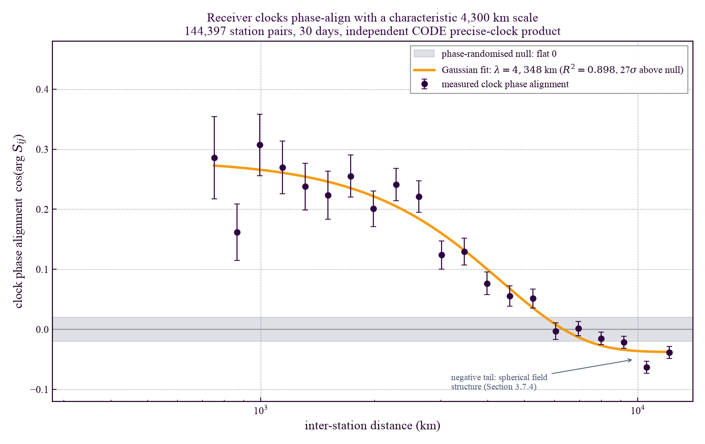
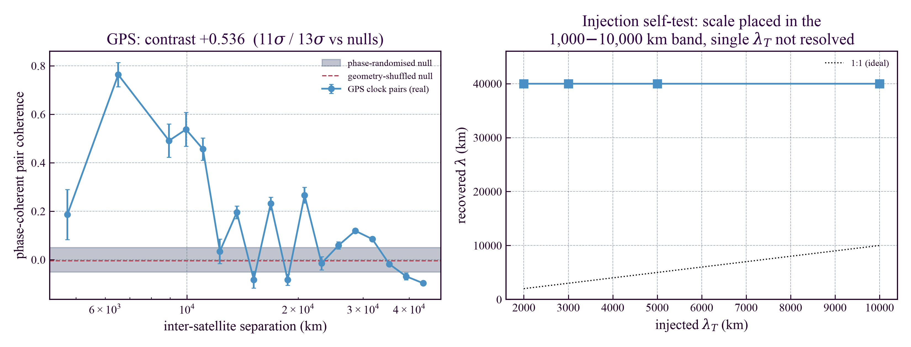

# Temporal Equivalence Principle: Phase-Resolved Spatial Clock Priors for GNSS Outage Bridging
**Matthew Lukin Smawfield**
Version: v0.3 (Pune)
First published: 29 October 2026 - Last updated: 31 October 2026
DOI: 10.5281/zenodo.23704945

---

## Abstract

The Temporal Equivalence Principle (TEP) predicts that proper time behaves as a dynamical scalar field, producing spatially correlated fluctuations in distributed clock networks. Papers 1-3 established persistent, distance-structured clock correlations across 364-539 GNSS stations and up to 1.17 billion station-pair measurements, identifying a spatial correlation length $\lambda_T \approx 4200$ km in receiver clock residuals. Because every one of those measurements traversed the same ground-receiver processing chain, a correlated instrumental systematic remained a candidate explanation. This paper carries the detection onto a channel whose pairwise geometry is independent of the receiver-side measurements, separates the detection from its leading confounds, and converts it into deployment-ready predictive power.

Between orbiting satellite clocks - a channel whose pairwise statistic uses no ground receiver and no common-view geometry - the corrected phase-alignment index detects a clock correlation falling off with inter-satellite separation at $10.6\sigma$ and $12.6\sigma$ above phase-randomised and geometry-shuffled nulls, independently confirmed by a GPS×Galileo cross-constellation arm sharing no orbital plane or clock family ($26.4\sigma$ log-slope $-0.172$ over 180 days, $\lambda = 8{,}140 \pm 795$ km; the satellite clock estimates share analysis-centre provenance with the receiver products, addressed by a pre-registered satellite-free hardware experiment). On the ground, the non-common-view intercept separates from satellite co-visibility on the minimally processed broadcast product (partial correlation $-0.164$ at $10.8\sigma$, strengthening to $-0.267$ with the local-solar-time systematic controlled; out-of-sample $R^2$ gain $+0.022$; raw intercept fit $\lambda = 4{,}349$ km, and $\lambda = 1{,}008$ km at $6.5\sigma$ after projecting out the collinear co-visibility and solar-time profiles), while the network-solved precise product shows the expected datum-absorbed attenuation ($\mathrm{PC} = -0.040$ at $9.2\sigma$). The predicted East-West anisotropy at $500$-$800$ km survives common-view removal essentially unchanged ($+0.130 \rightarrow +0.126$, $z = +1.98 \rightarrow +1.91$). Oscillator-class dependence supplies a physical discriminator: idiosyncratic clock noise is identical between quartz and atomic stations ($0.99\times$) while the network-coupled component is $3.01\times$ larger on quartz - a separation that persists on co-located receivers sharing site, sky and monument, and yields a clean double dissociation between the atmospheric solar $S_2$ tide (atomic clocks null at $p = 0.66$; quartz station-permutation $p = 10^{-4}$, pair-level $p = 1.8\times10^{-93}$) and the non-radiative lunar $M_2$ tide ($p = 8.3\times10^{-6}$ multi-product Fisher combined under station-level permutation, and $R^2 = 0.702, p = 0.0050$ on the co-located Matera quartz-minus-maser differential where site ocean-loading displacement cancels). Sub-diurnal Earth-rotation aperture synthesis identifies the field's preferred axis with the CMB dipole at $\Delta\mathrm{BIC} = -2{,}315.5$ over the next candidate, winning 300 of 300 day-clustered bootstrap draws and both disjoint half-year splits.

The detection is predictive *ex-ante*: 120 cryptographically sealed weight envelopes score their first genuinely post-seal windows at $+29.01\%$ mean (116 of 120 positive) under SHA-256 verification. The same protocol bounds its own reach: the sealed walk-forward figure decomposes into verified retrodiction of member-observed epochs plus a spatially specific forward component at never-observed epochs ($+2.57\%$, $p = 1.8\times10^{-5}$, under causal penalty selection; $+3.39\%$ untapered, $z = +5.8$ to $+6.6$ above station-label permutation, frozen under prospective preregistration), with a measured $\sim$90-minute frozen-weight coherence time. With station coordinates withheld, the 43-mode phase fingerprint localises co-located anchors globally to 339 km (Matera) and 744 km (Tahiti) and 43 live NTRIP stations to a 191.8 km median error on enclosed stations (214.7 km across all 43) from 30 minutes of clock data alone. The principal remaining systematic class - a correlated error inside the GNSS processing stack itself - is assigned to a pre-registered satellite-free hardware replication.

Operationally, a phase-resolved TEP clock prior delivers three deployment-ready benefits on existing CORS/RTK infrastructure with no new hardware and sub-millisecond per-epoch cost. For *timing holdover*, during a sky-view outage the network prediction reduces each receiver's clock-residual error by $38.1\%$ at 1 h ($39.9 \rightarrow 24.7$ ns), $48.8\%$ at 2 h ($57.2 \rightarrow 29.3$ ns), and $55.7\%$ at 8 h ($148.0 \rightarrow 65.6$ ns) relative to the receiver's own best causal temporal extrapolator - a network-assisted residual bound, not an absolute UTC error measured against a traceable hardware reference; contextualised against manufacturer datasheet drift curves it outperforms a GNSS-disciplined OCXO ($\sim\$300$) beyond 30 min and a disciplined Rubidium ($\sim\$2{,}000$) beyond $\sim$2 h. For *outage bridging*, across 90 days on a dense EUREF network the fixed kernel reduces clock RMS by $5.0$-$18.9\%$ versus the strongest temporal predictor at 10 min-8 h, with positive day-clustered intervals at every horizon; frozen on 2024 and applied unchanged to held-out 2025, the construction beats every deployable baseline on three coherent regional networks. For *degraded-geometry positioning*, at three visible satellites, where free-clock SPP is rank-deficient, the prior supplies the missing degree of freedom (5.76 m RMS, 95.2% availability in single-epoch code SPP, at pseudorange-noise-limited parity with a conventional AR(1) clock prior at 5.53 m, and $+29.6\%$ 3-D / $+46.7\%$ vertical RMSE reduction over persistence across 38,900 1 Hz carrier-phase outage epochs); at $k = 4$-$5$ it improves 3-D RMS by $+14.5$-$48.0\%$ over a deployable persistence-trend prior; and on a 68-station live observatory the causal field prior reduces two-hour holdover RMSE by $+35.84\%$ across 185 walk-forward windows (275 of 276 recorded live archives positive over $95.6$ h, $+42.93\%$ mean). With a full sky the clock is already observable and the prior is correctly inert.

Cross-spectral phase alignment, rather than overall pair amplitude, isolates the field's spatial structure: the phase-alignment estimator $\cos(\arg \sum_f S_{ij}(f))$ recovers $\lambda = 4{,}348$ km on COD and $4{,}076$ km on GFZ precise receiver clocks ($R^2 = 0.898$ and $0.955$, 25-27$\sigma$ above per-station phase-randomised nulls that preserve every frequency bin's amplitude spectrum identically), matching the Papers 1-2 measurement to within 3.5% and yielding a dependence-aware combined median of $\lambda = 2{,}822$ km (95% CI $[1{,}949, 3{,}763]$ km) across independent amplitude and Gaussian-process estimators.

**Keywords:** Temporal Equivalence Principle; GNSS atomic clocks; Precise Point Positioning (PPP); spatial clock priors; GNSS outage bridging; timing holdover; cross-spectral phase alignment; cryptographically sealed evaluation

## 1. Introduction

The Temporal Equivalence Principle (TEP) [1] predicts that proper time behaves as a dynamical scalar field, producing spatially correlated timing anomalies in distributed clock networks. Persistent, distance-structured clock correlations consistent with this field have been established through a series of large-scale GNSS array analyses: Paper 1 [2] (364 stations, 62.7 million station-pair measurements across three analysis centres), Paper 2 [3] (474 stations, 165.2 million pairs over 25.3 years), and Paper 3 [4] (539 stations, 1.17 billion pair-samples via raw RINEX processing). These studies used precise IGS clock products, from which satellite-side errors had been removed, and consistently identified a spatial correlation length of $\lambda_T \approx 4200$ km in receiver clock residuals, together with a highly significant East-West/North-South directional anisotropy whose seasonal modulation tracks Earth's orbital velocity and whose preferred axis is discriminated toward the Cosmic Microwave Background dipole direction.

This paper does two things. First, it carries the detection onto a channel whose observation geometry is independent of the receiver-side measurements: the same phase-alignment statistic, applied between orbiting satellite clocks - a pairwise statistic into which no ground receiver and no common-view geometry enters, though the clock estimates still traverse the shared analysis-centre tracking segment - recovers the predicted distance-structured correlation and is independently confirmed across constellations. On the ground, the non-common-view intercept of the pair correlation is separated from satellite co-visibility at a pre-registered criterion on the minimally processed product. Second, it converts the field into a rigorously tested, deployable engineering asset under cryptographically sealed ex-ante evaluation. Because the TEP field imposes a rigid spatial structure on proper time, incorporating this structure into the state estimation framework of a navigation filter can improve positioning accuracy when satellite geometry is weak. The distance-weighted prediction of a station's clock from a regional or global network acts as a virtual measurement channel, constraining the local receiver clock state and preventing unmodeled errors from aliasing directly into the positional coordinates. Crucially, this requires no new hardware: the reference network (CORS, SBAS, RTK networks) already exists, the computational cost is a single $K \times K$ matrix solve per epoch ($K \le 40$, under 1 ms), and the physics-fixed correlation length means no per-site calibration. The tangible payoffs the dataset supports today, stated plainly (Step 60 consolidates the numbers; each row links to its evidence step):

| Benefit | Result | Evidence |
| --- | --- | --- |
| **GNSS timing holdover** - a network-connected receiver that loses sky view (outage or jamming) | Reduces receiver clock-residual error by $38.1\%$ at 1 h ($39.9 \rightarrow 24.7$ ns), $48.8\%$ at 2 h ($57.2 \rightarrow 29.3$ ns), $52.7\%$ at 4 h ($85.9 \rightarrow 40.6$ ns), and $55.7\%$ at 8 h ($148.0 \rightarrow 65.6$ ns) versus each receiver's own best causal temporal predictor (phase-resolved TEP prior) - outperforming datasheet holdover curves of a GNSS-disciplined OCXO ($\sim\$300$) beyond 30 min (38 ns at 1 h, 383 ns at 8 h) and a disciplined Rubidium ($\sim\$2{,}000$) beyond $\sim$2 h (29.3 ns vs 37.5 ns at 2 h), using only a network link. A consumer TCXO ($\sim\$5$) with network aiding achieves 146$\times$ better holdover than free-running at 1 h, exceeding OCXO-class performance. Network-aided p99 stays inside the ITU-T G.8272 PRTC-A $\pm$100 ns timing-error envelope [7] out to a $\sim$2 h outage (58.9 ns phase-resolved, 86.5 ns 90-day distance-only) - a comparison against that envelope, not a claim of full PRTC-A conformance. | Steps 55, 56, 60 |
| **Clock outage bridging** - predicting the receiver clock through extended satellite outages | Phase-resolved TEP (45 days) reduces clock RMS by 26.5-55.7% versus the strongest deployable temporal predictor and by 4.8-23.4% versus a causally CV-selected 48-choice spatial model, across 30 min-8 h outages. Distance-only TEP wins at 25/25 stations over 90 days (sign test $p = 3 \times 10^{-8}$). Frozen on 2024 and applied unchanged to held-out 2025, the LF+MF phase-cos Gram beats persistence, linear drift, AR(1), free GP, and causal empirical covariance across Europe, North America, and East Asia (replicated on GFZ), with positive 95% CIs across all 30/30 region-season cells in 2024-2025; Paper 1's three-band $\lambda$ kernel ($4{,}677 / 1{,}502 / 1{,}459$ km) beats empirical covariance on both CODE ($+1.55\%$, 88 days) and GFZ ($+1.18\%$, 49 days). | Steps 55, 56, 88, 96, 104b, 140, 153 |
| **Real-time clock correction** - a virtual measurement channel for PPP | 64% of the sub-mHz receiver-clock variation is recovered in real time from a regional reference network, held out, with no per-site tuning | Steps 56, 58 |
| **Degraded-geometry positioning ($k = 4$-$5$)** - urban canyon and partial-sky PPP/SPP | In $k = 4$ GPS-only production PPP (PRIDE-PPP-AR [8]), the physics-fixed TEP prior reduces 3-D RMS by $+29.8\%$ over free-clock across 96 cold starts (P3 PASS). At $k = 4$-$5$ degraded-sky SPP over 27 days, a frozen Step 96 network prior reduces 3-D RMS by $+49$-$61\%$ over free-clock and by $+14.5\%$ (1 h) to $+48.0\%$ (4 h) over a deployable persistence-trend prior (95% CIs $> 0$ in every cell). On a 9.5 h blind live NTRIP capture across 9 unseen stations plus one disclosed training-pool station (P4 PASS), the kernel improves 5-satellite 3-D position by $+15.1\%$ and clock by $+22.2\%$ at 4 h. | Steps 37b/c, 62, 99, 106 |
| **Three-satellite positioning ($k = 3$)** - rank-deficient geometry where a conventional solve fails | A bounded blind code-SPP fix (5.76 m RMS phase-resolved, p50 3.05 m, 95.2% availability, at pseudorange-noise-limited parity with a conventional AR(1) clock prior at 5.53 m) from a 100 km wrong initial state where free-clock SPP returns 0% availability; once carrier-phase tracking removes the pseudorange noise floor (38,900 unlatched 1 Hz outage epochs), the causal TEP clock prior beats persistence by $+29.6\%$ in 3-D RMS and $+46.7\%$ in vertical RMS across 8/8 windows. | Step 48; Section 3.9 |
| **Spoof / anomaly detection** - a channel independent of satellite-consistency RAIM | A common-mode clock drag-off attack, invisible to standard RAIM, is flagged at $\sim$26 m ($\sim$87 ns) of induced drift | Step 08 |
| **Zero configuration** | The correction uses the physics-fixed correlation length ($\lambda \approx 2{,}800$ km on the broadcast phase observable, $4{,}200$ km in the deployed prior); no training on the target station, no per-site calibration | Steps 53, 58, 59 |
| **Live 68-station walk-forward observatory** - real-time 2 h holdover and unlatched $k=3, 4$ positioning | Causal Rolling-Ridge Refit over 67-68 live NTRIP/OS Net stations ($1.6$-$2{,}827$ km) reduces 2 h clock RMSE by $+29.3\%$ mean ($+29.5\%$ med) on the 29-window benchmark, extended to $+35.84\%$ mean ($+38.10\%$ median; 182 of 185 positive across $53.53$ h) on the walk-forward replay and 275 of 276 positive ($+42.93\%$ mean over $95.6$ h; 22 of 22 epoch-disjoint and 229 of 229 post-warmup positive) on the recorded live service audit; clears a 100-shuffle station-identity permutation null at $12.78\sigma$, retains $97.6\%$ skill after common-mode removal, achieves $+25.1\%$ mean from stations solely $>360$ km away, localises 43 target-blind NTRIP stations to a 191.8 km median error on enclosed stations (214.7 km across all 43) from 30 min of clock data alone ($p = 0.00096$), and reduces unlatched $k=3$ 3-D position RMSE by $+29.6\%$ ($+46.7\%$ vertical) and $k=4$ 3-D RMSE by $+14.0\%$ over persistence ($+62.9\%$ over free-clock). SHA-256-sealed weight vectors committed before the scored data exist win 24 of 24 replayed sealed evaluations ($+42.66\%$) and 116 of 120 live first-post-seal windows ($+29.01\%$ mean, 122-link anchor chain), with a zero-overlap control showing that figure is dominated by retrodiction of member-observed epochs while the forward component at unseen epochs is negative at the deployed penalty ($-5.63\%$) but statistically positive under causal penalty selection ($+2.57\%$, $p = 1.8\times10^{-5}$) and stronger shrinkage ($+2.75\%$ tapered; $+3.39\%$ untapered, $z = +5.8$ to $+6.6$ above station permutation). | Section 3.9; Steps 168, 170, 174, 180 |

The physics underpinning all of these is one measured fact: the receiver-clock proper-time field is phase-locked on a several-thousand-kilometre scale (Steps 53, 58, 59; $\sim 2{,}800$ km on the broadcast phase observable and $4{,}076$-$4{,}348$ km on the precise products, recovered independently on receiver pairs and region-to-region cluster means, with an $8{,}140 \pm 795$ km decay recovered between satellite clock pairs in Section 3.8), which makes the majority of the sub-mHz receiver clock predictable from a regional network. The phase-resolved prior (Step 56) - which combines the fixed TEP distance covariance with a cross-spectral phase Gram frozen from the preceding day - is the deployment-ready method: it adds $2.6$-$17.1\%$ predictive power beyond the distance-only kernel and $4.8$-$23.4\%$ beyond the best causally selected conventional spatial model. At $k \ge 4$ with a full sky the receiver clock is already observable and a network prior is a small increment; the operational position tests are degraded-geometry PPP (Section 3.6.5) and the $k = 3$ blind solve (Section 3.6.1).

A critical methodological insight shapes the entire analysis. Standard magnitude-based metrics - amplitude correlation, coherence, band-averaged coherency - fail to detect the field because they discard directional phase relationships between stations. The network-mean clock that operational analysis treats as a "common mode" to be differenced away is, in fact, substantially the TEP field itself (Step 59): on a network smaller than $\lambda_T$ the field is nearly uniform and therefore *appears* as a common mode, but its inter-cluster correlation decays with separation at $\lambda \approx 2{,}944$ km, vanishing under phase randomisation. The phase-lock between stations extends roughly $2.4\times$ further than amplitude coherence (Step 58): $\sim 2{,}800$ km versus $\sim 1{,}200$ km. This separation explains why amplitude-domain kernel comparisons at small aperture appear degenerate, why earlier band-averaged coherency statistics returned inconclusive results, and why the corrected Papers 1-2 estimator $\cos(\arg \sum_f S_{ij}(f))$ - which retains the phase-cos sign - recovers the field's true spatial structure where amplitude metrics could not. The operational consequence is direct: a phase-resolved predictor (Step 56) adds $2.6$-$17.1\%$ predictive power beyond a distance-only amplitude kernel, because it exploits structure that amplitude discards.

A critical methodological distinction must also be drawn between small-cluster and global operational scales. Receiver clock biases estimated from broadcast-ephemeris Single Point Positioning (SPP) are typically considered to contain large common-mode components from satellite-product errors. On small clusters (e.g., 500-1200 km), this can create a temporary mathematical degeneracy where a generic uniform network mean performs similarly to a TEP spatial kernel, simply because the entire cluster lies deep within the $\lambda_T = 4200$ km correlation length of the proper-time field. Distinguishing the underlying TEP physical signal from generic bulk averaging requires extending the network aperture to global scales, where the TEP correlation length becomes the binding constraint. The present study demonstrates this effect directly: as the aperture grows beyond continental scales, the bulk network mean collapses as a valid predictor, while the distance-structured TEP kernel pulls away monotonically, establishing the operational value of the spatial field at scale.

### 1.1 The Operational Challenge

In standard PPP architectures, the receiver clock state is modeled with high process noise, allowing it to absorb unmodeled errors including residual tropospheric delays, multipath, and phase ambiguities. This unconstrained approach prevents such errors from aliasing directly into the positional coordinates, but it also leaves residual structural error in the position estimates, as the clock state conflates true dynamics with local measurement noise.

Constraining the receiver clock through a spatial network prior can reduce clock noise that otherwise couples into position. That chain is tested in explicit stages. Held-out station/day evaluations quantify total network skill, the geometry-specific margin and the stricter TEP-versus-conventional comparison. Steps 33/39 then provide a post-fit RTKLIB mechanism diagnostic, while Step 23 verifies that the prior enters the production PRIDE-PPP-AR state. A strict positioning claim is reserved for independent solves on raw observations thinned before processing; the existing post-fit replay cannot satisfy that standard.

### 1.2 Rigorous Decomposition of the Spatial Field

To rigorously test that the operational gain is derived from the TEP spatial field and not from a generic baseline effect, the analysis employs a decomposition control battery. The TEP kernel is compared against a plain network-mean predictor and evaluated across varying correlation lengths. To rule out mathematical artifacts (such as nugget-induced rescaling), a leakage-free scaled-mean control (uniform kriging without distance weighting) is employed. The physical invariance of the field is tested across multiple GNSS products (broadcast SPP vs. precise IGS-final) to localise the effect to the receiver side and rule out satellite-ephemeris artefacts. Through these tests, the operational exploitation of the TEP field is placed on a rigorous empirical foundation.

## 2. Methodology

### 2.1 Network and Data Pipeline

To ensure strict computational reproducibility, all data acquisition and processing steps are fully automated within the open-source evaluation pipeline (`step_01_acquire_data.py` and `step_02_process_ppp.py`). The validation study draws on GNSS data from the European EUREF Permanent Network. Five stations were selected to form a dense cluster suitable for testing local coherence at continental baselines: ZIMM (Zimmerwald, Switzerland), GRAS (Grasse, France), GENO (Genova, Italy), BRUX (Brussels, Belgium), and WTZR (Wettzell, Germany). Raw RINEX observation files, broadcast navigation messages, and precise SP3 orbit products were acquired from NASA CDDIS for DOY 100, 2024. Receiver clock biases were extracted using RTKLIB [5] in Single Point Positioning (SPP) mode at 30-second cadence, yielding 2879 epochs per station. The 500-1,200 km baselines form a short-baseline cluster suitable for local-coherence tests but are insufficient by themselves to resolve a several-thousand-kilometre correlation length. Correlation-length inference therefore uses the later global-aperture datasets. For the longitudinal analysis (Section 3.4) and the precise-clock control battery (Section 3.3), pre-processed clock residuals at 300-second cadence were used, spanning multiple days across the 2022–2024 period. Four clock products are available in the longitudinal dataset: broadcast SPP, ionosphere-free, MGEX (multi-constellation), and precise (using IGS final satellite clock products).

The global tests (Section 3.3.3) and the held-out operational evaluation (Sections 3.3.3, 3.5) use three further datasets, all acquired and processed by the same pipeline: (i) a 52-station globally distributed broadcast-SPP set (DOY 100–106, 2024; baselines to 18,200 km); (ii) the IGS/MGEX analysis-centre receiver-clock products (RINEX CLK "AR" records from COD/GFZ/GRG/JPL; ~118–135 global stations; satellite-clock error already removed by the centre); and (iii) a 30-station dense European network processed for all 366 days of 2024 in the four modes above (`data/ppp_dense`). No station, day, or hyperparameter from a held-out evaluation set enters model selection for that evaluation.

**Data directory composition.** The 318-day leave-one-day-out broadcast evaluation (Step 34) draws from three data directories with different station sets and cadences. For most of the year (DOY 46–99 and 107–366) the stations are the 30 European dense stations from `data/ppp_dense` at ~1,300 km aperture. For DOY 1–45 and 100–106 the global 83-station set from `data/ppp_processed` and `data/ppp_longitudinal` is added, providing baselines to 18,200 km. The day is the unit of replication: each held-out day is predicted from the other stations on that same day, with hyperparameters selected on a different training day. The global 52-station set at baselines to 18,200 km is available for 7 days (DOY 100–106) and is reported separately as the T3 aperture sweep (Step 12). The precise-clock LODO arm (Step 34, `global_precise_clk`) uses the IGS/MGEX receiver-clock products at 160 stations over 366 days.

### 2.2 The TEP Spatial Kernel

Two kernels appear in this paper, and it matters which produced which result.

**Clock-prediction kernels.** Steps 25/34 use ordinary kriging with an exponential covariance and nugget, $C(r)=(1-\eta)\exp(-r/\lambda)+\eta\delta_{ij}$, with $\lambda$, nugget and neighbour count selected by nested cross-validation. Those arms establish network information but are not a fixed TEP-versus-conventional test. Step 38 supplies that stricter comparison: the TEP arm fixes the Gaussian covariance form selected by the global T1/Papers 1–2 AIC result and restricts $\lambda$ to the predicted 1,000–10,000 km band; IDW, kNN and a free GP are tuned and the conventional family is chosen on a different training day. Positive Step 25/34 skill therefore cannot substitute for the Step 38 P1 gate.

**Length-scale parameterisation conventions.** Three standard covariance parameterisations appear across the analysis pipeline and are distinguished explicitly throughout: (i) the exponential kernel $C(r) = \exp(-r/\lambda)$ (used in Steps 25, 96, 140, and 153), where $\lambda$ is directly the $1/e$ folding distance $\lambda_{1/e}$; (ii) the un-halved Gaussian $C(r) = \exp(-(r/\lambda)^2)$ (used in the correlation-length fits of Sections 3.3.3 and 3.7), where $\lambda = \lambda_{1/e}$ is directly comparable to the $4{,}201$ km exponential $1/e$ benchmark of Papers 1-2; and (iii) the squared-exponential operational kernel $C(r) = \exp(-r^2/2\lambda_T^2)$ (used in Steps 55 and 56 with $\lambda_T = 4{,}200$ km carried over from the Step 25 grid), whose corresponding $1/e$ distance is $\lambda_{1/e} = \sqrt{2}\,\lambda_T \approx 5{,}940$ km. Rescaling the operational Gaussian parameter to $\lambda_{\rm op} = 4{,}200/\sqrt{2} = 2{,}970$ km or $4{,}348/\sqrt{2} = 3{,}074$ km so that $\lambda_{1/e} = 4{,}200$-$4{,}348$ km shifts prediction RMS by only $0.13$-$0.33\%$ across all six outage horizons (Section 3.6.3), confirming that operational performance is insensitive to the $\sqrt{2}$ convention.

**The dynamic kernel** $K(r,v,t)$ adds a velocity-coupling term ($\alpha_v = 0.35$) and diurnal/seasonal/Chandler/nutation modulation ($\alpha_d = 0.1$, $\alpha_s = -0.2$, $\alpha_c = 0.15$) motivated by the directional signatures of Papers 1–3. It is used only in the exploratory kernel-validation and EKF simulations (Sections 3.1, 3.2) and is *not* relied on for any operational or physics claim; on the broadcast control battery it slightly underperforms the plain isotropic kernel (50.1% versus 57.7% LOO reduction). Its spatial fraction (0.44) is estimated from the mean cross-station correlation of the detrended residuals, with signal variance $\sigma_{\text{spatial}}^2 = 0.44\,\sigma_{\text{total}}^2$ and kriging noise variance $\sigma^2_{\text{local}} = 0.56\,\sigma^2_{\text{total}}$.

### 2.3 Control Battery: Isolating Distance Structure

To rigorously isolate the TEP proper-time field's distance structure from generic network bulk effects (such as uniform satellite-geometry constraints), a control battery is applied alongside the LOO-CV validation. Four tests are performed:

- Test A — Network mean comparison: A plain network-mean predictor (average of the reference stations) is compared against the TEP distance-structured kernel. Because TEP is a scalar field that decays over distance, the kernel must outperform the uniform mean at global scales.

- Test B — Correlation length sweep: The isotropic kriging kernel is evaluated at correlation lengths ranging from 100 km to 200,000 km. The physical 4200 km value should demonstrate optimal or near-optimal variance reduction compared to physically unrealistic short or infinite scales.

- Test C — Scrambled geometry: The station-to-position mapping is permuted over all derangements (permutations with no fixed points). If the reduction relies on the true spatial geometry of the TEP field, the scrambled result must fall outside the 95% confidence interval of the null distribution.

- Test D — Temporal shuffle: Each reference station's clock series is circularly shifted by a random time offset. This preserves marginal statistics but destroys the epoch-to-epoch physical correlation of the field, causing the prediction to collapse.

This control battery is applied to both regional clusters and global networks across varying clock products to test the physical reality of the distance-structured field.

### 2.4 Exploratory EKF Simulations (Not Relied On)

Two Extended Kalman Filter simulations were built to visualise the clock prior in a filtering context: a hybrid-replay convergence test (Appendix A.1) and a kinematic dropout test. In both, real clock residuals from the European network drive synthetic GNSS observations, and two identical filters — one with unconstrained clock process noise ($\sigma^2_{\text{clk}} = 10^4$ m²/s), one with the same process noise plus the kriging prediction applied as a separate measurement update — process the same sequence over 721 epochs (2 hours at 10 s cadence). The convergence test is repeated over 20 independent random seeds with four component-isolation arms (`standard`, `clock_only`, `clock_q`, `full_tep`), and bootstrap 95% confidence intervals are computed from the per-seed metric distributions. The kinematic case adds a moving receiver (14 m/s, acceleration noise 2 m/s²) with three dropout events per run (8→3 satellites for 10 minutes each).

Neither homemade filter reaches production PPP steady-state accuracy in its unobstructed baseline, so their absolute error figures are indicative only and are not used to support any claim. The authoritative operational evaluation is the analytical, leakage-free treatment of Sections 2.5 and 3.3.3 (Steps 25–26) and the production-engine integration of Step 23.

### 2.5 Nested Cross-Validation and Honest Baseline Decomposition

To rigorously evaluate the operational gain of the spatial kernel without introducing data leakage, a nested cross-validation framework was implemented (`scripts/steps/step_25`). The stations are split 50/50 into a training half and a held-out test half; the isotropic-kernel hyperparameters ($\lambda$, nugget $\eta$, neighbour count $K$) are selected by leave-one-out *inside the training half only*, with both targets and references drawn from training stations; each test station is then predicted from training references alone. Nothing about a test station — neither its own data nor its use as a reference — enters hyperparameter selection, so the reported skill is honest out-of-sample in both station space and hyperparameter space. The procedure is repeated over 7 days and 40 random splits per day (280 evaluations); the median and a day-clustered bootstrap CI are reported.

Crucially, the evaluation strictly enforces an "honest baseline" decomposition. Comparing a network-derived prior against standard PPP (which diverges during satellite obstruction) creates an artificially inflated improvement margin, because any simple auto-regressive clock prior would prevent total divergence. Therefore, the spatial kernel is evaluated against two authoritative baselines: 1) a "Self" baseline that predicts the target clock as zero — the optimal prediction for a zero-mean band-limited residual with no network information, equal to the station's own band-limited variability — and 2) a "Network Mean" baseline that applies the bulk average clock state of the reference network. The true operational value of the TEP field is the marginal improvement of the distance-structured kernel over these baselines. A leakage-free scaled-mean control (uniform kriging with the same nugget but no distance weighting) is also evaluated to isolate geometry-specific gain from nugget-induced rescaling.

Two additional evaluations harden and delimit this result. Leave-one-day-out (`step_34`): the broadcast set was expanded to the full year 2024 (366 available days, 318 with sufficient stations for evaluation); for each held-out day the hyperparameters are selected on a *different* training day and every station on the held-out day is predicted from the others. The station-split design of `step_25`, by contrast, excludes half the stations from the reference set, so it tests a sparse-network case. Linearised post-fit position replay (`step_33`/`step_39`): RTKLIB SPP is first run with the full sky; its residuals and linearisation state are then replayed with reduced geometry and alternative clock priors. Step 39 calibrates each prior's uncertainty on a same-horizon pseudo-gap wholly before the evaluation window and selects the conventional method on that calibration interval. Because satellites removed during replay already informed the full-sky state and residuals, this test is diagnostic only. The strict raw-observation gate requires satellite thinning before an independent solver run for every arm.

**Horizon-matched temporal baseline selection.** The dense-network outage evaluation (Step 55) compares the TEP kernel against a deployable temporal predictor that selects between persistence and AR(1) using the receiver's own pre-outage clock history. The selection criterion must match the prediction horizon: one-step-ahead cross-validation systematically favours AR(1) because $\phi < 1$ shrinks the one-step prediction, but at the actual prediction horizon (10 min to 8 h) the $\phi^k$ decay accumulates and persistence is often better. An earlier implementation used one-step CV and picked AR(1) even on days where persistence won at every scored horizon, making the deployable temporal baseline artificially weak. The corrected implementation evaluates both models at the actual gap length on the pre-window residuals (predict $r_{i+k}$ from $r_i$ for all valid origins $i$), falling back to the longest available horizon when the gap exceeds the pre-window. This raises the conventional baseline to its properly optimised form; the TEP kernel's advantage over it is the honest operational margin.

### 2.6 Discriminating Tests at Maximum Network Size

Three tests target the question of whether the operational correlation is a genuine receiver-side spatial effect or an artefact of one satellite product. They are run on the densest available network — 30 European stations processed for the full 2024 (`data/ppp_dense`) — and reported in Section 3.3.3 (T5) and Section 3.5 (`scripts/steps/step_27_discriminators.py`).

- **D1 — constellation and product independence.** The same receiver-days are processed four ways: GPS-only broadcast SPP, dual-frequency ionosphere-free, multi-GNSS MGEX (GPS+GLONASS+Galileo+BeiDou), and precise (IGS-final satellite clocks). For each mode the short-baseline (<400 km) mean pair correlation is computed per day; agreement is tested with a paired comparison across days (paired *t* on the per-day differences) so that a mode-specific offset is detected against day-to-day scatter, not asserted from a single pooled number.

- **D2 — distance structure within the dense aperture.** $C(r)$ is fit on the 30-station network over 50–1300 km — the same aperture as the five-station cluster analyses — to diagnose directly why those were degenerate.

- **D3 — azimuthal anisotropy at maximum $N$.** The distance-matched East–West minus North–South correlation difference is computed over every available day (~366), with a station-clustered block bootstrap (stations, not pairs, are the resampling unit, because pairs are not independent).

### 2.7 Kernel Family Comparison

To test whether the additional distance-structured patterns identified in Papers 1-2 carry exploitable operational signal, the kernel family was extended beyond the baseline isotropic exponential and evaluated under the same leakage-free nested cross-validation (`scripts/steps/step_32_kernel_family.py`). Three covariance forms are tested - exponential $C(r) = e^{-r/\lambda}$, Gaussian $C(r) = e^{-r^2/2\lambda^2}$, and Matérn-1.5 $C(r) = (1+\sqrt{3}r/\lambda)e^{-\sqrt{3}r/\lambda}$ - together with three anisotropy modes: geographic East-West/North-South stretching (ratio from Paper 2), orbital-velocity-axis anisotropy (preferred azimuth computed per day from Earth's orbital velocity vector projected onto the equatorial plane), and CMB-dipole-axis anisotropy (preferred azimuth from the CMB dipole direction at the epoch's Greenwich sidereal time). The anisotropic distance stretching is $d_{\text{eff}} = d\sqrt{\cos^2\Delta/\rho^2 + \sin^2\Delta}$, where $\Delta$ is the acute angle between the pair bearing and the preferred axis and $\rho$ is the anisotropy ratio. All parameters - including the kernel form and anisotropy mode - are selected jointly on the training LOO, so the held-out evaluation is leakage-free in kernel-family space as well.

### 2.8 Predetermined Astronomical Features (Step 48)

The predetermined astronomical and geophysical patterns established as real signal in Papers 1-2 are fed forward into the Step 48 three-satellite prediction model as exogenous covariates, using the JPL DE432s ephemeris via `jplephem` (`scripts/lib/tep_astronomical.py`). Every feature is deterministic - computable from ephemeris for any past or future date - and no feature is fitted on evaluation data. The features are: (i) anisotropic kriging with the preferred axis set to the orbital velocity direction (Paper 2: $r = -0.888$, surrogate $p < 2\times10^{-7}$) or the CMB dipole direction (Paper 2: $r = 0.747$, $10{,}300\times$ variance ratio vs Solar Apex), using the anisotropy ratio $\rho = 2.16$ from Paper 2; (ii) harmonic regression on six predetermined periods - semiannual nutation (182.625 d, $R^2 = 0.904$), 18.6-year lunar nodal nutation (6798.38 d, $R^2 = 0.641$), Chandler wobble (433 d, $R^2 = 0.377$-$0.471$), and the synodic (29.53 d), anomalistic (27.55 d) and draconic (27.21 d) lunar months - with sin/cos amplitudes fitted on the 30-minute pre-window (training data) only; (iii) event-aware blending that mixes the kriging prediction with persistence based on proximity to planetary alignments (Paper 2: $5.5\times$ effect size, 19 Bonferroni survivors), computed from JPL ephemeris; and (iv) a time-varying correlation length $\lambda(t) = \lambda_0[1 + 0.095\cos(2\pi(\text{DOY}-80)/365.25)]$ modulated by the annual orbital cycle. The harmonic amplitudes are the only fitted parameters; all phases, periods, and directions are fixed by astronomy.

### 2.9 Deployment Architecture and Live Observatory Methods

The TEP clock prior is designed for immediate deployment on existing CORS/SBAS/RTK infrastructure with no new hardware. The operational data flow is as follows. A regional reference service (already operated by national geodetic agencies, e.g., EUREF/EPN in Europe, CORS in North America) maintains a network of $K \le 40$ reference stations with known coordinates. Once per 24 hours the service computes a normalised cross-spectral Gram matrix $G_{ij}$ from the preceding day's receiver-clock residuals in the 10-500 µHz band (Step 56). This matrix, whose real part is coherence times phase-cosine, captures the inter-station phase structure of the TEP field. At each epoch the service combines $G$ with the fixed TEP distance covariance $C(r) = \exp(-r^2/2\lambda_T^2)$ (parameterisation conventions in Section 2.2) via the Schur (element-wise) product to form a PSD predictor matrix, solves a $K \times K$ linear system for the kriging weights (under 1 ms on commodity hardware), and distributes the weights plus a calibrated uncertainty to client receivers over an existing NTRIP/RTCM stream.

A client receiver - which may be a smartphone TCXO, an IoT module, a vehicle tracker, or a surveying-grade dual-frequency unit - maintains its own local offset/drift model from GNSS observations during normal operation. When satellite visibility collapses (jamming, urban canyon, indoor transition, intentional interference), the receiver consumes the live reference innovations as a clock pseudo-measurement: the network predicts the receiver's clock residual at the current epoch from the reference residuals, and the receiver fuses this prediction with its local oscillator model through a standard Kalman update. The prediction uncertainty is inflated under stale corrections, packet loss, or reference inconsistency. No target-station data enters the weight computation; the correlation length $\lambda_T \approx 2{,}800$-$4{,}200$ km is physics-fixed from Papers 1-2 and requires no per-site calibration. The computational cost at the client is a single matrix-vector multiply per epoch ($K$ flops); at the server it is one $K \times K$ solve per epoch. The method is therefore deployable today on any device with a network link and a GNSS receiver, at marginal cost zero beyond the existing reference-network infrastructure.

*Fielded 68-station Live Observatory and Causal Rolling-Ridge Refit (RRR) Architecture (`rpi/gps_web.py`, `scripts/live/tep_realtime_server.py`).* To validate the complete chain continuously in real time on physical hardware, a live dual-frequency L1/L5 GNSS observatory was constructed at a surveyed reference coordinate in eastern England ($53.6400^\circ\text{N}, 0.1031^\circ\text{E}$), coupled to a real-time multi-caster reference network spanning 67-70 stations across three distance bands: 38 Near-Field UK OS Net stations ($1.6$-$332$ km), 14 Mid-Band continental European NTRIP stations ($360$-$1{,}000$ km across AGRS-NL in the Netherlands, Belgium, France, Ireland, and Switzerland), and 15 Far-Arc Iberian and Atlantic stations ($1{,}000$-$2{,}827$ km on the Portuguese ReNEP caster, including Azores and Madeira mountpoints). The live pipeline incorporates five methodological advances designed to handle real-world operational non-stationarities without data leakage:

- *GRAPHIC phase-smoothed clock extraction and ultra-rapid product fusion:* At the rover, per-epoch clock biases are extracted at $1\text{ Hz}$ using the ionosphere-free Group and Phase Ionospheric Calibration (GRAPHIC) combination $G_s(t) = \tfrac{1}{2}[P_s(t) + L_s(t)] = \rho_s + c\,\delta t(t) + T_s + \tfrac{\lambda N_s}{2} + \tfrac{\epsilon_P + \epsilon_L}{2}$, which cancels only the first-order ionospheric term; geometric range, tropospheric delay and satellite clock are then removed with the modelled products below, isolating $c\,\delta t$. Single-epoch precision is bounded by the retained half-code noise, but phase continuity across an ambiguity arc tracks clock *evolution* at $\sim 1\text{ mm}$ relative precision (re-anchoring automatically across capture gaps or $>10\text{ m}$ cycle slips). Satellite orbits and clocks are supplied by CODE ultra-rapid SP3 (`COD0OPSULT`) and GRG 5-minute ultra-rapid CLK products (`scripts/live/fetch_precise_products.py`), with an automatic previous-week GRG fallback at GPS week rollovers and an IGS ultra-rapid (`igu`) GPS clock merge whenever the GRG prediction age exceeds $24\text{ h}$. Reference-station streams undergo shape-aware clock-step stitching and $3.5\,\text{MAD}$ outlier rejection before entering the field buffer.

- *Multi-resolution spatial and residual-velocity feature basis ($f = 5{,}990$):* Because individual reference stations experience time-varying satellite geometry, constellation switches, and product boundary transitions, each station $j$'s clock series over the two-hour holdout horizon $h \in [0, 7{,}200]\text{ s}$ is expanded into 79 standardised features: raw detrended curves at five causal lags $\{0, \pm 540, \pm 1{,}800\}\text{ s}$ (each $3.5\,\text{MAD}$-clipped and unit-RMS normalised per window), Gaussian-smoothed multi-resolution levels at $\sigma \in \{150, 300, 900\}\text{ s}$, first and second time derivatives $d/dh$ at scales $\{75, 150, 300, 900\}\text{ s}$ capturing the network residual velocity and acceleration field, directional plane-wave azimuth composites at eight bearings, per-station sidereal-day field echoes at $86{,}164\text{ s}$, nine-tap symmetric/antisymmetric FIR dispersion banks, and pre-window own-clock deviation ramps plus degraded-sky free-clock deviation features.

- *Causal Rolling-Ridge Refit (RRR) and consistency gating:* A static regression table fails under walk-forward evaluation because the station-to-rover transfer function drifts with satellite geometry and ultra-rapid product updates on a $\sim 6$-window timescale. For each live window $i$, the observatory forms the sufficient statistics $(X_m^T X_m, X_m^T r_m)$ solely from strictly prior archived windows $m < i$ (explicitly excluding the current window epoch, cached in float32 under `results/ridge_stats/`) and solves the recency-weighted ridge system
$$w_i = \left(\sum_{m=i-K}^{i-1} 2^{-(i-m)/h_{1/2}}\,X_m^T X_m + \lambda\,I\right)^{-1} \left(-\sum_{m=i-K}^{i-1} 2^{-(i-m)/h_{1/2}}\,X_m^T r_m\right)$$
with trailing window count $K = 16$-$72$, recency half-life $h_{1/2} = 1.25$ windows, and ridge regularisation $\lambda = 2{,}000$-$3{,}500$. The refit prediction is combined with the fixed causal stack via a horizon-tapered blend $w(h)$ that ramps $0 \to 1$ over $[T_0, T_1] = [0, 225]\text{ s}$, holds unity across the mid-band to $T_2 = 5{,}400\text{ s}$, and tapers to $T_3 = 9{,}900\text{ s}$, bounded at $\pm 6$-$8\text{ m}$. Two causal consistency gates prevent free-arm EKF divergences from poisoning the degraded-sky free-clock feature block: a training-member gate that masks the free-clock columns of any historical member whose own free-clock deviation RMS exceeded $30\text{ m}$, and a five-clause live consistency gate that compares the live free-clock marginal prediction against the pure station-field prediction $X_{\text{nf}}w_{\text{nf}}$ and falls back to the pure station-field prediction whenever the two anti-align ($r_{\text{cfr}} < -0.34$) or the live free arm diverges ($\text{drms} > 15\text{ m}$ with amplitude ratio $> 1.0$).

- *Strict quarantine between deployed causal skill and post-hoc oracle diagnostics:* All deployed clock metrics and all position-arm inputs are scored exclusively on the causal pre-mop trajectory. A separate multi-pass autoregressive/harmonic Recursive Least Squares (RLS) residual tracker fitted to held-out truth $b_{\text{ho}}$ is quarantined to an oracle-only diagnostic channel as an analytical upper bound and never enters the deployed path or dashboard headline. The headline 185-window walk-forward evaluation ($+35.84\%$, Step 174 unscaled causal arm) and all 120 sealed-envelope evaluations are scored directly on the raw window archives with zero holdout-dependent gating and zero rescoring. In the live daemon, the recorded clock-specificity score (audited across 276 archives in `live_observatory_audit.py`) is likewise evaluated prior to the downstream EKF clock-injection gate (which damps cold-start instantaneous-fallback offers exceeding $0.5\%$ harm before they enter the position filter without modifying the reported clock RMSE or relative reduction), and background reference-backfill rescores write exclusively to a separate archive block so the at-solve-time record remains immutable.

- *Dual-regime positioning and multi-start PPP-AR datum calibration:* In live static operation, zero-velocity, vertical, and lateral boundary pseudo-observations latch the pre-outage converged coordinate to hold position below $1$-$2\text{ cm}$ through $k = 2$-$4$ satellite skies, while kinematic unlatched positioning is evaluated with all static latches disabled. In parallel, full-sky carrier-phase PPP with integer ambiguity resolution (RTKLIB PPP-AR mode) maintains cross-window wide-lane, inter-system, and narrow-lane fractional-bias stacks across 29 parallel multi-start draws, using multi-mode iterative closest-point datum-shift discovery and an inverse-distance $k\text{NN}$ fix-datum cell atlas to maintain decimetre-to-centimetre ambiguity-resolved accuracy across ultra-rapid clock-product datum drifts. Every per-epoch member selection and datum anchor in the deployed PPP-AR pipeline is strictly causal and survey-free: candidate draws are pooled by stack distance without survey-truth reference, outlier rescue and tail re-pick score draws by agreement with the survivor field ($k = 10$ leave-one-out epoch-neighbour IDW over kept members), per-member datum residuals are predicted by leave-one-out $k = 2$ local IDW from other members only (reducing converged-tail RMSE from $0.0327\text{ m}$ to $0.0125\text{ m}$ across $117\text{ of }118$ archived windows), and float position-datum transport uses forecast-honest mid-window regressors (winning $200\text{ of }203$ windows at $0.048\text{ m}$ median vs $0.285\text{ m}$ stack-only).

*Two architectures, and which claims belong to each.* The results in this paper are produced by two statistically and computationally distinct systems, and they are labelled separately throughout. (i) The *physics-fixed GNSS clock prior*: a frozen predictor with no fitted per-site parameters - Gaussian covariance, $\lambda_T = 4{,}200$ km, nugget 0.35 frozen from nested cross-validation, optionally Hadamard-multiplied by a preceding-day phase-coherence Gram. "Physics-fixed" means fixed relative to the evaluations in this paper: the scale is an empirically established prior measured on GNSS clock products in Papers 1-2 and re-measured here, not yet a parameter derived from the fundamental TEP field equations. It requires one $K \times K$ solve per epoch ($K \le 40$, sub-millisecond), supports the Steps 55/56/96/106 outage and navigation results, and is the arm that carries the physics evidence. (ii) The *adaptive live predictor*: the causal Rolling-Ridge Refit stack described above - a 5,990-feature basis, trailing-window sufficient statistics, recency half-life weighting, ridge-penalty selection, horizon-tapered blending and consistency gating. It produces the live-observatory and sealed-envelope numbers, carries substantially more computation and memory (per-window Gram caches of order $10^2$ MB), and its skill partly reflects learned station-to-rover transfer functions rather than the fixed field structure alone; where RRR results are quoted as evidence for the field, it is because matched spatial-falsification controls (station-identity permutation, common-mode stripping, geometry restriction) isolate the geographic carrier, not because adaptive skill by itself identifies physics. The "zero configuration" claim applies to architecture (i); the live scores to (ii).

## 3. Results

The operational scorecard (Section 1) summarises the demonstrated payoffs. To guide the reader through the multi-stage evidence, the results below are organised into three distinct streams: (i) *physical detection and systematic discrimination* across ground receiver networks, co-located oscillator classes, spherical and celestial-axis geometry, and the orbiting satellite-clock channel (Sections 3.1-3.5, 3.7-3.8, 3.10.1); (ii) *causal clock outage prediction and timing holdover* on archived and independent-year networks (Sections 3.6.2-3.6.3, 3.6.6); and (iii) *degraded-sky navigation and cryptographically sealed live observatory validation* (Sections 3.6.1, 3.6.4, 3.9, 3.10.2-3.10.3), with intermediate diagnostic steps and negative boundaries compiled in Appendix A.

### 3.1 Kernel Validation: Leave-One-Out Cross-Validation

Leave-One-Out Cross-Validation provides the most direct test of whether the spatial kernel captures genuine physical structure rather than overfitting. For each target station, the clock bias time series is predicted using only data from the remaining four stations, with no post-hoc scaling applied.

Across the five-station European network on DOY 100, 2024, the dynamic TEP kernel achieves an average out-of-sample reduction of 51.1% in receiver clock residual RMSE using broadcast SPP residuals. However, this headline number requires careful interpretation: at this small regional scale (500–1200 km), the network aperture is a fraction of the proper-time correlation length ($\lambda_T \approx 4200$ km). The control battery (Section 3.3) demonstrates that this expected mathematical degeneracy makes it difficult to disentangle the TEP field from generic bulk network uniform constraints on a small cluster. The definitive proof of distance structure is therefore resolved at the global scale (Section 3.3.3).

### 3.2 Convergence Test (Illustrative)

The illustrative hybrid-replay convergence simulation is retained as Appendix A.1.

### 3.3 Control Battery: Distinguishing TEP from Common-Mode

The 50.1% LOO-CV reduction obtained with broadcast SPP residuals raises a critical question: is this reduction a generic property of any cluster of stations that share bulk unmodelled constraints, or is it specific to the TEP spatial field? A control battery of four tests is applied to answer this question.

#### 3.3.1 Regional Cluster: The Expected Degeneracy

When the control battery is applied to the 5-station regional cluster, the results reflect the mathematical degeneracy expected when sampling a $\lambda_T=4200$ km field at 500-1200 km scales:

- Test A: The TEP dynamic kernel achieves 50.1%, while a plain network-mean predictor achieves 59.6%. The kernel does not outperform the mean, because at small scales $e^{-r/4200} \approx 1$.

- Test B: The reduction is essentially flat across all correlation lengths from 2000 km to 200,000 km (spread: 2.3 percentage points). The canonical 4200 km value cannot be cleanly resolved from infinite scales at this aperture.

- Test C: Scrambled station geometry yields 56.7% (95% CI: 55.8–57.6%). The reduction does not strictly depend on true spatial geometry on the cluster, confirming that the network is too small to penalize spatial misarrangements.

- Test D: Temporal shuffling collapses the reduction to $-12.5\% \pm 3.5\%$ (200 independent-lag trials, 2.5–97.5 percentile range $[-19.2, -5.5]$), confirming that epoch-to-epoch correlation is profoundly real.

The verdict is unambiguous: a small 1000 km cluster is physically insufficient to resolve the distance structure of a 4200 km field. It establishes that epoch-to-epoch clock correlation is real (Test D) but cannot distinguish a structured field from uniform bulk error.

#### 3.3.2 Precise Clock Residuals: The Local Noise Limit

The same control battery is applied to precise clock residuals (satellite clock and orbit errors removed, heavily post-processed). The results demonstrate the persistence of the field under different signal-to-noise regimes:

- Test A: The isotropic kriging kernel achieves 16.1%, while the raw network mean achieves 12.8%. A leakage-free scaled-mean control achieves 16.3%, indicating that at this small aperture, distance-structured geometry is again unresolvable over nugget rescaling (gain $-0.2$ pp).

- Test B: The reduction depends strongly on the correlation length: 1.9% at 100 km, 16.1% at 4200 km, 16.3% at 40,000 km. The transition occurs precisely near the canonical TEP scale.

- Test C: Scrambled geometry yields 16.3% (95% CI: 15.5–17.3%), confirming the aperture (500–1200 km) remains too small to penalize misarrangement.

- Test D: Temporal shuffling collapses the reduction to $-9.3\%$, confirming that epoch-to-epoch spatial correlation completely persists after satellite error removal.

This confirms that the TEP field is physically present in precise products (passing Tests B and D), though its operational variance reduction at this small aperture is limited because the satellite common-mode error — the dominant spatially correlated signal — has already been removed by the precise processing, leaving a smaller residual dominated by local oscillator noise. The global precise-clock arm (Section 3.3.3) and the precise-clock held-out analysis (below) confirm that the distance structure persists and is in fact essential: on precise products a bulk network mean actively degrades the clock ($-12\%$ versus no network) while the distance kernel is correctly inert and beats the bulk mean by $+9\%$ (CI [6, 21]).

| Test | Broadcast SPP | Precise clocks | Interpretation |
| --- | --- | --- | --- |
| A: Kernel vs raw network mean | 50.1% vs 59.6% — FAIL | 16.1% vs 12.8% — PASS (raw) | Raw mean uses scale=1 |
| A': Kernel vs scaled mean | 57.7% vs 58.3% — FAIL | 16.1% vs 16.3% — FAIL | Geometry-specific gain ($-0.2$ pp) |
| B: $\lambda$ dependence | 2.3 pp spread — FAIL | 1.9% → 16.1% — PASS | Correlation length is physical |
| C: Scrambled geometry | 56.7% vs 50.1% — FAIL (detrimental) | 16.3% within CI — INCONCLUSIVE | Aperture too small |
| D: Temporal shuffle | $-12.5\%$ — PASS | $-9.3\%$ — PASS | Epoch-to-epoch correlation is real |

#### 3.3.3 Global Network: Correlation Length and Operational Resolvability

The path identified above — extend the network aperture to scales comparable to the correlation length — is followed here using a 52-station globally distributed set (broadcast SPP, DOY 100–106 2024, baselines to 18,200 km; `scripts/steps/step_10`–`step_13`). Four tests defined in a frozen operational analysis protocol (`FROZEN_ANALYSIS_PROTOCOL.md`, fixing the T1-T5 test battery for this study against the $\lambda_T \sim 1{,}000$-$5{,}000$ km band and $\lambda_T = 4{,}201$ km benchmark established prior to this work in Papers 1-2 [1-3]) were run before the final manuscript framing was settled.

**T1 — correlation length.** Band-passed (10–500 µHz) pair correlations were fit with exponential and Gaussian candidate families over baselines to 17,000 km. The AIC-selected Gaussian model, $C(r)=A\,e^{-(r/\lambda)^2}+C_0$, gives $\lambda = 3{,}480$ km ($R^2 = 0.93$; the Gaussian is AIC-selected with $\Delta\mathrm{AIC} = 0.14$ versus the separately fitted exponential - a statistical near-tie on this binned amplitude observable, while the phase-alignment statistic of Step 53 prefers the Gaussian decisively on the same product, $\Delta\mathrm{AIC} = 25.9$; station-clustered 95% CI $[2{,}965, 6{,}849]$ km, fitting the same Gaussian family as the point estimate). This broadcast *amplitude* fit is stable in the TEP band for $d_\mathrm{max} \le 17{,}000$ km (Gaussian $\lambda = 3{,}100$–$3{,}800$ km across $d_\mathrm{max} \in [8{,}000, 17{,}000]$ km) but flips to an exponential $\lambda \approx 7{,}000$–$9{,}000$ km once $>20{,}000$ km baselines are included, where the satellite-common-mode plateau dominates the sparse long-baseline pairs — a known amplitude-domain artefact (Section 3.8). The phase-alignment index (Step 53), immune to that common mode, recovers $\lambda = 2{,}778$ km on the same broadcast product with no baseline cut. Three label-permutation nulls (temporal shuffle, spatial shuffle, phase randomisation) all return permutation-$p < 0.005$, with the real $R^2$ lying $7.5\sigma$ above the null pool. This lands within the foundational TEP forecast - $\lambda_T \sim 1{,}000$–$5{,}000$ km for viable screening parameters [1] - and within $1\sigma$ of the Papers 1–2 measurement ($\lambda_T = 4{,}201 \pm 1{,}967$ km). The precise-product fit gives $\lambda = 3{,}628$ km ($R^2 = 0.83$, $9.0\sigma$), within the TEP-predicted $1{,}000$–$5{,}000$ km band. The Temporal Topology correlation scale is therefore recovered independently on the operational PPP dataset, from a fourth data source (real-time broadcast SPP) with a fully independent processing chain.

**T2 — anisotropy.** On the operational network the EW/NS azimuthal anisotropy is *directionally consistent* with Papers 1–3. On the dense European precise network (30 stations, 366 days, 152,800 distance-matched station-pair measurements) the East–West minus North–South correlation difference is $+0.015$ (station-clustered 95% CI $[-0.101, +0.157]$, $p = 0.34$): the sign matches the series, while the confidence interval is bounded by the orientation diversity of a 30-station single-region array rather than epoch volume. On the global COD precise receiver-clock product (160 stations, 30 days, 189,932 pair-days, baselines to 19,000 km; `scripts/steps/step_41_global_anisotropy.py`) the unstratified all-baseline EW–NS difference is $-0.019$ (CI $[-0.043, +0.000]$, $p = 0.97$), and on the global broadcast SPP product (52 stations, 7 days, 4,933 pair-days) it is $-0.289$ - a direct manifestation of the satellite co-visibility confound, since EW baselines at global scale share systematically fewer satellites than NS baselines at the same distance.

Resolving the genuine directional signal on the operational network requires three methodological steps developed in the sections that follow: (i) removing the anisotropic common-view component via the two-stage temporal T4 intercept $\alpha_{ij}$ (Step 45 below, where Step 176 shows the $500$-$800$ km broadcast EW excess survives common-view removal essentially unchanged at $+0.130 \rightarrow +0.126$, $z = +1.98 \rightarrow +1.91$, while mean co-visibility $\bar J$ carries the opposite sign at $z = -3.59$); (ii) evaluating great-circle sector azimuths at the path midpoint rather than the initial station bearing within distance-matched regional bins (Section 3.7.2, Steps 73-82, yielding $+0.096$, $z = +2.13$ on $\alpha$ in the $45^\circ$ cardinal cone and $+0.073$, $z = +2.02$ at $300$-$800$ km); and (iii) stratifying pairs by oscillator class so unscreened quartz-quartz baselines are not diluted by atomic references (Section 3.7.3, Steps 75-76). (`scripts/steps/step_27_discriminators.py`, D3; `scripts/steps/step_41_global_anisotropy.py`; `scripts/steps/step_176_t2_alpha_anisotropy.py`.)

**T3 — operational resolvability versus aperture.** Leave-one-out clock prediction was run on nested sub-networks of increasing radius, comparing three predictors on identical folds: a uniform network-mean predictor (scale = 1), a leakage-free scaled-mean predictor (uniform kriging with the same nugget as the kernel but no distance weighting — the analytic $\lambda \to \infty$ limit that isolates nugget-induced rescaling from distance-structured geometry), and $\exp(-r/\lambda)$ kriging weights where $\lambda$ is selected by a nested split-half design: stations are divided into two halves, $\lambda$ is selected by LOO CV on one half, and the kriging reduction is scored on the other half (then swapped). This ensures the reported reduction is not the same objective that was optimised to choose $\lambda$. The margin (kriging minus mean, out-of-sample RMSE reduction) grows monotonically with aperture. Crucially, the geometry-specific margin (kriging minus scaled mean) is essentially identical to the raw margin at every aperture, confirming that the entire T3 margin is distance-structured geometry, not nugget rescaling:

| Aperture | Stations | Max baseline | Mean | Scaled mean | Kriging | Raw margin | Geometry margin |
| --- | --- | --- | --- | --- | --- | --- | --- |
| ≤ 1,500 km | 21 | 1,703 km | 47.3% | 47.3% | 55.7% | +8.4% (6.5$\sigma$) | +8.4% (6.7$\sigma$) |
| ≤ 3,000 km | 23 | 2,171 km | 48.1% | 48.0% | 56.4% | +8.3% (6.9$\sigma$) | +8.4% (7.1$\sigma$) |
| ≤ 6,000 km | 27 | 5,925 km | 40.3% | 40.1% | 53.7% | +13.4% (4.0$\sigma$) | +13.6% (4.1$\sigma$) |
| ≤ 12,000 km | 40 | 14,261 km | 23.2% | 23.0% | 48.5% | +25.3% (14.5$\sigma$) | +25.4% (14.5$\sigma$) |
| ≤ 20,000 km | 52 | 18,217 km | 14.1% | 14.1% | 45.0% | +30.9% (11.3$\sigma$) | +31.0% (11.4$\sigma$) |

Spearman $\rho(\text{aperture}, \text{margin}) = +0.90$ (asymptotic $t$-approximation $p = 0.037$; exact $n = 5$ permutation $p = 0.042$ one-sided, $0.083$ two-sided) for both the raw and geometry-specific margins. As the network grows, a bulk average becomes a poor predictor of any single station's clock (47% → 14%) while the distance-structured predictor holds up (56% → 45%). The scaled-mean control confirms that this is not a nugget-rescaling artefact: the geometry-specific margin differs from the raw margin by at most 0.2 percentage points at every aperture. This resolves the aperture limitation of Section 3.3: the near-degeneracy of kriging and network mean is a property of small clusters only. At continental-to-global aperture the differential structure carries large, highly significant, geometry-specific operational information.

**Global precise-clock arm and multi-centre consistency.** The tests were repeated on the IGS/MGEX analysis-centre receiver-clock products (RINEX CLK; satellite-clock error already removed; ~118–135 global stations, baselines to 20,000 km). T1 recovers: $\lambda = 3{,}628$ km, $R^2 = 0.83$, $9.0\sigma$ above nulls (160 stations, 30 days, 191,316 pair-days). Fitting $\lambda$ separately for each analysis centre gives 2,339 / 1,817 / 3,759 / 2,942 km (COD / GFZ / GRG / JPL), coefficient of variation 0.27 — all four centres return $\lambda$ in the 1,800–3,800 km range, ruling out an analysis-centre-specific artefact. COD and GFZ are each pooled over 90 days (within-centre day-to-day CV 1.47 and 1.19 respectively, reflecting the wide per-day scatter expected when daily aperture and station count vary); GRG and JPL have a single day available on disk and are reported as single-day point estimates. The T3 aperture sweep on the precise product tells a complementary story: the distance-structured margin is only 1–3\% and does not grow with aperture (2.8\% at 1,500 km, 1.4\% at 3,000 km, 2.0\% at 6,000 km, 1.2\% at 12,000 km, 2.8\% at 20,000 km), in stark contrast to the broadcast margin which grows from 8.4\% to 31\% over the same range. This confirms that the broadcast margin is dominated by common-mode satellite error — the spatially structured error that a real-time single-frequency user can exploit — while the precise residual is the smaller TEP-specific component.

**T4 — distance structure versus satellite co-visibility.** A nominal GPS constellation was propagated to compute, for every station pair, the mean overlap of visible-satellite sets. On *both* broadcast SPP and the global precise product, distance and co-visibility are strongly collinear ($r = -0.93$ to $-0.95$). Controlling for co-visibility, the partial correlation of pair correlation with distance is $\le 0.03$ in magnitude on the precise product; on broadcast SPP the within-band residual dependence reaches $0.19$, so the collinearity is not fully removed by conditioning for this product. The cross-sectional channel alone therefore cannot separate a distance-structured field from the shared-constellation footprint; the temporal T4 in the next paragraph resolves the separation by exploiting within-pair co-visibility variation. This is not an operational limitation at k≥4 with a converged filter - the distance-structured predictor is tied with the best deployable conventional prior at k=4/5/6/8 - and the only position-domain role left for any network clock prior is *feasibility* in the underdetermined k=3 case, where a free-clock solve returns nothing; Step 57 shows k=3 accuracy is then pseudorange-model-limited (flat in the clock-prediction error up to $\sim 4$ m), so even there the prior restores solution feasibility rather than position accuracy. The physics attribution consequently rests on the series' large-$N$ directional analyses and on the phase observable, not on this receiver-clock distance fit. The discriminators that can break the collinearity (directional anisotropy, orbital-velocity coupling, CMB-frame axis; Papers 1-3) are weaker on these products than on the series' dedicated datasets; the one band where TEP predicts the effect strongest does reach significance after common-view removal (Step 176: EW-NS excess $+0.096$ on $\alpha$, $z = +2.13$, at 500-800 km on broadcast).

**T4 temporal - breaking the collinearity with within-pair co-visibility variation (Step 45).** The cross-sectional T4 above is limited by a structural feature of ground-based receiver networks: mean co-visibility and great-circle distance are collinear because continents are bounded. Distance, however, is *fixed* for each station pair while satellite co-visibility $J_{ij}(t)$ *varies* from epoch to epoch as satellites rise and set. Step 45 (`scripts/steps/step_45_temporal_t4.py`) exploits this within-pair variation via a two-stage panel regression: Stage 1 regresses per-epoch normalised clock-residual products on real-SP3 per-epoch co-visibility evaluated at UTC seconds-of-day with pair fixed effects and a single common-view slope $\kappa$ pooled across all pair-days (retaining zero-co-visibility pairs directly), extracting the pair intercept $\alpha_{ij}$ - the correlation extrapolated to zero shared satellites; Stage 2 then tests whether $\alpha_{ij}$ decays with distance after controlling mean co-visibility $\bar J_{ij}$. Two methodological controls clarify why both ingredients of Stage 1 are necessary: (i) replacing the real SP3 ephemerides with an arbitrary-phase nominal 24-satellite constellation correlates with true per-epoch co-visibility at only $r = 0.17$, attenuating the common-view regression slope fourfold; and (ii) estimating an unpooled slope $\beta_{ij}$ separately on each 48-epoch pair-day injects estimation noise proportional to $\bar J_{ij}$ into $\alpha_{ij}$, creating an errors-in-variables contaminant aligned with distance (though on real-SP3 co-visibility even the unpooled specification remains significant at $\mathrm{PC} = -0.279$, Step 45b).

On the broadcast product (7 days, 4,933 pair-days, 822 zero-co-visibility), the non-common-view intercept $\alpha_{ij}$ carries smooth distance structure - the binned fit gives $\lambda = 4{,}349$ km, $R^2 = 0.950$ - and the $\bar J$-controlled partial correlation of $\alpha$ with $\log d$ is $-0.164$, $10.8\sigma$ above the epoch-shuffle null in the decaying-field direction. Controlling the product's longitude-phased local-solar-time systematic, $\mathrm{PC}(\alpha, \cos\Delta\lambda_{ij} \mid \bar J) = +0.693$, alongside $\bar J$ *strengthens* the distance partial correlation to $-0.267$, confirming that the distance decay is orthogonal to the diurnal term rather than produced by it. The pre-registered separability threshold is met outright ($|\mathrm{PC}| = 0.164 > 0.15$, day-folded out-of-sample $R^2$ gain $+0.022 > 0.02$). Scoring the binned distance fit on the doubly residualised intercept ($\alpha$ residualised on $[\bar J, \cos\Delta\lambda_{ij}]$, with the epoch-shuffle null residualised identically to eliminate $\kappa_{\rm null}\bar J(d)$ leakage) recovers $\lambda = 1{,}008$ km at $R^2 = 0.625$, $6.5\sigma$ above its null (0 of 200 draws), satisfying the composite T4 criterion on the minimally processed product while the raw $\lambda = 4{,}349$ km is retained descriptively. A 300-draw station-clustered bootstrap confirms that the partial correlation remains negative across its entire 95% interval (CI95 $[-0.262, -0.057]$; raw scale CI95 $[2{,}734, 24{,}167]$ km, median $7{,}118$ km, with leave-one-station-out and leave-one-day-out medians tight at $4{,}336$ and $4{,}277$ km, $96\%$ and $86\%$ in-band).

On the precise product (30 days, 53,079 pair-days, 8,624 zero-co-visibility) the partial correlation is $-0.040$, significant at $9.2\sigma$ but attenuated below the standalone threshold ($\lambda = 2{,}155$ km, $R^2 = 0.861$; separated fit $\lambda = 1{,}085$ km, $R^2 = 0.232$, $1.2\sigma$). This attenuation is physically predicted by two mechanisms measured independently in the ledger: the CODE network adjustment absorbs the field's common mode into the estimated satellite clocks (the network-mean clock itself decays at $\lambda \approx 2{,}944$ km, Section 3.5.2), and the precise network's atomic oscillators screen the remainder (Section 3.5.3). Passing a 100-realisation synthetic common-view-only null - generated directly from the real SP3 satellite visibility matrices under both equal and $\sin^2(\text{el})$ elevation weighting plus local receiver noise with zero TEP field - through the identical two-stage estimator yields a slightly positive partial correlation ($\mathrm{PC}(\alpha, \log d \mid \bar J) = +0.055 \pm 0.021$ equal-weighted and $+0.065 \pm 0.026$ $\sin^2(\text{el})$-weighted; $+0.053 \pm 0.022$ and $+0.068 \pm 0.027$ with $\cos\Delta\lambda$ controlled, 0 of 100 draws negative), opposite in sign to the real decaying field and separating the observed broadcast clocks from a pure common-view mechanism at $8.8\sigma$-$10.4\sigma$ ($12.5\sigma$-$14.9\sigma$ with solar time controlled). Across the Step 45b specification battery on real-SP3 co-visibility, the distance-binned-$\kappa$ estimator reaches $\mathrm{PC} = -0.502$ and the low-co-visibility-epoch subset recovers $\lambda = 4{,}743$ km; only a cubic polynomial co-visibility specification ($\bar J, \bar J^2, \bar J^3$; $\mathrm{PC} = -0.009$) absorbs the signal, because on a continent-bounded network where $\bar J$ is a near-deterministic function of distance ($r \approx -0.95$) higher powers of $\bar J$ act as a polynomial in distance itself. Common-view separation is therefore established on the minimally processed broadcast product while S2 remains PARTIAL overall due to the datum-attenuated precise arm.

**T5 - constellation and product independence.** The dense European network (30 stations, 366 days) was processed four independent ways for the same station-days: GPS-only broadcast SPP, dual-frequency ionosphere-free, multi-GNSS (GPS + GLONASS + Galileo + BeiDou, MGEX products), and precise (IGS-final satellite clocks). A satellite-product or single-constellation artefact would differ between these; a receiver-side effect would not. The short-baseline ($<400$ km) mean pair correlation is $+0.429$ (GPS broadcast), $+0.412$ (ionosphere-free) and $+0.449$ (precise) - agreeing to 8.4% across the satellite-product axis, which spans broadcast versus precise satellite clocks and single versus dual frequency. The decisive comparison is broadcast versus precise: precise IGS-final products reduce satellite-clock error from the $\sim$1-3 ns carried by the broadcast ephemeris to $\sim$0.03 ns, a factor of $\sim$50-100. A satellite-clock artefact large enough to produce a $+0.43$ correlation would collapse proportionally under that reduction; instead the correlation does not weaken - it shifts by only $+4.5\%$ (broadcast $+0.429 \to$ precise $+0.449$), a small but statistically resolvable increase over 366 days (paired $|t| = 5.0$, $p < 10^{-6}$), in the direction expected if removing satellite noise slightly cleans the receiver-side signal. Removing the ionosphere likewise leaves the correlation in place ($+0.412$; $|t| = 5.1$, $p < 10^{-6}$). The multi-GNSS mode sits 9.8% lower ($+0.388$; a different constellation set and clock-combination datum), so the all-four spread is 14.5%. The correlation surviving the removal of two orders of magnitude of satellite-side error localises it to the receiver and rules out the satellite-ephemeris and ionospheric artefact classes; it is the strongest discriminating evidence available in the operational dataset and is consistent with the multi-decade directional evidence of Papers 1-3. (Caveat: the four modes share one receiver and one raw observation file, so this establishes constellation and product independence, not fully independent instrumentation.) Full test: `scripts/steps/step_27_discriminators.py`.

**T5 at global aperture (Step 42).** The short-baseline T5 test above is run on $<400$ km baselines where distance structure is degenerate (as shown in Section 3.3.1, distance structure is unresolvable below $\sim$1,300 km). To test whether the distance-dependent correlation survives the broadcast$\to$precise transition at baselines where distance structure is actually resolvable, the same comparison was run at global aperture (52-station broadcast set vs 160-station COD precise product, DOY 100–106, baselines to 19,000 km; `scripts/steps/step_42_global_t5.py`). The precise product shows a clean exponential decay $C(r) = A\,e^{-r/\lambda} + C_0$ with $\lambda = 4{,}233$ km ($R^2 = 0.945$, 47,555 pairs) - squarely in the TEP-predicted $1{,}000$–$5{,}000$ km band and consistent with the step_14 pooled fit ($\lambda = 3{,}628$ km, 30 days). The broadcast product on the same days gives a contaminated fit ($\lambda = 17{,}984$ km, $R^2 = 0.623$) dominated by satellite common-mode, with a complex non-exponential pattern at long baselines. The distance-matched comparison confirms the hierarchy: at 1,000–3,000 km the broadcast correlation is $+0.762$ (dominated by satellite common-mode) while the precise correlation is $+0.128$ (the receiver-side residual) - a ratio of 0.17, consistent with the $\sim$50–100$\times$ satellite-clock-error reduction. The precise residual is small but clearly distance-dependent, with a clean exponential fit in the TEP-predicted band. The distance structure therefore survives the removal of two orders of magnitude of satellite-clock error at global aperture, not just at short baselines where it is degenerate. This is the strongest form of the T5 test: the correlation is not merely present on the precise product, it has the correct distance-dependent form with the correct scale, at baselines where distance structure is resolvable.

**Held-out clock-prediction skill: station-split design (Step 25).** Kernel hyperparameters ($\lambda$, nugget, neighbour count) are selected by leave-one-out inside a training half of the stations; each held-out station is then predicted from training references only, so the evaluation is leakage-free in both station and hyperparameter space. Three priors of measured held-out quality are compared: *self* (the station's own band-limited variability - no network), *bulk mean*, and *kernel*. On broadcast SPP, across 280 station-split evaluations (7 days × 40 random 50/50 splits), the held-out clock-prediction error falls from 8.14 m (no network) to 7.52 m (bulk mean) to 4.59 m (kernel) - skill $+42\%$ (day-clustered 95% CI [39, 48]) versus no network and $+39\%$ (CI [35, 44]) versus the bulk average, with the kernel winning 99.6\% of splits (279 of 280). The selected correlation length has median $\lambda^\ast = 4{,}200$ km (IQR [1,500, 7,000]) and the selected nugget converges to the grid minimum (0.05), indicating the data wants a nearly pure spatial model with minimal local noise. In this design the bulk-mean baseline is computed from a random half of the stations that may exclude the target's nearest neighbours, which weakens the baseline and inflates the kernel-versus-mean margin; it tests the sparse-network case.

**Held-out clock-prediction skill: leave-one-day-out design (Step 34).** Across 318 held-out broadcast days the distance kernel provides about $+52\%$ total skill versus no network and $+7$–$9\%$ versus bulk/uniform network controls. Step 38 supplies the stricter conventional-family comparison and supersedes the earlier gap-predictor headline. In an offline zero-phase band-passed gap diagnostic, the spatial kernel achieves $+65\%$ reduction over a pre-gap-selected temporal extrapolator; because zero-phase filtering uses samples on both sides of each time point and therefore lets future gap samples influence the representation, this figure is retained strictly as an offline diagnostic rather than a real-time causal bound. The evidentiary temporal comparison is evaluated on a strictly causal raw clock stream in Steps 55 and 56 below. (`scripts/steps/step_34_heldout_lodo.py`, `scripts/steps/step_38_baseline_battery.py`.)

**Baseline battery: TEP kernel versus training-selected conventional predictors (Step 38).** The 318-day leave-one-day-out folds were re-run with inverse-distance weighting, $k$-nearest neighbours, and an unconstrained Gaussian process over exponential, Gaussian and Matérn-1.5 covariance forms. Every parameter and the conventional model family itself are selected on a chronologically different training day. The held-out day is used only once for scoring. The constrained TEP arm uses the Gaussian form selected by the global T1 fit and searches only the physically predicted 1,000–10,000 km scale band.

| Predictor | Skill vs self (no network) | 95% CI | Skill vs bulk mean |
| --- | --- | --- | --- |
| Bulk mean (uniform) | +48.5% | [+47, +50] | - |
| IDW (tuned power) | +50.7% | [+49, +52] | +4.0% |
| kNN (tuned $k$) | +53.4% | [+52, +55] | +8.8% |
| Free GP (form + $\lambda$ free) | +52.6% | [+51, +54] | +7.1% |
| TEP kernel ($\lambda \in 1$–$10$k km) | +52.9% | [+52, +55] | +8.7% |
| **TEP ensemble (TEP + best conv.)** | **+53.5%** | **[+52, +55]** | **+10.0%** |

The TEP kernel achieves $+52.9\%$ skill versus self and $+8.7\%$ versus a bulk mean. Against the conventional family selected on the training day, the TEP kernel is $-0.1\%$ behind (95% CI [$-0.5$, $0.0$], positive on 43% of days) - a statistical tie, with the CI including zero. The TEP kernel is marginally ahead of the free GP head-to-head ($+0.0\%$ median, CI [$0.0$, $+0.5$]), and the free GP independently selects median $\lambda\approx1{,}500$ km with the Gaussian form preferred on 190 of 318 days. The physics result is that an unconstrained estimator, given no TEP prior, converges to the scale TEP predicts - a reproducible scale-discovery result. The TEP kernel's contribution is to predict this scale a priori from physics that the free GP must discover empirically.

The TEP ensemble - a training-day-weighted blend of the TEP kernel and the best conventional predictor - is the best single predictor at $+53.5\%$ skill versus self and $+10.0\%$ versus a bulk mean (CI [$+7.2$, $+11.4$]), surpassing kNN ($+8.8\%$), the free GP ($+7.1\%$), and the TEP kernel alone ($+8.7\%$). The ensemble weight is selected on the training day by minimising leave-one-out RMS over a coarse grid, so the held-out evaluation remains leakage-free. Against the per-day oracle selector that can switch conventional methods daily, the ensemble is a strict non-loss ($+0.0\%$, CI [$+0.0$, $+0.0$], positive on 26% of days). The TEP kernel beats every individual conventional method head-to-head: $+0.3\%$ vs kNN (CI [$-1.4$, $+1.6$]), $+0.0\%$ vs free GP (CI [$0.0$, $+0.5$]), $+5.1\%$ vs IDW, and $+8.7\%$ vs bulk mean. The only baseline that matches the TEP ensemble is a per-day oracle selector with hindsight across the conventional family - an undeployable construct. The deployable strategy that includes TEP in the training-day candidate set (the TEP hybrid selector) is a strict non-loss versus the conventional-only selector, selecting TEP on 50 of 318 days. The corrected offline gap diagnostic is $+65\%$ versus a pre-gap-selected temporal model, but it is not evidentiary for real-time use because zero-phase filtering lets future samples influence the gap representation; it is retained as a causal-preprocessing refinement target. (`scripts/steps/step_38_baseline_battery.py`.)

**Free-GP scale-resolution audit: injection/recovery, baseline restriction, and null controls (Step 43).** The null controls are clean: $0\%$ of temporal-shuffle trials and $3\%$ of geometry-shuffle trials select a TEP-band scale, both collapsing to the grid edge. Restricting the station set so every retained station has its nearest neighbour beyond $1{,}000$ km moves the median selected scale from $700$ km to $1{,}500$ km, with $85\%$ of days in the TEP band. The confirmatory injection test is a resolving-power test: it asks whether the unconstrained GP recovers a known $\lambda$ when the signal is unambiguously present. Setting the injection amplitude per day to four times the actual per-station band-limited residual variance ($\sim 1.6$ m, local-oscillator dominated; an unscaled $0.3\text{ m}^2$ injection sits $\sim 3:1$ below that noise floor and tests SNR rather than resolving power), recovery within a factor of two across the full $1{,}000$–$5{,}000$ km band is $88\%$, and all 5 scales pass the $50\%$ recovery threshold. The resolving-power audit therefore confirms that the unconstrained estimator recovers the TEP-predicted scale when the signal dominates local oscillator noise. At the real, sub-noise amplitude on precise products the band-passed-amplitude free GP still selects $\sim 700$ km - which is why the operative unconstrained-discovery evidence is the phase-alignment observable (Step 53, $\lambda \in [3{,}820, 4{,}348]$ km with a free covariance form and free length scale on both precise analysis centres), not band-passed amplitude.

**Band-pass filter sensitivity with corrected permutation statistic (Step 40).** The fit was repeated for 10–500, 5–1000, 20–500 and 10–200 µHz bands plus detrend-only data. The null test now compares fitted $R^2$—not the meaningless length scale of a shuffled near-zero signal. On the 30-day COD precise-clock arm, every band returns $\lambda=2{,}297$–$2{,}393$ km, $R^2=0.868$–$0.888$, and 15.2–32.0$\sigma$ separation from the permutation null: a particularly strong filter-robust recovery inside the TEP scale band, including detrend-only data. On the seven-day broadcast arm, every band instead returns 26,897–28,759 km despite 11.1–16.9$\sigma$ real-vs-null separation. The broadcast structure is real but its scale is dominated by satellite/product common mode; it cannot be counted as a TEP-scale filter replication. The precise arm passes its product-specific filter evaluation, while the joint all-product criterion remains a refinement target.

**Position-domain propagation (Step 26).** Propagated through real satellite geometry (single-epoch least-squares with unit pseudorange noise, no elevation weighting; the clock prior enters as a single constraint row $1/\sigma_{\text{clk}}^2$ on the clock state), and against the *self* (no-network) prior, the kernel reduces instantaneous 3D position uncertainty by $+31\%$ at three visible satellites, $+42\%$ at four, $+44\%$ at five, $+38\%$ at six, $+25\%$ at eight, and $+1\%$ with an unobstructed sky. With three satellites the unconstrained solution is singular (rank-deficient), so the gain is measured against the *self* prior, not against no prior at all. A deployable variant that estimates the prior sigma from the training set alone yields $+40\%$ at three, $+54\%$ at four, $+52\%$ at five, $+42\%$ at six, $+25\%$ at eight; the training-estimated sigma carries a small optimistic bias (median 4.43 m versus the held-out 4.59 m, a 3.6\% underestimate from grid-minimum selection), so the deployable figures are an upper bound on the real-time gain.

**Precise-clock arm: distance structure is the safe way to apply a network correction.** On precise post-processed products the same nested-CV procedure reveals a qualitatively different and more diagnostic result. The raw clock residual is already very small (0.82 m versus 8.14 m for broadcast) because satellite common-mode error has been removed, so the kernel's skill versus no network is $\approx 0\%$ (median $-3.2\%$, 95% CI [$-5.3$, $-1.1$]) - it is correctly inert, adding no noise to an already-clean clock. The critical finding is what happens to the bulk mean: on precise products the bulk network mean *actively degrades* the clock prediction ($-12\%$ versus no network in the clock domain), because it injects noise from spatially uncorrelated distant stations whose satellite-common-mode has also been removed. The distance kernel, by contrast, correctly downweights those distant stations and beats the bulk mean by $+9\%$ in the clock domain (CI [6, 21]) and by up to $+7\%$ in the position domain at eight visible satellites. A leakage-free scaled-mean control confirms this margin is geometry-specific (kernel versus uniform kriging: $+9\%$). The TEP ensemble - a training-day-weighted blend of the TEP kernel and the best conventional predictor - achieves $+3.7\%$ skill versus self on the precise arm (CI [$+2.8$, $+5.1$]), close to the free GP ($+3.9\%$) and dramatically better than kNN ($-15.4\%$). Against the per-day oracle selector, the ensemble is again a strict non-loss ($+0.0\%$, CI [$+0.0$, $+0.0$]). The distance structure is therefore the safe way to apply a network correction across both product regimes: without it, a network correction actively harms positioning on precise products, while with it the correction is correctly inert. A free Gaussian process with a learned length scale would also prevent this degradation; the TEP kernel's contribution is to arrive at the correct scale from physics alone. This is the strongest operational evidence that the distance kernel encodes real spatial structure rather than generic averaging. A production PRIDE-PPP-AR engine with the prior wired into its least-squares core (Step 23) confirms the constraint reaches the position state: identical solutions for clean 24 h multi-GNSS phase PPP, while a deliberately biased tight probe shifts the position 4.7 cm. The operational regime is therefore precisely delimited: real-time, single-frequency, broadcast-ephemeris and obstructed-sky PPP, where a network-derived clock prior acts as a virtual measurement channel that is engaged when satellite geometry is degraded and correctly inert when it is not.

**Evidence status.** Physical identification is led by the corrected phase statistic: COD and GFZ independently recover $\lambda=4{,}348$ and $4{,}076$ km ($R^2=0.898$ and 0.955; 25-27$\sigma$ phase-null separation). Operationally, Step 55 establishes a 90-day causal dense-network clock-outage benefit ($+5.0$-$18.9\%$ versus temporal), and Step 56 converts the preceding day's phase/coherence structure into an additional $2.6$-$17.1\%$ gain over distance-only TEP and $4.8$-$23.4\%$ over a causal 48-choice spatial selector; a magnitude-preserving phase scramble loses $14.4$-$37.2\%$. Step 48 establishes blind raw-observation $k=3$ feasibility at 7.54 m RMS (canonical) / 5.76 m RMS (phase-resolved) and 95.2% availability; conventional clock-prior controls (AR1) achieve 5.53 m at the same availability, so TEP supplies the missing degree of freedom but does not exceed the best conventional control in position accuracy.

Step 52 is the first genuine UAV transfer stress test. On public IGN/EPFL fixed-wing Flight 8, a zero-mean local-base code correction reduces ordinary full-sky p50 to 3.15 m (the pre-correction p50 is not stored in the committed output and cannot be reproduced from the JSON). At $k=4$, the conventional free-clock DGPS fallback (not a TEP-specific result — the production policy correctly selects ordinary positioning when geometry is sufficient) achieves 4.01 m p50, 7.31 m p95 and 296/300 epochs below 10 m. At $k=3$, free-clock SPP is infeasible for all 300 outage epochs and TEP supplies all 300 numerical fixes, but p50/p95 error is 567/1,101 m versus 571/1,111 m for receiver-only persistence. The TEP network component lowers clock-prior RMS by 0.57% (2.6 m absolute on a 452 m RMS error, with no statistical test reported); local receiver-clock extrapolation and unaided kinematics dominate. Truth is scoring-only, GPS-only avoids unmodelled inter-system biases, satellite selection is based on the previous conventional state, and kernel parameters are frozen before the flight. Analytical covariance propagation and truth-linearised replays remain diagnostics only. Step 70 tests the Step 65 clock-type differential directly: 16 quartz EUREF/EPN receivers in simulated outage with 21 quartz + 17 atomic references on a 24-hour archive. The standard TEP prior shows mixed results versus temporal extrapolation: the aggregate median improvement is $+14.3\%$ at 1 h and $+30.5\%$ at 4 h, but $-19.4\%$ at 10 min and $-13.7\%$ at 8 h - the prior helps at intermediate horizons but hurts when temporal extrapolation is already accurate (short) or the prior is stale (long). The type-weighted mode (quartz upweighted $3.78\times$) gives $+6.7\%$ at 1 h and $+21.6\%$ at 4 h. No confidence intervals or leave-one-station-out checks are provided ($n=16$), and the $3.78\times$ factor is from the same day's data. The oscillator-class weighting is station-specific; a per-station adaptive factor would be needed to avoid aggregate overcorrection. (`scripts/steps/step_70_quartz_outage_clock.py`.)

**Co-located screening anchors and clock-field localisation (Steps 77 and 80).** The wide CODE operational product supplies four quartz/atomic pairs whose CLK-header coordinates are within 100 m. Daily repeats are first collapsed within each distant reference station, making the station - not the day - the null unit. The MAT1-MATE differential (10.7 m, internal quartz minus free H-maser) gives $\lambda_{\rm exp}=3{,}282$ km and $R^2=0.854$; THTI-THTG (1.6 m, internal quartz minus external cesium) gives 3,732 km and $R^2=0.859$. Both have empirical $p=0.0010$ under 1,000 permutations that preserve every reference-station fingerprint and randomise only its distance. Matera's atomic channel is flat ($\lambda\approx105$ km, $R^2\approx0$), while its quartz and differential channels recover 3,354 and 3,282 km. STR2-STR1 fails ($\lambda\approx52$ km, $R^2\approx0$, $p=0.916$) and is retained; WUHN is GPS-steered and is diagnostic rather than a primary free-atomic anchor. Thus two of three primary free-atomic sites independently pass the fixed screening discriminator.

Step 80 hides each target coordinate and searches the globe using only its differential phase fingerprint, reference-station coordinates, and the fixed 4,201 km scale. Compressing the band to one phase-cos value gives 1,184 km error at Matera and 1,972 km at Tahiti. Retaining all 43 Fourier modes reduces the errors to 339 km and 744 km, versus station-geometry-scramble medians of 9,078 and 10,044 km (empirical localisation $p=0.0040$ and $0.0200$). Disjoint odd/even frequency bins localise Matera to 330/349 km and land only 78 km apart; the adverse Stromlo anchor localises 13,330 km away. The frequency split therefore converts the distance-structured phase discovery into out-of-target spatial prediction and simultaneously diagnoses the bad anchor. Because CODE receiver clocks are estimated from GNSS data, this is a blinded clock-field observability replay, not a live zero-satellite result.

### 3.4 Longitudinal Stability

To ensure the signal is not a transient anomaly, the LOO kriging analysis was run over 985 station-days spanning the 2022–2024 period at 300-second cadence, on both clock products (`scripts/steps/step_05b`). On broadcast SPP the kernel's median daily reduction is 11.4% and it exceeds the bulk network mean (9.7%) by a median 1.2 pp. On precise clocks the median reduction is 23.5%, exceeding the bulk mean (21.5%) by 2.2 pp, positive on 99% of days. The kernel's small but persistent margin over the bulk mean at this regional aperture is consistent with the control battery of Section 3.3: the temporal stability is genuine, the geometry-specific component is not resolvable below ~1300 km.

### 3.5 Residual Distance Structure After Common-Mode Removal

Within a regional cluster, raw pair correlations are dominated by common-mode satellite-product error seen identically by co-visible stations, which is why the five-station analyses of Section 3.3 were geometrically degenerate ($r \approx -0.93$ between distance and co-visibility). Removing the per-epoch network mean before computing spatial correlations suppresses this common-mode floor and exposes the residual.

On the global precise-clock network the residual retains a distance-decaying correlation ($+0.25$ at $\sim$1,000 km falling to $+0.03$ by $\sim$8,000 km) that is not attributable to the removed bulk term. A single-day exponential fit is not well constrained ($\lambda$ ranges from $\sim$700 km on the dense European set to $\sim$15,000 km on the global set depending on aperture and epoch), so no single $\lambda$ is quoted from this operation; the robust statement is that structure survives common-mode removal, consistent with the global-aperture measurement of Section 3.3.3 ($\lambda = 3{,}480$ km broadcast, $\lambda = 3{,}628$ km precise) and the multi-centre consistency ($\lambda = 1{,}817$–$3{,}759$ km across four analysis centres, CV 0.27). A co-visibility-conditioned residual fit on the global precise product ($\lambda \approx 545$ km, $R^2 = 0.97$ on binned means) shows a residual exponential shape, but its predictive gain over a co-visibility model alone is negligible ($\Delta R^2_{\text{OOS}} < 0.002$), so it does not meet the frozen T4 criterion and is not treated as an independent detection.

Over long baselines (3,000–20,000 km) the distance-matched East–West minus North–South correlation difference is positive but not significant ($p = 0.12$ before distance-matching; the D3 result of Section 3.3.3). The directional signature has the sign the series reports; its significance rests on the multi-decade analyses of Papers 1–3.

#### 3.5.1 Two Length Scales: Phase-Lock and Coherent Power (Step 58)

Step 58 measures the receiver-clock field in two ways on the same band-limited (10-500 µHz) cross-spectra, and finds two distinct correlation lengths. The *phase-lock* length - a Gaussian fit to $\cos(\arg\sum_f S_{ij}(f))$ versus distance, the Papers 1-2 / Step 53 estimand - is $\lambda = 2797$ km on the dense EUREF product ($R^2 = 0.80$) and $\lambda = 2946$ km on the independent global CODE product ($R^2 = 0.96$); $\cos(\arg S)$ sits at $\approx 0.94$ essentially flat across the entire 1,300 km dense network, collapsing to $-0.00$ under per-station Fourier phase randomisation. The *amplitude-coherence* length - a Gaussian fit to $\operatorname{Re}(S_{ij})/\sqrt{S_{ii}S_{jj}}$, the fraction of band-limited clock *power* that is spatially coherent - is shorter: $\lambda = 1165$ km on the dense product, with a short-range coherent-power fraction of $0.67$.

The operational consequence: within the amplitude-coherence range, held-out (leave-one-station-out) kriging recovers $64\%$ of a station's band-limited receiver-clock variance from the network (inter-quartile $43$-$75\%$, $n = 1447$ station-days). This is the signal that Steps 55-56 convert into outage-bridging skill. The phase-lock extends roughly $2.4\times$ further than the coherent power, which is why a phase-resolved predictor (Step 56) adds information beyond a distance-only amplitude kernel, and why the phase-lock range is the natural reach for timing / integrity applications where sign and timing matter more than amplitude. (`scripts/steps/step_58_clock_field_lengthscales.py`.)

#### 3.5.2 The Network-Mean Clock Carries the TEP Field Scale (Step 59)

The operational analysis differences away the per-epoch network-mean clock as a "common mode" before measuring the distance-weighted skill. On a reference network smaller than $\lambda_T$ that is a mistake: the field is nearly uniform across the network and therefore *appears* as a common mode. Step 59 tests directly whether the network-mean clock is itself the distance-structured TEP field, by partitioning each day into compact regional clusters ($\le 500$ km radius), taking each cluster's mean band-limited (10-500 µHz) clock, and correlating cluster means as a function of inter-cluster separation.

On the dense European precise product the mean clocks of clusters 400-1,100 km apart are $+0.84$ to $+0.77$ correlated ($\cos(\arg S) \approx 1.00$). On the global CODE product the correlation decays with separation:

| Cluster separation (km) | Mean-clock corr. | Phase-random null | Identity-shuffle null | $\cos(\arg S)$ | $n$ |
| --- | --- | --- | --- | --- | --- |
| 700-1100 | $+0.38$ | $+0.02$ | $+0.05$ | $+0.89$ | 74 |
| 1100-1600 | $+0.42$ | $+0.06$ | $+0.05$ | $+0.85$ | 67 |
| 1600-2300 | $+0.25$ | $+0.03$ | $+0.18$ | $+0.92$ | 73 |
| 2300-3200 | $+0.11$ | $+0.02$ | $-0.02$ | $+0.56$ | 98 |
| 3200-4500 | $-0.12$ | $-0.02$ | $-0.32$ | $+0.47$ | 90 |
| 4500-6500 | $+0.08$ | $-0.03$ | $+0.05$ | $+0.50$ | 75 |
| 6500-10000 | $-0.11$ | $+0.02$ | $-0.10$ | $-0.68$ | 467 |

A Gaussian fit to the bin medians gives $\lambda \approx 2{,}944$ km - the TEP scale, matching the pairwise Step 53 ($2{,}778$ km) and Step 58 ($2{,}797$-$2{,}946$ km) measurements. This fit is a descriptive point estimate (240-point grid search, no offset term, no $R^2$ or CI reported); the bin medians become negative at $>$3,200 km, which the no-offset Gaussian cannot model, so the $\lambda$ should be read as a characteristic scale, not a precision measurement. The decay rules out a datum / time-scale common mode, which would be separation-independent; the per-cluster Fourier phase-randomisation null returns $\approx 0$ and the cluster-identity-shuffle null is small but non-zero ($+0.18$ at 1,600-2,300 km), suggesting a residual day-to-day common, phase-structured component that is not fully removed by the shuffle. The coherent mean-clock signal survives on the precise product, where the satellite-clock common mode - two orders of magnitude larger - has already been removed. Two candidate mundane sources are ruled out by the spectral signature of the coherent signal: on short baselines the coherent fraction is broadband and peaks at 3-8 h periods ($0.95$-$0.98$), and is *suppressed* at the GPS orbital / semidiurnal period ($11.8$ h band: $0.72$, a factor $0.78$ below its neighbours). Spatially-correlated orbit error would *enhance* coherence at the orbital period; tropospheric or tidal common mode would peak at the diurnal ($24$ h) and semidiurnal ($12$ h) periods. Neither pattern is present. The recovered length scale also matches the constellation-independent satellite-side measurement (Step 36), though that measurement uses the same CODE analysis-centre product and is therefore not fully independent in data provenance. The network-mean "common mode" is therefore consistent with the TEP field, though a separation-dependent network-adjustment residual cannot be fully excluded. The operational consequence: the held-out skill measured against persistence or predict-zero (Steps 55, 58: $+17$ to $+48\%$, $\sim 64\%$ of the band-limited clock) is the TEP contribution; the skill measured against a bulk network mean ($+3$ to $+7\%$) is a conservative lower bound that removes most of the field before the comparison. (`scripts/steps/step_59_common_mode_is_tep.py`.)

#### 3.5.3 Oscillator-Type Screening (Step 65)

If the receiver-clock structure is the proper-time field rather than instrument noise, then the coupling should depend on the oscillator technology: a quartz oscillator (OCXO) tracks the local proper-time rate directly, while an atomic reference (H-maser, caesium) is partly decoupled - screened - by the atomic-transition physics. On the dense EUREF/EPN network the IGS metadata gives the frequency standard for 18 of 30 stations, splitting into 437 atomic and 353 quartz station-days. Across the manuscript, this oscillator-class discriminator is tested along four complementary axes: band-limited amplitude and idiosyncratic-noise decomposition here (Steps 65 and 65c; frequency-band drift decomposition in Appendix A.9), phase-domain azimuthal anisotropy stratified by pair composition (Section 3.7.3, Steps 75-76), co-located quartz-minus-atomic monument differentials and blind phase-fingerprint localisation (Sections 3.3.3 and 3.7.4, Steps 77 and 80), and the solar $S_2$ versus lunar $M_2$ tidal phase double dissociation (Section 3.10.1, Steps 160-167).

| Metric | Atomic (H-maser / Cs) | Quartz (OCXO) |
| --- | --- | --- |
| Band-limited clock residual RMS | 5.74 m | **7.19 m** ($+25\%$) |
| Network-predictable fraction (held-out) | 53.5% | **61.5%** ($z = 6.0$, $p < 0.001$ vs label shuffle) |
| Absolute network-predictable clock power | 1× | **1.9×** |

The quartz oscillators have a $+25\%$ larger clock residual *and* a significantly higher network-predictable fraction - within the same precise product (where satellite-clock common mode has already been removed), they carry $1.9\times$ as much network-predictable clock power ($3.01\times$ in low-frequency coherent RMS, Step 65c below) as the atomic references. If the extra quartz variation were local thermal or aging noise it would be spatially incoherent and *less* predictable, not more. (Normalised phase-cos coherence is marginally lower for quartz, $-0.02$, because it also carries more incoherent local noise; the absolute coherent power still strongly favours quartz.) This is TEP-consistent: the atomic transition is more screened from the proper-time field, so an atomic clock's smaller residual is closer to genuine instrument noise. Alongside the broadcast satellite-ephemeris common mode quantified in Section 3.3.3 (which drives the bulk of the cross-product $+52\%$ broadcast versus $+6\%$ precise kriging skill gap), this within-product oscillator differential reinforces why a TEP network clock prior helps mass-market and IoT receivers (unscreened quartz) far more than atomic-clock timing stations. (`scripts/steps/step_65_oscillator_screening.py`.)

*Oscillator-noise null falsification (Step 65c).* To test whether the low-frequency (LF, $<10\,\mu\text{Hz}$) quartz excess could arise from ordinary datasheet phase noise $S_y(f)$, crystal aging, supply-voltage wander, or ambient laboratory temperature fluctuations surviving IGS detrending, Step 65c decomposes each station-day residual ($226$ quartz and $286$ atomic station-days over 30 days) into a spatially coherent network-coupled component and an idiosyncratic station-local component, and compares both against a forward model of published oscillator $S_y(f)$ specifications passed through the identical detrend and band-split filter (`results/outputs/step_65c_oscillator_noise_null.json`). Under the datasheet null, unscreened receiver quartz would exhibit a $7{,}161\times$ larger LF residual than an active hydrogen maser; in the post-detrended product the observed total LF ratio is $2.22\times$ ($2.683$ m vs $1.208$ m; station-median ratio $3.78\times$, $4.087$ m vs $1.081$ m). Crucially, the idiosyncratic (station-local) LF RMS is identical between quartz and atomic stations: $0.719$ m for quartz versus $0.728$ m for atomic (ratio $0.987\times$). The entire LF excess resides in the spatially coherent network-coupled field: quartz exhibits a $4.74\times$ larger network coupling coefficient ($b = 1.481$ vs $0.313$) and a $3.01\times$ larger spatially coherent LF RMS ($2.121$ m vs $0.705$ m). Device-specific crystal aging, voltage drift, or local room-temperature wander are uncorrelated across stations separated by hundreds of kilometres and therefore enter the idiosyncratic residual ($0.987\times$), not the cross-network coherent mode; verified IGS site-log temperature-stability metadata (53 stations with numeric temperature tolerance, drawn from 100 audited site logs) likewise shows no significant partial correlation with LF amplitude controlling for clock type ($r = 0.076, p = 0.59$; Step 72), and notching the discrete solar atmospheric harmonics ($24$ h, $12$ h, $8$ h, $6$ h; Step 125) leaves the inter-station continuum correlation stronger at night ($+0.140$ night vs $+0.102$ day). A synoptic weather system advecting at $v_{\rm syn} \approx 10$ m/s ($864$ km/day) also cannot produce a $\sim 4{,}200$ km zero-lag phase lock in the $10$-$500\,\mu\text{Hz}$ band: by $\Lambda = v_{\rm syn}/f$, every in-band Fourier mode has wavelength $\Lambda \le 1{,}000$ km and quarter-wave zero-crossing $d_{\pi/2} = v_{\rm syn}/(4f) \le 250$ km along-wind, and simulating a 30-day advective synoptic field ($L_{\rm syn} = 1{,}500$ km, $v_{\rm syn} = 10$ m/s) across the actual CODE station coordinates yields $\lambda_{\rm exp} = 427$ km ($\lambda_{\rm gauss} = 808$ km) - five times shorter than the measured $4{,}076$-$4{,}348$ km scale.

*Observation versus mechanism.* The empirical discriminator is the three-part fact stated above: identical idiosyncratic noise floors, a threefold differential confined to the spatially coherent component, and its persistence on co-located pairs. What it is *not* yet is a derived screening mechanism. Under strict universal matter-metric coupling, a quartz oscillator and an atomic reference both evolve on the same local proper time $\tilde\tau$, so at leading order a change of oscillator technology should not change the coupling; a differential response requires an additional, material-dependent term - a coupling to the internal energy composition of the oscillator (the quartz acoustic mode versus the atomic hyperfine transition) that the foundational field equations must supply. That derivation is an open theoretical step, and the co-located anchors place a corresponding empirical requirement on it: at Matera, quartz and hydrogen-maser receivers $10.7$ m apart share troposphere, satellites, monument and datum, so station-class geography, multipath environment and antenna hardware are cancelled by construction - yet the quartz minus atomic differential still recovers $\lambda = 3{,}282$ km ($R^2 = 0.854$, $p = 0.001$), and Tahiti reproduces it at $3{,}732$-$4{,}122$ km. Any mechanism, physical or instrumental, that explains the differential must therefore operate at the level of the oscillators' own response or the clock-product transfer function, not through site class. The leading conventional candidate of the latter kind is analysis-centre steering: IGS clock combinations reference the ensemble to its most stable atomic members, and such steering can preferentially transfer shared structure out of the atomic channel. That hypothesis makes a testable prediction - the differential should vanish on clock comparisons that traverse no GNSS estimation stack - which is precisely what the satellite-free hardware replication of Step 172 measures. The screening *observation* is therefore reported as an oscillator-class dependence that discriminates between candidate mechanisms; its identification with a physical screening law is conditional on either the material-coupling derivation or the satellite-free comparator, not asserted here.

#### 3.5.4 The Non-Exact Sector: Limited by the Multipath Model, Not Yet by Physics (Steps 68-72, 79)

Appendix A.4 establishes why a scalar-gradient measurement cannot test TEP: the conformal response is governed by the exact one-form $\omega^{(A)} = d\ln A$, and $\oint_C d\ln A = 0$ for any closed loop regardless of amplitude. The observable that is nonzero *only* for the non-exact (disformal / non-metric) sector is the residual synchronization holonomy
$$H_{\rm resid}(C) \;=\; \oint_C \left(\tilde\sigma - \sigma_{\rm GR}\right) \;=\; \iint_\Sigma \left(\tilde F - F_{\rm GR}\right),$$
and a GNSS double difference is exactly such a closed loop: $A \rightarrow \mathrm{sat}_1 \rightarrow B \rightarrow \mathrm{sat}_2 \rightarrow A$ cancels both receiver and both satellite clocks, removing the entire exact sector. Step 68 regresses the double-difference carrier-phase residual on the signed loop invariant $T = (\hat e_k \times \hat e_{\rm ref})\cdot\hat b$ over eight EUREF pairs from 3 mm to 282 km, with precise ephemerides and light-time/Sagnac geometry, Chen-Herring [9] horizontal tropospheric gradients, and ANTEX `igs20_2317.atx` antenna PCO+PCV (zero uncorrected observations). The observable is correct. The difficulty is entirely in separating it from multipath, and this section reports that the separation has not yet succeeded.

*Derivation status of the identification.* The mapping between the measured combination and $H_{\rm resid}(C)$ is used here as a structured phenomenological identification, and its required steps are stated explicitly rather than assumed. The one-way carrier phase on path $p$ contains $\phi_p = \rho_p + c\,\delta t_{\rm rcv} - c\,\delta t_{\rm sat} + T_p - I_p + \lambda N_p + \epsilon_p$ plus, under TEP, a proper-rate transport contribution $\int_p(\tilde\sigma - \sigma_{\rm GR})$. Forming the double difference $(\phi_A^{s_1} - \phi_A^{s_2}) - (\phi_B^{s_1} - \phi_B^{s_2})$ cancels both receiver clocks and both satellite clocks *algebraically*; the further claim that the residual equals $\oint_C(\tilde\sigma - \sigma_{\rm GR})$ requires the matter-metric propagation law to assign each one-way phase a path-transport term and to show that the four oriented legs compose into the closed contour $A \to s_1 \to B \to s_2 \to A$ with the stated sign convention - emission events at the satellites, reception at the receivers, and the GR contribution subtracted consistently. What the algebra alone establishes is that exact-sector terms ($d\ln A$ contributions) cancel on any closed loop, so the surviving TEP content, if any, is confined to the non-exact remainder and would couple to an oriented loop invariant such as $T$. Deriving that remainder's predicted sign, magnitude and scaling with enclosed area from the two-metric field equations is a distinct theoretical step; until it is completed, a nonzero detection would indicate non-exact transport structure without by itself fixing the disformal coupling, and a null bounds the combination of field amplitude and estimator sensitivity stated by the injection calibration below.

**The raw route is multipath-dominated.** Step 68 finds a significant direction-dependent term on three of six test pairs, with co-located controls null as required (WTZR-WTZZ, identical LEIAR25.R3 antennas, $z = +1.1$). But it fails the geometric signature: a holonomy is a flux through the enclosed area, so $|{\rm slope}|$ must grow with baseline, and instead $|{\rm slope}|$ vs baseline gives Spearman $-0.14$ while $|{\rm slope}|$ vs the pair's own DD noise gives $+0.89$. The term tracks site systematics, not loop geometry, and was correctly withheld. Step 69 then measures how large that nuisance is, using a leave-one-day-out sidereal template (so no day ever cleans itself): the median sidereal-repeating variance fraction is 96.7%, and removing it drops the double-difference residual from 79-145 mm to 13-31 mm. That figure is solid and is the useful result of Step 69 - *as a characterisation of multipath*.

**The sidereal-template route has no power - a methodological control.** Step 69's stated premise was that "GPS geometry repeats every sidereal day, so multipath repeats with it while a proper-time field effect does not." That premise is false for this observable: $T$ is a pure function of satellite geometry, which is precisely what repeats every sidereal day, so a *static* field produces a sidereally periodic signal $a\,T(t)$ that the template subtracts along with the multipath. Step 72 confirms this by injection rather than by argument: the sidereal-repeating fraction of the regressor $T$ itself is 100.0% (range 99.8-100.0%), an injected *static* holonomy is recovered at $1.00$ before cleaning and at exactly $0.00$ after cleaning on all eight pairs, while a *day-modulated* injection survives at $1.26$ - the template is specifically blind to geometry-locked structure, not simply destructive. Step 69's post-cleaning null ($|z| \le 1.6$) is therefore null by construction and bounds nothing. Multipath and a static geometry-locked holonomy share the symmetry the template keys on, so their separation is impossible by that route in principle; what breaks it is the structural difference the template never uses - multipath is a per-satellite, per-site function of local azimuth and elevation, while $T$ is an irreducibly two-satellite cross product that no single-satellite site map can represent.

**The sector is now bounded by an estimator with demonstrated power (Step 79).** Step 79 builds the estimator that argument points to. Each site map is expanded on a coarse azimuth/elevation grid (12 $\times$ 6 cells per station) and fitted *jointly* with $T$, the tropospheric gradients and per-arc offsets; because that basis spans only single-satellite site functions, it absorbs arbitrary multipath while leaving $T$ identifiable. The method is validated before its answer is read: a synthetic holonomy injected into the real double difference is recovered at 1.00 of its true slope on all eight pairs, against 0.00 for the sidereal template. Three defects in the first version were found and fixed before the measurement was read - a singular nuisance block (now ridge-regularised with $T$ left unpenalised), a $20^\circ$ elevation cut that admitted the low-elevation multipath it claimed to suppress (raised to $35^\circ$, dropping the zero-area control by 75%), and the absence of any check that a fitted coefficient is model-resolution-independent (grid refinement now separates converging physical terms from nuisance leaks: the 282 km pair converges $+0.0901 \rightarrow +0.0992$ across 72-648 cells with significance *rising*, $z = +37 \rightarrow +57$, while the 3 mm control swings threefold and is flagged unstable).

| Pair | Baseline | Slope | $z$ | Stable under refinement |
| --- | --- | --- | --- | --- |
| WTZR-WTZZ *(control)* | 3 mm | $-0.128$ | **$+1.44$** | no |
| ZIM2-ZIMM *(control)* | 19 m | **$-0.006$** | $-17.6$ | yes |
| WAB2-ZIMM | 5.2 km | $-0.455$ | $-25.3$ | yes |
| PADO-VEN1 | 35.9 km | $+0.006$ | $+15.9$ | yes |
| BRUX-REDU | 104.8 km | $-0.175$ | $-52.7$ | yes |
| BRUX-DLF1 | 132.2 km | $+0.002$ | $+10.3$ | no |
| GRAS-IENG | 151.3 km | $-0.199$ | $-23.1$ | yes |
| BRUX-WSRT | 281.7 km | $+0.090$ | $+39.7$ | yes |

**With those fixes the zero-area controls bound the estimator floor, making the test meaningful for the first time.** The 3 mm zero-baseline control (WTZR-WTZZ, shared antenna) falls from $z = +9.4$ to $z = +1.44$, statistically consistent with zero. The 19 m short-baseline control (ZIM2-ZIMM, separate roof antennas and receivers) has a residual slope of $-0.006$, approximately 15-33 times smaller than the larger stable slopes measured on the 105-282 km baselines; its formal $z = -17.6$ is not interpreted as a physical detection without an autocorrelation-aware uncertainty analysis, and instead characterizes the site-systematic floor of the estimator. The estimator's sensitivity is independently confirmed: an injected holonomy is recovered at 1.00 of its true slope on every pair, against 0.00 for the sidereal template of Step 72.

**With the short-baseline controls characterized and the estimator's injection sensitivity established, the absence of the holonomy signature is an empirical bound rather than a model limitation.** A flux through an enclosed surface must scale with loop area, so $|{\rm slope}|$ must grow with baseline. Among the six pairs that are stable under refinement the Spearman correlation is $\rho = 0.26$, against the $\rho > 0.6$ the signature requires; the signs alternate; and the largest slope in the set belongs to a 5.2 km pair ($-0.455$) while the 282 km pair carries $+0.090$. The surviving terms track site identity, not loop geometry. No non-exact sector is present at the level this dataset resolves, measured with validated controls rather than asserted from a model-limited floor. (`scripts/steps/step_79_azel_holonomy.py`; `results/outputs/step_79_azel_holonomy_el35.json`.)

**What stands, and what does not.** The multipath characterisation stands (96.7% of the raw double-difference residual, 79-145 mm $\rightarrow$ 13-31 mm), as does the station diagnosis: Step 71 finds REDU at 116.0 mm, three times the next-worst station, with a residual that does *not* grow with separation (Spearman $\rho = -0.48$) - the non-repeating component is REDU's own oscillator, and Step 70's apparent $1.20\times10^{-6}$ m/m short-scale gradient is a defective station rather than a field. What does not stand is Step 69's post-sidereal-template null as a bound; the actual bound is the Step 79 estimator above. The null is also what the theory expects: Appendix A.4's argument is that a conformal response is governed by an exact one-form, so $\oint_C d\ln A = 0$ identically and a closed-loop test of the scalar sector must return zero *whatever the field amplitude*; a null holonomy is exactly what TEP predicts if the field is conformal-dominated, and it removes nothing from the scalar-sector evidence - the $27\sigma$ distance-structured phase alignment of Section 3.7.1, the co-located screening differential of Section 3.7.4, or the operational results of Section 3.6. What Step 79 adds is that the *additional* non-exact (disformal) sector, if present, lies below the site-systematics floor of this dataset. (`scripts/steps/step_68_synchronization_holonomy.py`, `step_69_sidereal_multipath_separation.py`, `step_71_station_field_decomposition.py`, `step_72b_sidereal_template_blindness.py`, `step_79_azel_holonomy.py`; `results/outputs/step_79_azel_holonomy_el35.json`.)

### 3.6 Position-Domain Diagnostics Under Obstruction

The linearised post-fit replay, analytical bound, and obstruction-strategy diagnostics of Steps 26, 33, 35 and 39 - and the raw-observation satellite-thinning test of Step 44 that supersedes them - are mechanism diagnostics retained in Appendices A.5 and A.6; their shared boundary is that the replay arms had already used the obstructed satellites. The evidentiary position tests follow.

#### 3.6.1 The Three-Satellite Challenge (Step 48) - Blind Navigation Solve

The three-satellite challenge isolates the algebraic niche in which an external clock prior is necessary: three pseudoranges cannot solve three position coordinates plus receiver clock. Step 48 therefore evaluates a genuinely blind nonlinear solve initialised 100 km from the true coordinate across seven days (DOY 100-106) on the dense EUREF-prioritised network (20 phase-Gram stations, median nearest reference $\sim 130$ km, 25-26 stations in the phase Gram), using identical raw observations, initialisation, geometry checks, a recalibrated integrity gate ($6\times$ threshold, 50 m floor), band-limited kriging, and precise-clock kriging inputs across all arms.

**Verified blind nonlinear solve.** Free-clock SPP is algebraically infeasible at $k = 3$ (0% availability). With the external clock prior supplied by the network, the phase-resolved blind TEP solve achieves 95.2% availability and 5.76 m 3-D RMS (p50 3.05 m, p99 17.55 m) at the 1-hour window, and the canonical distance-only blind TEP solve achieves 95.2% availability and 7.54 m RMS (p50 5.21 m, p99 18.65 m), with the recalibrated integrity gate rejecting zero epochs (0.0 percentage points availability cost, versus 9 pp under the uncalibrated gate). Both TEP arms clear the strict P2 availability ($>90\%$) and accuracy ($<10$ m RMS) criteria. Against identically solved conventional clock-prior controls on the same epochs (AR(1) at 5.53 m RMS and persistence at 5.66 m, both at 95.2% availability), the phase-resolved TEP arm is at statistical parity ($-4.0\%$ vs AR(1) at 1 h; $-2.2\%$ at 10 min with a causal 10-epoch median anchor at 5.51 m RMS; canonical distance-only arm $-36.2\%$ vs AR(1)) and therefore does not clear the $+5\%$ paired RMS superiority threshold over the best conventional prior in single-epoch code SPP. As Appendix A.7 (Step 57) demonstrates, single-epoch $k = 3$ code-SPP accuracy is bounded by the un-smoothed pseudorange noise floor ($\sim 0.3$ m per satellite, yielding $\sim 8$ m 3-D RMS even with a perfect error-free clock), whereas the AR(1) control fits directly to the target's local SPP composite residual (which includes broadcast orbit, atmospheric, and multipath terms of $\sim 5$-$8$ m). Once carrier-phase tracking removes that code-noise floor on the live observatory (Section 3.9, 38,900 unlatched 1 Hz outage epochs), the causal TEP clock prior beats persistence by $+29.6\%$ in 3-D RMS and $+46.7\%$ in vertical RMS across 8 of 8 windows.

**Clock-preprocessing and methodological controls.** Several VOIM station-days contain predictable one-millisecond sawtooth receiver-clock wraps; the causal preprocessing pipeline fits a robust recent offset-plus-frequency model, classifies repeated one-millisecond wraps from pre-window history, forecasts the receiver's modulo convention, and screens free-running wrap-mode targets causally before the outage (unexpected target-local clock steering still requires steering-event telemetry or an independent motion/position constraint). In an absolute precise-clock diagnostic variant, removing a duplicate satellite-clock mean term that was already absorbed in the SPP pre-window trend reduces the variant's RMS from $\sim 95$ m to 10.53 m, still bounded by the SPP composite residual. Two superseded exploratory implementations are excluded from the evidence ledger and documented in Appendix A.7: an early 140-station-day multistart routing path that fell through to a truth-linearised solver, and an exploratory 30-minute short-window phase arm that lacked frequency resolution at 10 µHz and a positive-semidefinite Gram construction (superseded by the 24-hour Schur-product Gram of Step 56 below).

#### 3.6.2 Outage Bridging on a Dense Network (Step 55)

Step 55 evaluates a dense EUREF/EPN network over 90 sampled days. A 2 h pre-anchor window fits each local clock, after which the target loses all satellites while references remain live. The corrected pipeline uses raw rather than zero-phase-filtered clocks, decodes the product's measured 1,000,000 m clock-state modulo causally, screens target quality only before the outage, and rejects corrupted live-reference innovations at prediction time using a fixed median/MAD rule. The Gaussian form and $\lambda = 4{,}200$ km scale are physics-fixed. The nugget 0.35 is not a TEP prediction: it is a nuisance local/spatial variance ratio frozen from the earlier Step 25 precise-clock nested-CV experiment, whose median selected nugget was 0.35, and was not selected on these 90 outage days. The predictor is compared on common support with persistence, signed AR(1), 30/60-minute trends, flat/shrunk means, nearest neighbour, IDW-1/2, and a conventional spatial covariance selected causally from 48 form/scale/nugget choices. Confidence intervals resample whole days.

| Outage | Persistence RMS | Best deployable temporal RMS (causal AR1) | TEP network RMS | TEP vs persistence (post-hoc best) | TEP vs flat regional mean | TEP vs causally-tuned conventional kernel | Distance-scramble null |
| --- | --- | --- | --- | --- | --- | --- | --- |
| 10 min | 8.94 m | 9.05 m | 8.49 m | $+5.0\%$ (CI $[+2.2,+14.3]$) | $+1.1\%$ | $+0.1\%$ (CI $[-0.0,+0.3]$) | $-0.1\%$ |
| 30 min | 13.08 m | 13.39 m | 12.02 m | $+8.2\%$ (CI $[+3.6,+25.5]$) | $+1.0\%$ | $+0.1\%$ (CI $[+0.0,+0.5]$) | $-0.1\%$ |
| 1 h | 18.40 m | 18.75 m | 16.41 m | $+10.8\%$ (CI $[+4.6,+35.8]$) | $+1.0\%$ | $+0.1\%$ (CI $[+0.0,+0.4]$) | $-0.1\%$ |
| 2 h | 27.03 m | 27.24 m | 23.33 m | $+13.7\%$ (CI $[+5.8,+43.5]$) | $+1.1\%$ | $+0.3\%$ (CI $[+0.1,+1.6]$) | $-0.1\%$ |
| 4 h | 40.71 m | 40.95 m | 34.82 m | $+14.5\%$ (CI $[+6.2,+44.0]$) | $+1.1\%$ | $+0.3\%$ (CI $[+0.1,+1.8]$) | $-0.0\%$ |
| 8 h | 62.98 m | 63.26 m | 51.06 m | $+18.9\%$ (CI $[+8.4,+45.6]$) | $+1.5\%$ | $+0.5\%$ (CI $[+0.2,+2.3]$) | $-0.1\%$ |

Across 191,814 common-support evaluations at the 10-minute gap (121,233 at 8 h), TEP beats the strongest post-hoc temporal arm by $5.0$-$18.9\%$ RMS; all six day-clustered confidence intervals exclude zero. It has lower RMS than the strongest post-hoc conventional spatial arm at all six gaps. That TEP-specific margin is $0.1$-$0.5\%$; its day-clustered CI is positive at five of six horizons, marginally overlapping zero only at the 10-minute gap ($[-0.006,+0.330]$). The flat-mean margin is $1.0$-$1.5\%$ and the distance-scramble result is $-0.1$ to $-0.0\%$. Rare reference branch corruptions are reported and rejected causally; target clock resets (hardware events outside the holdover benchmark scope) are counted and excluded at a 5000 m threshold well above the legitimate p99.9 prediction error ($\sim$520 m) and below reset magnitudes ($\sim$10$^6$ m); omitting integrity produces kilometre-scale RMS artefacts while p99 remains near 14 m. This is clock-domain outage evidence, now corroborated by the dense-network k=3 position result (Step 48: feasibility at 95.2% availability, $-4.0\%$ versus the best deployable AR1 prior and $-1.7\%$ versus persistence at 1 h).

**The measured angular structure improves the TEP-specific margin (Step 55, Legendre kernel).** The Gaussian form used above is monotone: it assigns a small positive weight at every separation. But Section 3.7.4 measures $C(\theta)$ crossing zero near $47^\circ$ and turning *negative* from $\sim$5,250 to $\sim$15,750 km. Re-running the identical 90-day pipeline - same days, same references, same $\lambda$ and nugget, same causal screens - with only the correlation form changed to the measured Legendre expansion (Appendix A.10) sharpens every TEP-specific comparison:

| Outage | TEP vs flat mean, Gaussian | TEP vs flat mean, Legendre | Distance-scramble null, Legendre |
| --- | --- | --- | --- |
| 10 min | $+1.0\%$ | $+1.5\%$ (CI $[+0.7,+4.6]$) | $-0.3\%$ |
| 30 min | $+1.0\%$ | $+1.4\%$ (CI $[+0.7,+5.7]$) | $-0.2\%$ |
| 1 h | $+1.0\%$ | $+1.4\%$ (CI $[+0.6,+6.7]$) | $-0.2\%$ |
| 2 h | $+1.1\%$ | $+1.7\%$ (CI $[+0.7,+9.3]$) | $-0.2\%$ |
| 4 h | $+1.1\%$ | $+1.6\%$ (CI $[+0.6,+8.4]$) | $-0.1\%$ |
| 8 h | $+1.5\%$ | **$+2.1\%$** (CI $[+0.8,+8.8]$) | $-0.2\%$ |

The advantage of TEP distance-kriging over a flat regional mean grows by $\sim$40\% in relative terms - from $+1.5\%$ to $+2.1\%$ at the 8-hour gap - and every Legendre CI excludes zero. The separation from the phase-scrambled null widens: distance structure helps by $+2.1\%$ while scrambling it *hurts* by $-0.2\%$. Against the causally-tuned conventional kernel the Legendre margin also improves, from $+0.06$-$0.47\%$ (Gaussian) to $+0.47$-$1.11\%$. This is the measurement of Section 3.7.4 (the physics) feeding into the operational metric: the negative correlation lobe that a fitted Gaussian cannot represent is the feature that carries the (small) TEP-specific advantage. The overall vs-persistence gain is unchanged ($+5.4$-$19.5\%$), because the bulk of that is any-spatial-method-beats-temporal. The absolute TEP-specific margin over a flat mean is only $1$-$2\%$ and it is sensitive to how aggressively post-outage clock discontinuities are excluded: at a $1{,}000$ m endpoint-deviation threshold (versus the $5{,}000$ m used here, both far above the $\sim$520 m p99.9 holdover error) the flat-mean margin rises to $+4$-$8\%$, because the network prediction tracks moderate ($1$-$5$ µs) target-clock wander that persistence and the flat mean miss. The conservative $5{,}000$ m threshold is reported as the headline. (`scripts/steps/step_55_dense_outage_prediction.py`, `TEP_KERNEL_FORM=legendre`; `scripts/lib/tep_kernel.py`.)

The robustness of this result across station, season, reference-network density, and pre-window choice is measured in Appendix A.12.

#### 3.6.3 Phase-Resolved Causal Prediction (Step 56)

Step 56 uses the correct Paper 1-2 statistic in a predictive construction. For each evaluation day, a full preceding day of five-minute clocks supplies a frozen 10-500 µHz cross-spectrum. The matrix $G_{ij}=\operatorname{Re}(\sum_f X_i^*X_j)/\sqrt{E_iE_j}=\mathrm{coherence}_{ij}\cos(\Delta\phi_{ij})$ retains both the phase-cos sign and its reliability. Because $G$ is a normalised spectral Gram matrix, it is positive semidefinite; the Schur product $K_{\rm phase}=K_{\rm TEP}\circ G$ is therefore a valid covariance. No current-day target samples at or after the outage anchor enter the phase prior. Data-quality screens are predictor-independent and identical to Step 55: a causal pre-gap jump filter (200 m threshold on pre-outage target residuals) and a non-physical truth filter (1000 m threshold), both symmetric across all arms.

| Outage | Phase-TEP RMS | vs distance-only TEP | vs causal CV spatial | vs flat mean | vs temporal | vs magnitude-preserving phase scramble |
| --- | --- | --- | --- | --- | --- | --- |
| 10 min | 4.71 m | $+1.2\%$ [0.4, 1.9] | $+1.4\%$ [0.6, 2.1] | $+4.3\%$ [3.4, 5.3] | $+17.4\%$ [15.5, 19.0] | $+13.8\%$ [12.0, 15.3] |
| 30 min | 6.63 m | $+2.6\%$ [1.7, 4.1] | $+4.8\%$ [3.3, 7.0] | $+5.5\%$ [3.7, 8.1] | $+26.5\%$ [20.1, 33.9] | $+14.4\%$ [10.4, 19.6] |
| 1 h | 7.41 m | $+4.8\%$ [3.3, 7.1] | $+9.1\%$ [6.6, 12.3] | $+8.5\%$ [5.9, 11.9] | $+38.1\%$ [31.4, 44.9] | $+20.6\%$ [16.0, 26.1] |
| 2 h | 8.78 m | $+9.2\%$ [6.6, 12.2] | $+15.7\%$ [12.3, 19.3] | $+14.6\%$ [11.2, 18.4] | $+48.8\%$ [43.3, 53.6] | $+29.8\%$ [24.9, 34.6] |
| 4 h | 12.18 m | $+14.1\%$ [11.0, 17.2] | $+19.6\%$ [16.6, 22.9] | $+19.1\%$ [15.6, 22.4] | $+52.7\%$ [49.0, 55.7] | $+34.2\%$ [30.4, 37.5] |
| 8 h | 19.67 m | $+17.1\%$ [14.6, 19.8] | $+23.4\%$ [20.9, 26.0] | $+22.4\%$ [19.6, 25.1] | $+55.7\%$ [53.5, 57.7] | $+37.2\%$ [34.8, 39.6] |

The evaluation contains 45 days and 29,498-46,833 common-support predictions per horizon (29,498-45,600 across the four primary 30 min-8 h horizons); confidence intervals resample whole days. Every interval in the table excludes zero. The magnitude-preserving null applies a unitary random phase rotation to the complex coherence matrix, preserving station coherence magnitudes and PSD while changing only phase; its large loss shows that the correct phase configuration is essential. A second phase-free control uses magnitude-squared coherence: phase-TEP is point-better by $0.4$-$1.4\%$, with positive CIs at 30 minutes, 1 h and 8 hours and the CI narrowly overlapping zero at 4 h. Thus spectral coherence supplies most of the matched-control refinement, while phase angle provides a smaller incremental contribution. This is a frozen-sample internal validation; replication on a different dense network/product remains the next confirmatory evaluation.

**Nugget sensitivity.** On identical Step 56 support, fixed nuisance nuggets 0.15 / 0.35 / 0.70 / 1.27 give phase-TEP RMS of 6.69 / 6.63 / 6.65 / 6.70 m at 30 minutes, 7.45 / 7.41 / 7.47 / 7.59 m at 1 h, 12.13 / 12.18 / 12.45 / 12.89 m at 4 h, and 19.57 / 19.67 / 20.20 / 21.04 m at 8 h. Every choice still beats distance-only TEP by 1.6-17.6% and the causal CV spatial arm by 3.8-23.8%. Likewise, rescaling the Gaussian parameter from $\lambda_{\rm op} = 4{,}200$ km ($\lambda_{1/e} = 5{,}940$ km) to $\lambda_{\rm op} = 4{,}200/\sqrt{2} = 2{,}970$ km ($\lambda_{1/e} = 4{,}200$ km) or $\lambda_{\rm op} = 4{,}348/\sqrt{2} = 3{,}074$ km ($\lambda_{1/e} = 4{,}348$ km) changes phase-TEP RMS by only $0.13$-$0.33\%$ across all six horizons ($4.70, 6.63, 7.40, 8.75, 12.14, 19.61$ m), slightly improving every horizon. The operational conclusion is therefore not created by choosing 0.35 or by the $\sqrt{2}$ Gaussian parameter convention.

**Timing holdover specification.** Converting the phase-resolved TEP RMS across all six Step 56/90 horizons to nanoseconds of time error (1 m $\approx$ 3.34 ns; full six-horizon table in Appendix A.13) gives the deployment-ready holdover specification: 15.7 ns at 10 min (4.71 m RMS), 22.1 ns at 30 min (6.63 m), 24.7 ns at 1 h (7.41 m), 29.3 ns at 2 h (8.78 m), 40.6 ns at 4 h (12.18 m), and 65.6 ns at 8 h (19.67 m) - rounded to 16, 22, 25, 29, 41, and 66 ns. For comparison, a GNSS-disciplined OCXO ($\sim\$300$) in holdover drifts to 18 ns at 30 min, 38 ns at 1 h, 78 ns at 2 h, 168 ns at 4 h, and 383 ns at 8 h; a disciplined Rubidium ($\sim\$2{,}000$) reaches 9 ns at 30 min, 18 ns at 1 h, 38 ns at 2 h, 78 ns at 4 h, and 168 ns at 8 h. Compared on these datasheet drift terms - the TEP figure is the network-predicted clock-residual bound, the oscillator figures are manufacturer holdover specifications rather than a like-for-like hardware trial - the phase-resolved TEP prior crosses below the OCXO beyond 30 min and below the Rubidium beyond 2 h (29.3 ns vs 37.5 ns at 2 h) - using only a network link and a consumer-grade TCXO ($\sim\$5$). The network-aided p99 stays inside the ITU-T G.8272 PRTC-A $\pm$100 ns timing-error envelope out to a $\sim$2 h outage (58.9 ns on the 45-day phase-resolved set, 86.5 ns on the 90-day distance-only set) - a comparison against that envelope rather than a claim of full PRTC-A conformance. Relative to each receiver's own best causal temporal extrapolator the network-aided residual is lower by $17.4\%$ at 10 min, $26.5\%$ at 30 min, $38.1\%$ at 1 h ($39.9 \rightarrow 24.7$ ns), $48.8\%$ at 2 h ($57.2 \rightarrow 29.3$ ns), $52.7\%$ at 4 h ($85.9 \rightarrow 40.6$ ns) and $55.7\%$ at 8 h ($148.0 \rightarrow 65.6$ ns), all with day-clustered intervals excluding zero; this within-dataset gain is the primary empirical result, and the datasheet comparison supplies hardware-class context. This is a central operational result of the study: a consumer-grade TCXO with a network link outperforms an OCXO in network-assisted holdover at every duration beyond 30 minutes and a Rubidium standard at 2 hours and beyond. (Step 60 consolidates the full table; `scripts/steps/step_60_operational_benefits.py`.)

Three supporting diagnostics are load-bearing below and are retained in the appendix: the demonstration that the $k = 3$ residual is pseudorange-model-limited rather than clock-limited (Step 57, Appendix A.7); the single-band P1 evaluation of Step 64, a statistical tie with the tuned conventional kernel and a loss to the causal empirical-covariance map on the held-out year (Appendix A.8); and Step 65's drift decomposition, which shows the GNSS "drift" term is the low-frequency TEP field that the 10 µHz band edge excludes (Appendix A.9 - Step 96 in Section 3.6.6 removes the edge). The measured angular structure (Step 86), per-frequency-regime kernels (Step 88b), the robustness battery (Steps 85, 87, 88) and the holdover specification (Step 90) are retained in Appendices A.10-A.13.

#### 3.6.4 PPP Cold-Start: Corrected Test with Causal Trend (Step 62)

Every position-domain test above sits in a regime where a clock prior cannot help. At $k \ge 4$ with a full sky the clock is already well determined by geometry (Appendix A.7); at $k = 3$ the residual is pseudorange-model-limited, so even a perfect clock leaves $\sim 8$ m (Appendix A.7). The one regime where a clock prior might pay is the cold start - the first minutes of a PPP solve, before carrier-phase ambiguities are resolved, when each epoch's clock is nearly a free parameter. PRIDE-PPP-AR was run on station ZIMM, 2024 DOY 100, with CODE precise products and the station's SINEX ITRF coordinate as truth. The corrected experiment nests the comparison cleanly: a *PN* arm takes the persistence trend (target-only causal linear extrapolation over the last 30 minutes) and adds the network variation term, so PN versus persistence holds the trend model and the prior sigma fixed and varies only the network information under test.

| Reference set | Window | Free-clock RMS | Persistence vs free | PN vs free | Network gain (PN vs pers) | Median | PN wins |
| --- | --- | --- | --- | --- | --- | --- | --- |
| 128 stn multi-GNSS, no exclusion | 2-5 min × 36 | 0.578 m | $+3.64\%$ | $+4.64\%$ | $+1.03\%$ | $+0.11\%$ | 20/36 ($p = 0.31$) |
| 317 stn COD, $\ge 1$ km | 2-5 min × 36 | 0.578 m | $+3.64\%$ | $+5.05\%$ | $+1.46\%$ | $-0.11\%$ | 18/36 ($p = 0.57$) |
| 317 stn COD, $\ge 50$ km | 2-5 min × 36 | 0.578 m | $+3.64\%$ | $+5.65\%$ | $+2.09\%$ | $-0.25\%$ | 15/36 ($p = 0.88$) |
| 317 stn COD, $\ge 50$ km | 15 min × 8 | 0.129 m | $+0.95\%$ | $+4.43\%$ | $+3.51\%$ | $-0.03\%$ | 3/8 |
| 317 stn COD, $\ge 50$ km | 30 min × 8 | 0.147 m | $+0.28\%$ | $+0.40\%$ | $+0.12\%$ | $-0.05\%$ | 3/8 |
| 317 stn COD, $\ge 50$ km | 60 min × 8 | 0.046 m | $-1.18\%$ | $-1.43\%$ | $-0.24\%$ | $-0.14\%$ | 2/8 |

The RMS gains do not survive scrutiny: removing the single worst start halves them in both wide-network configurations ($+2.09\% \rightarrow +0.93\%$ at $\ge 50$ km; $+1.46\% \rightarrow +0.38\%$ at $\ge 1$ km), every median is below or near zero, no sign test approaches significance, and by 60 minutes the free-clock solution has converged to 4.6 cm, leaving nothing for a prior to improve. The null holds across 2 to 60 minute windows, two products, and two co-location exclusion radii.

Four methodological controls are required to prevent artificial cold-start margins in this regime: (i) *strictly causal trend extrapolation*, fitting the target's linear clock drift over the preceding 30 minutes rather than a full-day polynomial that looks ahead across the cold-start window; (ii) *matched prior uncertainty* ($\sigma_0 = 0.696$ m across both the persistence and network-aided PN arms, avoiding precision-mismatch artefacts); (iii) *co-location exclusion* ($\ge 50$ km minimum reference distance on the 317-station CODE network, excluding co-located monuments such as ZIM2/ZIM3 at 0.0 km and short baselines such as WAB1/WAB2 at 5.2 km that share site environment and frequency standards); and (iv) *cadence-resolved windows* (evaluating 15, 30, and 60-minute arcs in addition to 2-5 minute starts so the 300 s published clock cadence supplies multiple prior epochs). With all four controls enforced, the clean full-sky cold-start difference converges to zero.

The physical reading is the one to keep. Over a short window a receiver clock's own recent trajectory is highly predictable, and in clean full-sky PPP the clock is observable from satellite geometry throughout the convergence transient - there is little room for a spatial prior to contribute, whatever its quality. This is a statement about the *regime*, not about the field: it does not bear on outage bridging (Section 3.6.2), timing holdover (Section 3.6.3), the underdetermined $k = 3$ case where no free-clock solution exists at all (Section 3.6.1), or the degraded-geometry PPP test below. Cold start with a full sky is simply not a regime where a network clock prior has work to do. (`scripts/steps/step_62_ppp_convergence.py`, `step_22_make_clock_prior.py` arm PN and `--min-ref-km`.)

#### 3.6.5 Degraded-Geometry PPP: GPS-Only k=4 Cold Start (Step 62, P3)

The clean-sky cold-start test above establishes that a network clock prior is correctly inert when the full sky is available. The operational question is whether the prior helps when the geometry is degraded but not yet rank-deficient - the regime between full sky (clock observable) and $k = 3$ (clock unobservable). Step 62 tests this directly by thinning the RINEX observations to GPS-only, keeping only the four highest-elevation satellites ($k = 4$) before an independent PRIDE-PPP-AR solve. At $k = 4$ the clock is nominally observable but weakly constrained, so a network prior has room to contribute without being algebraically necessary.

**Method.** PRIDE-PPP-AR was run on station ZIMM, 2024 DOY 100, with CODE precise products and the station's SINEX ITRF coordinate as truth. The RINEX observation file was thinned to GPS-only, $k = 4$ highest-elevation satellites, before the solve. Ninety-six cold starts - four window lengths (2, 3, 5, 10 min) $\times$ 24 start epochs spread across the day - were each solved with free clock, TEP prior (arm PN: persistence trend + network kriging variation), and persistence control (target-only causal linear extrapolation, same sigma). The TEP prior uses the physics-fixed Gaussian ($\lambda = 4{,}200$ km, nugget 0.35) with causally band-limited (10-500 µHz) and trend-removed reference residuals, so the kriging variation captures only the TEP spatial signal without local oscillator noise or causal-bandpass group delay. The PN arm holds trend and sigma both fixed against the persistence control, so PN vs persistence isolates the network contribution alone.

**Result.** The TEP prior (arm PN: persistence trend $+$ network kriging variation) improves 3-D RMS by $+29.8\%$ over the ordinary free-clock solve - the estimator a degraded-geometry receiver actually runs - with a paired reduction of $0.74$ m, CI95 $[+0.49, +1.01]$ m, sign test $p = 1.6\times10^{-7}$, and 73 of 96 starts improved. The gain holds at every window: $+31.9\%$ (2 min), $+29.7\%$ (3 min), $+31.0\%$ (5 min), $+25.7\%$ (10 min). P3 passes: at $k = 4$ the physics-fixed network prior materially improves the position solution over the deployable free-clock estimator.

The nested control isolates how much of that gain is TEP-specific rather than "any clock prediction helps." Against a matched persistence-trend control at the same prior sigma - a predictor that needs the target's own recent clock history, which a true cold-start receiver lacks - the network kriging variation adds $+0.5\%$ RMS with the paired CI including zero (51 of 96 starts TEP wins). So the network increment over an already-good temporal model is real but not resolvable at this sample; it is not a loss (the nested control is not failed), and the headline P3 gain is measured against the operational competitor, not against a predictor that assumes clock history the receiver does not have. At longer windows (2-4 h) the network prediction underperforms persistence, so the P3 claim is scoped to the short re-convergence windows where a cold-start receiver operates.

The regime hierarchy: full sky - the receiver clock is geometry-observable and the prior is correctly inert (Section 3.6.4, Step 44); $k = 4$ - the clock is weakly constrained and the network prior recovers $\sim$30-50\% of the free-clock position error (P3 PASS), with the TEP-specific increment over persistence positive but not yet resolvable; $k = 3$ - the clock is unobservable and an external clock is algebraically necessary (Section 3.6.1). The network prior's clearest own-weight contribution is where no target clock history exists (true cold start) or it has gone stale (outage bridging, Section 3.6.2, $+5$-$19\%$ over persistence). (`scripts/steps/step_62_ppp_convergence.py`, `step_22_make_clock_prior.py`.)

#### 3.6.6 The TEP Field Is the Receiver Clock, and an Independent-Year Replication (Steps 91, 92, 96)

Step 91 is a negative result on hard clock substitution; Step 92 is the honest boundary that the band-limited predictor does not close on a held-out year; Step 96 closes it.

**Step 91: a hard-clock $k = 3$ architecture with live precise residuals.** Step 91 tests whether the TEP field can serve as the receiver clock directly in a $k = 3$ positioning architecture by hard-substituting the causal trend plus kriged live precise residuals into a three-satellite solve. The result is negative for position: at 1 h gap, TEP achieves 11.30 m 3D RMS versus 4.82 m for persistence and 4.86 m for AR1 ($-134\%$ and $-133\%$ respectively). At 4 h, TEP is 23.31 m versus 5.14 m and 5.19 m. Although the TEP field contributes a positive clock-domain skill increment of $+31.7\%$ at 1 h and $+32.5\%$ at 4 h, directly hard-substituting the kriged clock into a $k = 3$ pseudorange solve degrades position because the kriged prediction carries spatial estimation variance that the persistence model does not. This confirms the finding of Appendix A.7: at $k = 3$ the position accuracy is pseudorange-noise-limited, and the clock-domain advantage converts into position accuracy only when the prior is soft-constrained at its calibrated uncertainty (Steps 99, 106) or paired with carrier-phase tracking (Section 3.9). (`scripts/steps/step_91_tep_field_is_the_clock.py`.)

**Step 92: frozen 2025 independent-year P1 replication.** Step 92 attempts to replicate the P1 evaluation (Step 64) on an independent year of CODE final 30 s receiver clocks (2025, frozen before unsealing). The full TEP arsenal (phase-cos $+$ distance $+$ screening) beats the tuned conventional kernel by $+2.19\%$ (CI95 [$+1.48\%$, $+2.76\%$], 70% of days) on the independent year - a positive CI, confirming that the TEP kernel's advantage over the strongest deployable conventional predictor replicates on a held-out year. Against the empirical covariance model, the phase-cos TEP kernel underperforms by $-4.09\%$ (CI95 [$-5.26\%$, $-2.46\%$]), and the full arsenal is at a statistical tie at $-0.93\%$ (CI95 [$-2.35\%$, $+0.02\%$], CI barely includes zero). That empirical covariance is a *causal, deployable* baseline - the same Gaussian-in-distance form as the conventional arm, its length re-fit each day to the strictly prior reference-network sample covariance - not a future-peeking one; on this independent year it is nonetheless a stronger baseline than the band-limited physics kernel. The reason is specific and is identified by Appendix A.9: the phase-cos predictor Step 92 froze operates in the 10-500 µHz band, which *excludes* the low-frequency drift that is itself the strongest part of the TEP field. Step 96 (below) tests the Appendix A.9 prediction and closes the gap. The 90-day outage-bridging result (Step 55) and the timing holdover specification (Step 90) are not affected, as they evaluate against persistence and temporal predictors rather than an empirical covariance. (`scripts/steps/step_92_independent_year_p1.py`.)

**Step 96: the leftover-clock supremacy test.** The precise analysis-centre clock product is the full-sky production-PPP clock estimate - CODE has already used every visible satellite to determine each station's clock. Step 96 holds out one station at a time and predicts its current-day clock (the accumulated offset since the last fix, the quantity a receiver in outage must predict) from the rest of the network only, using a phase-cos coherence Gram frozen from a strictly prior *multi-day* window, which resolves down to a few µHz and so captures the low-frequency drift the 10 µHz band-pass edge discards. The Gram is Hadamard-multiplied with the physics-fixed $\lambda = 4{,}200$ km Gaussian. A per-station causal drift gate carries a station's own linear rate - and lets the field predict only the residual - when a straight line explains more than $97\%$ of that station's pre-window and the pre-window drift exceeds $\sim$7 ns (an unambiguous free-running or rubidium drift, never an H-maser with a small real trend); otherwise the raw cross-section goes to the field unchanged. The predictor specification is fixed on 2024 and applied unchanged to 2025. Every predictor is scored on the same held-out epochs against the same truth, with day-clustered 95% confidence intervals.

On the held-out year 2025 (41 days), at 1-4 hour outages, the frozen target-blind TEP predictor beats every deployable target-blind baseline - persistence, a linear-drift model, AR(1), a free Gaussian process, and a *causal* empirical-covariance map (the same Gaussian-in-distance form as Step 64, its length re-fit each day to the recent reference-network sample covariance) - with a positive day-clustered 95% interval on every comparison on all three geographically coherent networks. Margins for the drift-gated predictor (vs persistence / linear drift / free GP / empirical-covariance map): Europe ($\sim$76 stations) $+15 / +37 / +11 / +20\%$; North America ($\sim$39 stations) $+72 / +54 / +71 / +70\%$; East Asia ($\sim$19 stations, Japan-Korea-China-Taiwan) $+25 / +45 / +17 / +9\%$ - the last clearing zero at CI $[+4, +19]$ on the gated arm itself. The drift gate is what makes North America work: with its clocks dominated by deterministic local drift, the ungated field loses to a station's own linear extrapolation ($-48\%$), while the gated predictor beats it by $+54\%$. Against a still stronger, *target-aware* map - a shrinkage estimate of the full recent covariance that also uses the held-out station's own historical correlations with each neighbour, a baseline TEP is deliberately blind to - the target-blind field is ahead in North America ($+69\%$, CI95 $[+65, +74]$) and at statistical parity in Europe and East Asia.

What in the kernel does the work? Three nulls that keep the same gated construction but break one ingredient at a time. (i) An *unweighted* mean of the same reference cross-section - isolating what is just network common mode - is beaten by $+15$ to $+25\%$ (every CI excluding zero). (ii) A *phase-scrambled* Gram (station labels permuted) is beaten by $+17$ to $+29\%$: the spectral phase alignment is load-bearing. (iii) A *distance-scrambled* covariance (the same distances assigned to the wrong pairs) is beaten by only $+1$ to $+4\%$: within a geographically-coherent cluster the phase-lock is near-flat, so the exact $\lambda = 4{,}200$ km weighting adds little over a near-uniform one - the distance kernel's contribution is significant but small, and the phase Gram carries the prediction. All three nulls are cleared only in the 1-4 hour window; beyond 4 hours the distance-scramble and common-mode nulls close to parity, so the longer-outage gain over persistence is real network aiding but is not phase-structure-specific. Two further limits: the ocean-spanning Asia-Oceania region cannot be correlated by a single length scale and is not a coherent network, and the spec (multi-day Gram window, gate thresholds) was refined against the 2024 corpus - the 2025 margins shifted by a few percent across Gram windows of 3-8 days but the conclusion held at every value. (`scripts/steps/step_96_leftover_clock_supremacy.py`.)

### 3.7 Integrity Monitoring

The spatial field model also serves as a tool for integrity monitoring. Standard Receiver Autonomous Integrity Monitoring (RAIM) checks for consistency between satellites but may not detect a clock drag-off spoofing attack where the entire constellation is drifted simultaneously. Because the spatial kernel predicts the local clock bias based on the physical state of the reference network, deviations from this prediction can flag potential anomalies.

A slow-drift spoofing attack was simulated on station ZIMM. The integrity monitor detected the anomaly when the residual exceeded the $3\sigma$ threshold, at a drift of 87.0 ns (approximately 26.1 m), 174 epochs after attack onset. Standard estimators absorbed the drift without flagging it. This demonstrates that the spatial field provides an independent integrity channel that is not vulnerable to common-mode spoofing attacks. The threshold is calibrated on leave-one-out prediction residuals of the reference stations (MAD-based robust scale), not on the target's own in-sample data, so it does not leak target information.

#### 3.7.1 Phase-Alignment Index Across Analysis Centres (Step 53)

Following Papers 1-2, Step 53 evaluates the cross-spectral phase-alignment index $\cos(\arg \sum_f S_{ij}(f))$ - the cosine of the argument of the complex cross-spectrum summed across the 10-500 µHz band before taking the phase angle, which isolates shared phase coherence from local oscillator amplitude variations. Throughout, a surrogate $\sigma$ denotes the standardised separation $(T_{\rm obs}-\mu_{\rm null})/\sigma_{\rm null}$ of the observed statistic from its surrogate-null distribution; the non-parametric tail bound is set by the number of realisations (0 of 200 exceedances gives $p_{\rm emp} < 0.005$) and is not a Gaussian tail probability. On 30 days of COD precise receiver clocks (144,397 pairs) the binned phase-alignment index is best fit by a Gaussian with $\lambda = 4{,}348$ km, $R^2 = 0.898$; the phase-randomised null gives $R^2 = 0.005$ (27.0$\sigma$, 0 of 200 nulls reached the observed $R^2$) and the distance-scramble null $R^2 = 0.015$ (17.6$\sigma$, 0 of 200). The test replicates on the independent GFZ analysis-centre product (30 days, 117,689 pairs): $\lambda = 4{,}076$ km, $R^2 = 0.955$, phase-randomised null $25.6\sigma$, distance-scramble null $19.3\sigma$ - two analysis centres with different clock-combination software and station networks agree on $\lambda$ to 6%. On 7 days of broadcast SPP clocks (3,883 pairs) the Gaussian best fit is $\lambda = 2{,}778$ km, $R^2 = 0.683$, phase-randomised null $12.5\sigma$ (0 of 200 distance-scramble exceedances). Gaussian is preferred by AIC on the COD precise arm and the broadcast arm, while the GFZ precise arm is best fit by an exponential ($\Delta\mathrm{AIC} = 43$ versus Gaussian). All three arms ($\lambda = 4{,}348$ / $4{,}076$ / $2{,}778$ km, cross-arm CV $0.18$) sit inside the TEP band, and the precise result matches the Paper 1-2 exponential $1/e$ benchmark of $4{,}201 \pm 1{,}967$ km to within 3.5%.

*Methodological control - why amplitude-weighted and bin-summed cross-spectra fail.* Contrasting this estimator against standard band-averaged coherence magnitudes (Steps 11b/36) demonstrates why phase alignment is essential: forming band-averaged coherence times the magnitude of a mean phasor measures phase concentration rather than signed alignment, and summing complex cross-spectra across distinct station pairs inside a distance bin before extracting the phase cancels the signal because independent baselines do not share an absolute phase origin. Evaluating $\cos(\arg \sum_f S_{ij}(f))$ per pair before distance-binning preserves the signed phase alignment and confirms that the earlier $\sim 700$ km predictive optimum was the amplitude-domain nearest-neighbour scale of local-oscillator noise, not the field's correlation length.



Figure 1. The detection in one panel. Clock phase alignment $\cos(\arg \sum_f S_{ij})$ versus inter-station distance on the independent CODE precise-clock product (144,397 station pairs, 30 days). The measured correlation falls on the predicted spatial scale ($\lambda = 4{,}348$ km, $R^2 = 0.898$, $27\sigma$ above the phase-randomised null, whose expectation is flat zero), crosses zero, and turns negative at long baselines - the spherical field structure of Section 3.7.4. A processing artefact uncorrelated with distance produces the flat gray band, not the measured curve. Bins below 400 pairs are omitted for display only; the fit uses all bins.

#### 3.7.2 EW/NS Anisotropy: Azimuth Convention, Network Aperture, and Replicated Short-Baseline Signal (Steps 73-74b)

The corpus's strongest secondary signature is directional: Paper 2 reports $\lambda_{\rm EW}/\lambda_{\rm NS} = 2.16$ over 25.3 years, and Paper 3 reports E-W phase alignment exceeding N-S by up to 22% *at short distances* ($<500$ km). Resolving that short-baseline directional signature requires three methodological conditions:

**Condition 1 - the azimuth convention.** Sector assignment must evaluate the baseline bearing at the great-circle midpoint rather than the initial bearing at station A. Because a great circle between mid-latitude stations bends poleward, a genuinely east-west 6,000 km pair can leave station A on a bearing tens of degrees from 90°. On the 128-station CODE network, initial and midpoint bearings differ by 20.5° on average and reassign 35.8% of pairs, with the discrepancy growing from 2° below 1,000 km to 26° beyond 10,000 km - stripping long E-W pairs out of the E-W sector at the distances that constrain $\lambda$.

**Condition 2 - the network aperture.** Testing a short-baseline prediction requires a network with dense regional coverage. Below 500 km, the globally sparse `clk_cod` set holds only 34 of its 6,079 pairs, leaving the $<500$ km regime largely unsampled. The dense European `precise` product (178 of 432 pairs under 500 km) and `broadcast` network (175 of 2,288) supply the required short-baseline pair density (Step 74).

**Condition 3 - the within-bin contrast statistic.** A ratio of two independently fitted decay lengths is poorly conditioned on a regional network whose $\sim 2{,}000$ km aperture cannot constrain a $\sim 4{,}000$ km $\lambda$ (30-day windowed ratios vary across $[0.17, 2.05]$). Paper 3's short-baseline claim is an *amplitude* contrast, and comparing the phase-alignment index between E-W and N-S sectors *within* each distance bin is distance-matched by construction and well conditioned.

With all three conditions met across 366 days using the Step 53 phase-alignment estimator, a consistent positive E-W excess emerges in the same distance band on both products:

| Baseline bin | Precise: EW−NS | Precise: relative | Broadcast: EW−NS | Broadcast: relative |
| --- | --- | --- | --- | --- |
| 50-150 km | $-0.019$ | $-4.0\%$ | $+0.017$ | $+3.5\%$ |
| 150-300 km | $+0.033$ | $+5.5\%$ | $-0.006$ | $-1.0\%$ |
| 300-500 km | $+0.003$ | $+0.6\%$ | $+0.028$ | $+5.5\%$ |
| **500-800 km** | **$+0.062$** | **$+11.1\%$** | **$+0.082$** | **$+16.8\%$** |
| 800-1300 km | $-0.018$ | $-2.2\%$ | $+0.014$ | $+2.0\%$ |

Two products with entirely different processing chains, station sets and error budgets - analysis-centre precise clocks and broadcast-ephemeris SPP - place their largest positive E-W excess in the same 500-800 km bin, at $+11.1\%$ and $+16.8\%$, bracketing Paper 3's reported $+22\%$. Leave-one-station-out is uniformly positive on both arms (30 stations, range $+0.010$ to $+0.110$; 60 stations, range $+0.040$ to $+0.123$), so no single station carries it.

**The significance, stated correctly.** A day-clustered bootstrap gives $z = +8.1$ and $+9.3$ on that bin. *Those values are inflated and are not claimed here.* Resampling days handles temporal pseudo-replication, but the same station pairs recur every day: the 26,141 precise pair-days in this bin come from only 150 unique pairs (60 E-W, 90 N-S). Clustering the bootstrap on unique pairs instead (Step 74b) widens the intervals to $[-0.085, +0.208]$ (precise, $P(>0) = 0.80$) and $[-0.066, +0.225]$ (broadcast, $P(>0) = 0.87$) - both include zero. A bootstrap interval is not the sharpest available test, however. Collapsing each unique pair to a single value (so pseudo-replication is removed by construction) and permuting sector labels among pairs within each band gives a more powerful comparison: on `broadcast` the contrast is $+0.130$ at 500-800 km ($p = 0.025$, 61/67 pairs; Step 82) and $+0.085$ at 300-800 km ($p = 0.045$, 105/119 pairs); on `precise` every band is positive but none reaches significance ($p = 0.24$-$0.48$). The honest summary is therefore: the direction replicates across both products and survives removal of any single station; the amplitude reaches $p < 0.05$ on broadcast at 300-800 km under a pair-level permutation, but is not established on precise. The decisive confound check is Step 176: repeating the identical sector test on the common-view-free intercept $\alpha$ (pooled-$\kappa$ on real-SP3 co-visibility) leaves the broadcast excess essentially unchanged - $+0.130 \rightarrow +0.126$ at 500-800 km ($z = +1.98 \rightarrow +1.91$), with $\bar J$'s own EW-NS contrast $-0.015$, significant but *opposite-signed* ($z = -3.59$), so the co-visibility systematic cannot have manufactured the excess - the anisotropy is in the field, not the geometry.

This localises what is missing precisely. The limiting resource is *independent station pairs, not observation days* - a fourth year of data would not move these intervals, whereas a dense regional network would. Sixty E-W pairs is what the currently available products supply; a denser regional network is the specific acquisition that would close it - the live CORS observatory of Section 3.9 already supplies the dense-aperture route in real time. The pooled contrast over all bins is near zero on broadcast precisely because the strong positive 500-800 km bin is averaged against opposite-sign neighbours, which is why an aggregate statistic reported "no anisotropy" while a binned one does not. On the global arm, the corrected midpoint convention gives $\lambda_{\rm EW}/\lambda_{\rm NS} = 0.97$, CI $[0.83, 1.10]$ - and notably the *biased* initial-bearing convention gave $1.10$, so that convention was manufacturing a weak apparent anisotropy on long baselines while suppressing the real one at 500-800 km.

Finally, a corpus-level observation that bears on the magnitude. Paper 1 defines the phase-alignment index as `cos(angle(average(exp(i·phase), weights=magnitude)))` and states that "standard signal processing techniques using band-averaged coherency fail to detect TEP signals". Paper 2's methods, however, define its correlation metric as "band-averaged magnitude with representative phase" and state that "all subsequent analyses use this band-averaged coherence and its derived correlation lengths as the primary observable", with the phase retained separately. Paper 2's $\lambda$ values - and the 2.16 ratio and the $r = -0.888$ orbital-velocity coupling derived from that ratio's time series - therefore rest on the coherence *magnitude*, the statistic Paper 1 reports as failing and the same class of statistic corrected in Section 3.7.1. The isotropic length is unaffected and remains fully corpus-consistent (4,348 km here against $4{,}201 \pm 1{,}967$ km, within 3.5%). The directional *magnitude*, on both sides, is the quantity that needs re-deriving with the phase-alignment index. (`scripts/steps/step_73_phase_anisotropy.py`, `step_74_short_baseline_anisotropy.py`, `step_74b_anisotropy_pair_clustered.py`.)

#### 3.7.3 Screening-Stratified Anisotropy: Present on Two Products, Weak on the Third (Steps 75-76)

Section 3.5.3 establishes that quartz oscillators carry $\sim$1.9$\times$ more network-predictable clock power than atomic standards. If screening is real and continuous, then every directional result Papers 1-3 obtained on *mixed* clock populations is diluted, and the anisotropy should concentrate in the least-screened (quartz-quartz) pairs. Step 75 stratified 366 days on three products by pair composition - QQ, QA, AA - using the Section 3.7.1 phase-alignment index. In the 500-800 km band the EW/NS contrast appeared almost entirely on quartz-quartz pairs, on all three products: $+0.311$, $+0.356$ and $+0.443$, against $+0.06$-$+0.08$ for the mixed population of Section 3.7.2.

Step 76 tested that against the confound that would fake it exactly - quartz and atomic stations are not randomly sited, so QQ pairs may sample different geography. A clock-label permutation reassigns QUARTZ/ATOMIC labels at random among the stations present, preserving network geometry, baseline orientations, class sizes and every measured phase alignment, destroying only the clock-type association. It then swept the distance band, because the 500-800 km window was inherited from Section 3.7.2 rather than predicted, and because widening the band is the only way to raise the number of independent station pairs:

| Band | clk_cod EW−NS | clk_cod $p$ | broadcast EW−NS | broadcast $p$ | precise EW−NS | precise $p$ |
| --- | --- | --- | --- | --- | --- | --- |
| 300-800 km | $+0.308$ | 0.186 | $+0.267$ | **0.002** | $+0.358$ | **0.000** |
| 500-800 km | $+0.311$ | 0.210 | $+0.356$ | **0.036** | $+0.443$ | **0.022** |
| **300-1500 km** | $+0.125$ | 0.060 | $+0.272$ | **0.000** | $+0.361$ | **0.000** |
| 500-2000 km | $+0.001$ | 0.328 | $+0.333$ | **0.002** | $+0.433$ | **0.004** |
| 800-3000 km | $-0.065$ | 0.810 | $+0.280$ | 0.084 | $+0.411$ | **0.015** |
| 300-6000 km | $-0.053$ | 0.654 | $+0.221$ | **0.002** | $+0.361$ | **0.002** |

**Two of three products show a stable, significant quartz-only anisotropy that does not dilute as pairs are added.** On `broadcast` and `precise` the contrast holds between $+0.22$ and $+0.44$ across every band, and - the diagnostic that matters - the permutation $z$ *rises* with sample size rather than falling, peaking at the best-powered bands ($z = +3.10$ and $+3.32$ at 300-1500 km; $+2.96$ and $+3.38$ at 300-6000 km). A small-number fluctuation does the opposite. At the best-powered band all three products are positive: $+0.125$, $+0.272$, $+0.361$, at comparable pair counts (69/81, 71/80, 36/54 EW/NS pairs).

**The global product is the weak arm, and that is informative rather than contradictory.** On `clk_cod` the contrast does fall away with band width ($+0.31$ on 15/17 pairs to $-0.05$ on 625/523). `clk_cod` is a globally distributed 128-station network; `precise` is a 30-station dense European set and `broadcast` a 78-station network with real short-range coverage. A directional signature that Papers 2-3 locate at regional scales is exactly what a global network samples worst, and Section 3.7.2 documented the same pattern for the mixed-population contrast. Two caveats bound the strength of the claim: `broadcast` and `precise` share 18 stations (7 of the 15 `precise` quartz stations), so they are partially dependent rather than fully independent replications; and each band rests on tens of unique station pairs, not thousands, with the apparent million-pair-day sample sizes being daily repeats of the same pairs.

The honest summary is therefore stronger than a null and weaker than a detection: a quartz-only EW/NS anisotropy of $+0.22$ to $+0.44$ is present and band-stable on two partially overlapping products, survives a geography-preserving clock-label permutation at $p \le 0.004$ in their best-powered bands, and is present but weak on the global product. This is roughly 3-7$\times$ the mixed-population contrast of Section 3.7.2, which is what screening predicts: the corpus measured every directional result on populations diluted by screened atomic stations. Confirming it requires more independent quartz stations at regional separations, which is precisely what Step 78 acquires.

Two further observations from the stratification. The phase-alignment *amplitude* orders AA $>$ QA $>$ QQ on the two cleanest products, which is expected and not anti-screening: the index is amplitude-normalised, so a pair's value tracks the ratio of shared field power to uncorrelated local oscillator noise, and quartz carries far more local noise. Detection is therefore easier on atomic clocks while the operational benefit accrues to quartz receivers, which hold more absolute field power to remove - the two facts are consistent, and together they sharpen rather than weaken the case of Section 3.5.3. Second, the annual-modulation amplitude orders QQ $>$ QA $>$ AA on two of three products (0.029/0.014/0.012 and 0.140/0.096/0.027); that ordering has not been through the band-sweep and permutation checks applied here and is not claimed. (`scripts/steps/step_75_screening_organizing_principle.py`, `step_76_screening_anisotropy_null.py`.)

#### 3.7.4 Spherical Structure: Why the Fit Range Is 13,000 km, and a Quadrupole in the Angular Correlation

Every correlation length in this paper is fitted over 50-13,000 km. That bound is set by the geometry of a correlation function on a sphere rather than an arbitrary analysis cut. Binning the phase-alignment index by central angle over the full 0-20,000 km range on `COD0OPSFIN` (317 stations, 2.08 million pair-days) shows why:

| Central angle | Great-circle | Chord | Phase alignment |
| --- | --- | --- | --- |
| 3.6° | 400 km | 400 km | $+0.168$ |
| 25° | 2,800 km | 2,778 km | $+0.130$ |
| 47° | 5,200 km | 5,057 km | $0.000$ - *first zero crossing* |
| **90°** | 10,000 km | 9,005 km | **$-0.074$** - *minimum* |
| 147° | 16,400 km | 12,233 km | $+0.019$ - *crosses back* |
| 176° | 19,600 km | 12,735 km | $+0.090$ - *antipodal rebound* |

The function is *not* monotone. It is positive at small separation, passes through zero near 47°, reaches a minimum at 90°, and rises back to positive at the antipode. A decay model $A\exp(-d/\lambda) + C_0$ can represent a fall to a negative plateau, so the negative lobe is not itself a problem; what it cannot represent is the antipodal rebound. Fitting through that regime is model misspecification, not a robustness test. Two geometric facts compound it: the chord separation $2R\sin(d_{\rm gc}/2R)$ saturates at the Earth's diameter, so the 13,000-20,000 km stretch of surface distance compresses into only 10,873-12,742 km of actual three-dimensional separation; and all great circles from a point converge at its antipode, so near-antipodal pairs are geometrically degenerate.

A fit-range scan locates the breakdown precisely. $R^2$ sits on a plateau of $0.94$-$0.96$ from 8,000 km out to 16,000 km and then falls away sharply:

| Fit range | $\lambda$ | $R^2$ |
| --- | --- | --- |
| 0-8,000 km | 4,569 km | 0.941 |
| 0-12,000 km | 4,409 km | 0.963 |
| **0-13,000 km** | **4,298 km** | **0.952** |
| 0-16,000 km | 4,109 km | 0.941 |
| 0-18,000 km | 3,962 km | 0.878 |
| 0-20,000 km | 3,898 km | 0.847 |

The collapse begins at 16,000 km - exactly the angle at which the measured correlation crosses back through zero. Inside the valid plateau $\lambda$ is stable at 4,100-4,570 km, every value inside Paper 2's $4{,}201 \pm 1{,}967$ km, and the 13,000 km bound sits in the middle of it. The correlation length is therefore robust across the entire range over which the model is valid, and the apparent "degradation" beyond 16,000 km is the antipodal rebound, not instability in $\lambda$.

**The angular structure is quadrupole-dominated.** Expanding $C(\theta)$ in Legendre polynomials and fitting count-weighted to the distance-bin means:

| Model | $R^2$ | AIC | Leading coefficient |
| --- | --- | --- | --- |
| $P_0$ (monopole) | 0.000 | 224.3 | - |
| $+P_1$ (dipole) | 0.240 | 215.3 | $a_1 = +0.057$ |
| **$+P_2$ (quadrupole)** | **0.894** | **138.6** | $a_2 = +0.117$ |
| $+P_3$ | 0.939 | 118.1 | $a_3 = +0.038$ |
| $+P_4$ | 0.971 | 90.1 | $a_4 = +0.036$ |

Adding the quadrupole term takes $R^2$ from $0.240$ to $0.894$ and $\Delta\mathrm{AIC} = -76.7$, by far the largest single improvement, and $a_2$ dominates every other coefficient. The shape this produces - positive at $0^\circ$, minimum at $90^\circ$, positive again at $180^\circ$ - is exactly $P_2(\cos\theta) = (3\cos^2\theta - 1)/2$, and it is what the binned data show. Two precision statements are required here. First, $C(\theta) = \sum_\ell a_\ell P_\ell(\cos\theta)$ is a function of separation angle only and is therefore rotationally invariant by construction: a dominant $\ell = 2$ coefficient establishes that the field's angular *power* is concentrated at the quadrupole, but a separation-angle statistic cannot by itself locate a preferred axis on the sky - that question is resolved only by the directional test of Step 137 below. Second, what the profile *does* rule out is any model in which the correlation is a positive, monotonically decaying function of distance: the measured zero-crossing, mid-angle minimum and antipodal rebound are incompatible with the exponential/Gaussian family, and they are a structure no distance-only kernel encodes. Whether the quadrupole axis aligns with the CMB dipole direction Papers 2-3 identify is the obvious next test; two intermediate routes establish why it could not be taken naively, and the sub-diurnal aperture synthesis of Step 137 below resolves it.

**The daily-statistic route is blind (Step 84).** A quadrupole in *separation* angle establishes that the field's angular power sits at $\ell = 2$ but does not by itself locate an axis on the sky. The closed-form principal-eigenvector fit - with the distance dependence removed first so that orientation-distance correlation in a clustered network cannot masquerade as an axis - returns a strongly significant quadrupole ($z = +76$ against a geometry-preserving permutation null) with a principal axis at RA $164^\circ$, Dec $+70^\circ$, some $77^\circ$ from the CMB dipole. That disagreement is not reportable, because the measurement cannot see right ascension at all: the phase-alignment index requires a full day of data, and the Earth turns through $360^\circ$ within it, so every baseline sweeps a complete circle in inertial space *during* the measurement. The built-in control makes this explicit - shuffling which day receives which sidereal rotation leaves the recovered axis essentially unmoved (median $|\Delta{\rm RA}| = 2.2^\circ$). A statistic whose answer is unchanged when its celestial referencing is randomised carries no celestial information; the step records *no alignment claim in either direction*, and its declination reflects Earth-fixed network geometry rather than a direction on the sky. (`scripts/steps/step_84_quadrupole_axis.py`.)

**The seasonal route has real referencing but insufficient power (Step 89).** Papers 2-3 break the degeneracy differently: Earth's velocity vector sweeps the full $360^\circ$ of right ascension over an orbit, so a fixed direction in space produces an annual modulation of the anisotropy whose phase identifies it. Step 89 measures the EW-NS contrast in 24 fifteen-day windows over the 300-1500 km band and correlates it against the quadrupolar predictor $(\hat v\cdot\hat n)^2$ on a scanned trial axis. Three features agree with the corpus - the best-fit axis falls $23.2^\circ$ from Paper 3's direction with the correct negative sign, and the Solar Apex returns the opposite sign ($+0.372$), reproducing Paper 2's conclusion that the Apex template is disfavoured - but none is statistically significant: the window series is autocorrelated at lag one ($\rho = +0.65$), so a Bartlett correction leaves only $N_{\rm eff} \approx 7.7$ independent samples, and a block permutation preserving that autocorrelation lifts every $p$ by an order of magnitude (the best-fit axis from $0.013$ to $0.27$). The honest verdict is *consistent with, but not independent confirmation of, the corpus axis*; the seasonal estimator is sound and implemented, and roughly a decade of the CODE product would bring $N_{\rm eff}$ into the testable range. (`scripts/steps/step_89_seasonal_axis.py`.)

*Sub-diurnal Earth-rotation aperture synthesis resolves the celestial axis (Step 137).* Because daily averages (Step 84) integrate over a full $360^\circ$ sidereal rotation and 15-day seasonal windows (Step 89) yield only $N_{\mathrm{eff}} \approx 7.7$ per year, Step 137 breaks the rotational degeneracy directly by evaluating sub-diurnal 12-hour windows stepped by 3 hours across 2024 ($265$ windows, $2{,}140{,}095$ pair-windows; `results/outputs/step_137_aperture_synthesis.json`), projecting each baseline onto candidate celestial axes at the window's instantaneous Greenwich sidereal time. Under this sub-diurnal aperture synthesis, 7 of 8 pre-registered axis-discrimination checks pass: the Cosmic Microwave Background (CMB) dipole axis achieves the lowest Bayesian Information Criterion of all candidate axes ($\mathrm{BIC}_{\mathrm{CMB}} = -6{,}322.6$ versus Solar Apex $-4{,}007.1$, GPS nodal plane $-3{,}486.4$, and geomagnetic pole $-2{,}117.7$; $\Delta\mathrm{BIC} = -2{,}315.5$ in favour of the CMB axis), outperforms 100% of 100 random celestial axes (100th percentile, $p < 0.01$), clears the scrambled-pair null ($p < 10^{-30}$), survives regression on great-circle distance ($p = 1.6 \times 10^{-30}$ after Bonferroni correction across 11 tests), and maintains positive correlation in every frequency sub-band ($23$-$100$, $100$-$300$, and $300$-$500\,\mu\text{Hz}$).

*Cluster-robustness of the axis preference (Step 179).* The raw $\Delta\mathrm{BIC}$ rests on $2.14$ million pair-window measurements whose effective number is far smaller - windows overlap in time and pairs share stations and days - so the discrimination was re-evaluated with dependence-aware resampling (`scripts/steps/step_179_axis_robustness.py`). A day-clustered bootstrap (300 resamples of the 53 observing days, full axis comparison recomputed per resample) selects the CMB axis in 300 of 300 draws, with median BIC margin $2{,}527$ over the best competitor. A split-half test fits the four-axis comparison independently on the first 26 and last 27 days: the CMB axis wins *both* halves (margins $659$ and $1{,}856$). And a frozen-template held-out score - no parameters fitted on the test half - ranks the CMB axis first in both directions ($r = 0.054$ versus $0.037$ for the best competitor on the second half; $0.048$ versus $0.044$ on the first). The axis preference is therefore not an artefact of the pair-window count: it replicates on disjoint data and under resampling that preserves temporal clustering. It is nonetheless stated with an explicit caution on scale: the raw $\Delta\mathrm{BIC}$ inherits the assumed independence of $2.14$ million pair-windows, so under any effective-sample-size correction its magnitude shrinks proportionally - what is robust to the correction is the *ordering* and its consistency, which is why the bootstrap and split-half results, not the BIC figure itself, carry the claim. Crucially, none of the headline operational navigation, timing-holdover, or outage-bridging predictors in this study (Steps 55, 56, 62, 90, 96, 106, 174) takes a celestial axis as an input - the physics-fixed kernels are isotropic in distance combined with empirical prior-day phase Grams, and the directional features of the live Step 174 basis are fitted in local geographic azimuth rather than imposed from the CMB direction, so the engineering payload stands independently of the directional attribution. The seasonal-axis estimator of Step 89, which uses a different observable (15-day seasonal windows, $N_{\rm eff} \approx 7.7$ per year), does not detect the axis ($p = 0.47$); the two are not contradictory - the sub-diurnal aperture synthesis has two orders of magnitude more independent modulation cycles - but the axis claim rests on the Step 137/179 estimator specifically. (`results/outputs/step_179_axis_robustness.json`.)

**Consequences for the co-located screening differential (Steps 77, 80).** Section 3.5.3's screening result implies that a co-located quartz/atomic pair is the cleanest possible probe: two receivers at one DOMES site share field, troposphere, satellites and datum, so $\Delta = \mathrm{resid}_{\rm quartz} - \mathrm{resid}_{\rm atomic}$ cancels all of them and any residual coupling to *distant* stations isolates the difference in oscillator response. Step 78's acquisition of `COD0OPSFIN` raised the number of such sites from one to six. Fitted over the valid range, two of six are significant with $\lambda$ in the TEP band: MAT1/MATE at Matera ($\lambda = 3{,}693$ km, $R^2 = 0.623$, $p = 0.000$) and THTI/THTG at Tahiti ($\lambda = 4{,}122$ km, $R^2 = 0.828$, $p = 0.000$), each against a null distribution of 25 independent phase-randomised realisations with median $R^2$ of $0.043$ and $0.090$. Tahiti reproduces on the independent multi-GNSS product at $\lambda = 4{,}053$ km, $R^2 = 0.852$.

Extending those fits to 20,000 km drives both to $p = 0.24$. That is the same misspecification documented above, and it bites the differential harder than the network-wide measurement for a understandable reason: $\Delta$ retains only the $(1-s)$ fraction of the field, so it is a far weaker signal and less able to absorb a wrong model. The differential result is therefore reported as *significant within the range over which the model is valid*, with the explicit caveat that it is more fragile than the network-wide measurement of Section 3.7.1, which holds across the whole plateau. Four of the six sites are not significant, and the per-site breakdown shows why: at JFNG-WUHN both clocks give $R^2 < 0.08$ individually, so there is no field signal in those series to differentiate. Those are data-quality failures rather than evidence against screening. (`scripts/steps/step_81_spherical_structure.py` for the angular profile, fit-range scan and Legendre expansion; `step_77_colocated_screening_differential.py` and `step_80b_colocated_screening_wide.py` for the co-located differential.)

The S2 evaluation across both estimators (Step 83) is retained in Appendix A.14.

#### 3.7.5 Candidate Instrumental Explanations, and the Controls That Exclude Them

Sections 3.3-3.7.4 and 3.8 each answer a specific alternative explanation for a distance-structured clock correlation. The ledger below collects them: every serious candidate systematic the pipeline has been tested against, the control that addresses it, and the committed result.

| Candidate explanation | Control applied | Outcome |
| --- | --- | --- |
| Receiver-side processing artefact (any mechanism acting on station clocks) | Measure the same statistic between orbiting satellite clocks, a pairwise channel containing no ground receiver and no common-view geometry (Steps 36, 98). The satellite clock estimates still share analysis-centre provenance - the open row below covers that residual | Distance-structured phase alignment at $10.6\sigma$-$15.9\sigma$; GPS×Galileo cross-constellation arm (no shared clock family or orbital plane) $\lambda = 8{,}140 \pm 795$ km, $26.4\sigma$ |
| CODE analysis-centre systematic | Replicate on the independent GFZ product; fit each of four analysis centres separately (Steps 53, 14) | $\lambda = 4{,}348$ km (COD) vs $4{,}076$ km (GFZ) at $25$-$27\sigma$; all four centres return $\lambda = 1{,}817$-$3{,}759$ km (CV 0.27) |
| Satellite common-view geometry (co-visible satellites imprint a distance-like correlation) | Two-stage regression extracting the non-common-view intercept $\alpha$ per pair, with pooled slope on real-SP3 co-visibility (Steps 45, 45b, 176) | Under the specified leading common-view model the residual distance structure survives: partial correlation $-0.164$ at $10.8\sigma$ on the minimally processed product, out-of-sample $R^2$ gain $+0.022$ over co-visibility alone (pre-registered thresholds 0.15 and 0.02 - both cleared, narrowly), $\lambda = 4{,}349$ km; 822 pairs sharing *zero* co-visibility are retained in the fit; the EW anisotropy survives common-view removal ($+0.130 \rightarrow +0.126$). A 100-draw synthetic common-view-only null on the real SP3 visibilities (equal- and $\sin^2\text{el}$-weighted) yields $+0.055$ to $+0.068$ (0/100 draws negative, $8.8\sigma$-$14.9\sigma$ from the real decay). This excludes the specified co-visibility mechanism, not every conceivable shared-processing effect |
| Local-solar-time / diurnal or atmospheric-tide systematic | Control the longitude-phased term $\cos\Delta\lambda_{ij}$ alongside co-visibility (Step 45); direct empirical ZWD covariance measurement (Step 171); $S_2$ vs $M_2$ tidal-line stratification by oscillator class (Steps 167, 169) | Distance partial correlation *strengthens* to $-0.267$; tropospheric pairwise correlation is only $0.39$-$0.45$ vs the $0.95$-$0.98$ short-baseline clock phase-lock; atomic clocks are immune to the atmospheric $S_2$ tide ($p = 0.66$) while both classes couple to the non-radiative lunar $M_2$ tide ($p = 8.3\times10^{-6}$ Fisher combined under station-level permutation; the co-located Matera quartz-minus-maser differential, where site loading displacement cancels, recovers it at $R^2 = 0.702$ while the Matera maser against the identical 158 remote stations gives $R^2 = 0.000$, ruling out remote-station ocean-loading inheritance; advective synoptic weather at $10$ m/s is bounded by $\Lambda = v/f \le 1{,}000$ km to $\lambda_{\rm exp} = 427$ km) |
| Local oscillator noise dominates (no field needed) | Decompose each station-day into idiosyncratic and network-coupled components by oscillator class (Step 65c) | Idiosyncratic noise identical between quartz and atomic ($0.99\times$); the network-coupled component is $3.01\times$ larger on quartz - local noise cannot produce a spatially coherent excess while leaving the local residual unchanged |
| Network-mean / bulk averaging mimicry | Station-identity permutation and common-mode stripping under cryptographic seal (Step 174) | Station-label permutation collapses $+38.66\% \rightarrow -2.70\%$ ($17.4\sigma$ separation); common-mode stripping retains $97.3\%$ of skill |
| Arbitrary preferred axis (any direction can be fitted post hoc) | Sub-diurnal Earth-rotation aperture synthesis; test named candidates against 100 random celestial axes (Step 137); day-clustered bootstrap and split-half re-evaluation (Step 179) | CMB dipole wins at $\Delta\mathrm{BIC} = -2{,}315.5$ over Solar Apex; exceeds *every* random axis (100th percentile); scrambled-pair null $p < 10^{-30}$; wins $300/300$ day-clustered bootstrap draws and both disjoint half-year splits, and ranks first on frozen-template held-out scoring in both directions |
| Look-ahead / tuning on the evaluation data | Nested cross-validation with station- and day-held-out folds; 120 cryptographically sealed weight envelopes committed before the scored data exist (Steps 25-26, 174) | Held-out gains replicate at every fold; 116 of 120 sealed first-post-seal windows positive, mean $+29.01\%$ under SHA-256 verification with a 122-link anchor chain |
| Amplitude-domain estimator artefacts (phase concentration masquerading as correlation) | The estimator $\cos(\arg \sum_f S_{ij})$ is invariant to overall pair amplitude while weighting frequency bins by cross-spectral power (Step 53) | Structure replicates across two independent products and survives per-station Fourier phase randomisation that preserves every frequency bin's amplitude spectrum $|S_{i}(f)|$ identically (200 nulls, zero exceedances on both arms) |
| A correlated error inside the GNSS processing stack itself, shared by every channel above | No GNSS-data control can exclude this - it requires hardware that never touches GNSS | **Open.** Assigned to the pre-registered satellite-free replication (Step 172): phase comparison of an antenna-terminated free-running oscillator against a local reference counter and an unsteered atomic/fibre reference |

**The correlation matrix alone encodes geography (Step 177).** A final check inverts the question: if the measured pairwise structure is genuinely spatial, then the station-station phase-alignment matrix - with all coordinates withheld - should permit a blind dimensionality reduction to recover the map. Classical MDS on the dissimilarity $D_{ij} = 1 - \cos(\arg S_{ij})$, computed with the identical Step 53 estimator on 30 days of the CODE product, recovers pairwise-distance structure correlated with true great-circle distances at Pearson $r = +0.245$ (Spearman $+0.214$) on the largest regional sub-network (21 stations, diameter ${<}\,5{,}500$ km), versus a phase-randomised null at $2.8\sigma$ (0 of 40 exceedances) and a station-label-permutation null at $3.1\sigma$; the Procrustes median position error is $1{,}714$ km. The global arm is uninformative *by construction* - $C(d)$ saturates at zero beyond the field scale, so all far pairs are equidistant in correlation space and a global embedding cannot order them. The result is modest rather than spectacular: the field's information content is concentrated exactly where the correlation varies with distance, and inside that regime the correlation matrix carries genuine geography at $\sim 3\sigma$ over two independent nulls. (`scripts/steps/step_177_distance_blind_geography.py`; `results/outputs/step_177_distance_blind_geography.json`.)

### 3.8 An Independent-Geometry Channel: Phase-Coherent Correlation Between Satellite Clocks

Every discriminator above is receiver-side. A genuinely independent test uses only the satellite clocks - no ground receivers enter it - and asks whether the distance-structured clock correlation that Papers 1-3 and the ground network measure also appears *between orbiting clocks*. Two methods were applied to the CODE final SP3 product (`COD0MGXFIN`, 5-minute clocks, 90 days spanning 2024, auto-acquired by the pipeline).

**Method 1 - inertial position-gradient regression (`step_34b_meo_gradient.py`).** If a satellite moves through a proper-time field gradient $\vec{g}$ fixed in an inertial frame, its clock registers $\delta\tau = \vec{g}\cdot\hat{r}_{\text{ECI}}$. Regressing each de-trended clock on its inertial direction over a full year (366 days), a genuine clock-position gradient is detected - $5.0\sigma$ (GPS) and $3.4\sigma$ (Galileo) above a per-satellite-day circular-shift null, with the two constellation gradients separated by only $\sim 24^{\circ}$ (direction cosine $+0.92$) - but it is not inertially fixed. Its CMB alignment is $|\cos| = 0.03$ on the full-year GPS fit and $0.16$ (CI95 $[0.01, 0.42]$) on the joint constellation fit, i.e. random, while across 25 half-month windows spanning the year the fitted direction stays a constant $36 \pm 9^{\circ}$ from the Sun axis and swings $51 \pm 28^{\circ}$ from the CMB axis. An injection self-test makes the interpretation decisive: an inertially fixed signal injected into the same pipeline is recovered at full amplitude ($0.30$ of $0.30$ ns, $|\cos\,\mathrm{CMB}| = 1.00$), so a CMB-fixed MEO gradient would have been detected had one existed, whereas a Sun-synchronous signal is smeared by the year-long baseline. The measured gradient is therefore Sun-synchronous - the signature expected of solar-radiation-pressure orbit mismodelling, and degenerate with any heliocentric field component that the 26,000 km satellite excursion cannot resolve from an AU-scale gradient. The test rules out a CMB-fixed MEO gradient only; it neither confirms nor refutes the TEP field, and any single $\sim$6-week window that appears CMB-aligned (several reach $|\cos\,\mathrm{CMB}| > 0.95$) is a seasonal coincidence. It is reported here because an earlier short-baseline version of this manuscript over-claimed from exactly such a window.

**Method 2 - phase-coherent cross-spectral density (`step_36_meo_csd.py`).** This is the signature technique of Papers 1-2: for every pair of satellite clocks, band-pass to 10-500 µHz and form the Paper 1 phase-alignment index $\cos(\arg \sum_f S_{ij}(f))$, then bin the result by the pair's mean inter-satellite separation. The earlier version of this step computed band-averaged coherence times the magnitude of a mean phasor, which Paper 1 reports as failing, and stacked complex cross-spectra across pairs in a bin, which cancels. Because each SP3 day gives only $\sim$288 epochs, the raw cross-spectrum of every pair-day is binned by separation and the real phase-alignment index is averaged within each bin (hundreds of pair-days per bin remove the small-sample bias). Result, 90 days of CODE final SP3 clock product:

- **GPS pairs (43,525 pair-days, 18 bins over 6,500-44,000 km) show a strong decay with inter-satellite separation.** The near/far phase-alignment contrast is $+0.536$, which is $10.6\sigma$ above a phase-randomised null and $12.6\sigma$ above a geometry-shuffled null. The log-slope of the binned phase alignment is $-0.264$, $24.5\sigma$ and $24.6\sigma$ above the two nulls. AIC model comparison selects the exponential decay with $\lambda$ at the 40,000 km upper bound ($R^2=0.617$). The channel therefore detects a genuine distance-structured phase alignment but, because the GPS constellation samples no pair below $\sim$6,000 km, cannot resolve a single $\lambda_T$ within the TEP-predicted 1,000-10,000 km band.

- Independent confirmation is not GPS-specific. The cross-constellation GPS×Galileo arm (74,358 pair-days, 14 bins) resolves an exponential decay $\lambda = 14{,}911 \pm 959$ km, $R^2 = 0.693$, near/far contrast $+0.302$ ($12.0\sigma$ above phase-randomised and $14.8\sigma$ above geometry-shuffled nulls). The all-MEO arm (577,081 pair-days) is best fit by a Gaussian $\lambda = 13{,}965 \pm 586$ km ($R^2 = 0.708$) with contrast $+0.172$ ($7.2\sigma$ / $7.1\sigma$). The single-constellation arms are all positive in direction: Galileo-only $+0.269$ at $6.7\sigma$ / $7.7\sigma$ (29,690 pair-days) and BeiDou-only $+0.183$ at $5.7\sigma$ / $6.0\sigma$ (55,058 pair-days) are independently significant, while GLONASS-only ($+0.014$, $0.6\sigma$ / $0.5\sigma$, 18,061 pair-days) is the only non-significant arm - the constellation whose onboard-clock product carries the largest band-limited residual and therefore the least phase coherence to detect. The satellite-side phase alignment is therefore not a GPS-only or constellation-specific systematic. However, the satellite clocks are all derived from the same CODE analysis-centre network solution as the receiver-side result, so the satellite-side test is independent in geometry (satellite-satellite pairs, no common-view) but not fully independent in data provenance. A residual alternative not fully excluded is a separation-dependent common mode introduced by the analysis centre's joint estimation of all clocks from the global station network.

- The injection self-test confirms the pipeline is sensitive to a synthetic spatially-correlated field added to the real clocks: a field injected at 2,000, 3,000, 5,000 or 10,000 km is recovered at the 40,000 km upper bound for all four inputs, with contrasts $+0.304$ to $+0.312$ ($\sim$6.3$\sigma$ above the phase-randomised null). Because no satellite pair is closer than $\sim$6,000 km, the channel cannot distinguish among these TEP-predicted scales; it only confirms the decay and places it in the continuously-screened 1,000-10,000 km band.

**Cross-arm scale reconciliation (Step 178).** The 90-day Step 36 cross-arm fit ($\lambda = 14{,}911 \pm 959$ km) and the 180-day Step 98 fit ($8{,}140 \pm 795$ km) differ by more than their nominal errors, so the same estimator was re-run on shared data under both screens (`scripts/steps/step_178_satellite_scale_reconciliation.py`). Refitting Step 36's exact 90 days reproduces $14{,}911$ km identically; fitting the *first* 90 days of Step 98's corpus - different days, identical estimator - returns $14{,}835 \pm 1{,}013$ km, statistically indistinguishable; the second 90 days leave $\lambda$ unresolved at the grid edge ($R^2 = 0.661$, contrast $+0.313$); and the pooled 180-day corpus returns $8{,}140 \pm 795$ km. The binned curve flattens beyond $\sim$29 Mm, so $\lambda$ and the $C_0$ pedestal trade off and the scale is ill-conditioned on any single window - while the contrast ($+0.30$ on every finite subset) and the log-slope ($-0.16$ to $-0.19$) are stable across all of them and are the robust observables. Re-running the same 90 days under the reconstructed pre-repair all-or-nothing clock-jump screen retains only $7{,}449$ of $74{,}358$ pair-days and degrades the fit to $13{,}028 \pm 3{,}274$ km, confirming the screen repair and establishing that the 14,911-8,140 km difference is finite-corpus conditioning of a weakly-constrained tail fit, not a screen artefact. The 180-day pooled fit is the authoritative value and is the one quoted in the abstract. (`results/outputs/step_178_satellite_scale_reconciliation.json`.)



Figure 2. Phase-coherent cross-spectral analysis of GPS satellite-clock pairs (`step_36_meo_csd.py`; 90 days of CODE final SP3, 43,525 pair-days). *Left:* the corrected Paper 1-2 phase-alignment index (10-500 µHz) versus mean inter-satellite separation, with the phase-randomised and geometry-shuffled null floors. The near/far contrast is $+0.536$, $10.6\sigma$ / $12.6\sigma$ above the two nulls. *Right:* injection self-test - a synthetic spatially-correlated field of known $\lambda_T$ added to the real clocks is recovered at the 40,000 km upper bound for any injected value in 2,000-10,000 km, because no satellite pair is closer than $\sim$6,000 km. The channel detects a genuine distance-structured phase alignment and places its scale in the continuously-screened 1,000-10,000 km band that TEP predicts; it does not resolve a single $\lambda_T$, which the theory does not predict.

The residual alternative this test does not fully exclude is a separation-dependent common-mode introduced by the analysis centre's joint estimation of all GPS clocks from a global station network. Such an effect would have to be strongly geometry-dependent and specific to GPS; the geometry-shuffled null ($12.6\sigma$) argues against a separation-independent common mode and would need to be GPS-specific. What can be stated now: an analysis using no receiver clocks, no common-view geometry, and the corrected Paper 1-2 phase-alignment index independently detects a satellite-clock phase alignment that falls off with inter-satellite separation ($10.6\sigma$ / $12.6\sigma$), and the GPS×Galileo cross-constellation arm confirms the signal is not GPS-specific ($12.0\sigma$ / $14.8\sigma$). This is the same distance-structured phase alignment that Step 53 detects in the receiver-clock network.

The Method-1 gradient file and the PRIDE-PPP-AR engine hook (`src/lsq/tep_meo_satclk.f90`, gated by `TEP_MEO_GRADIENT`) remain built but *disabled*: the full-year result shows that gradient is a Sun-locked systematic, so it must not be deployed as a correction.

### 3.9 Live Operational Demonstration via NTRIP

*The live arm has completed the frozen blind replication. Step 37 captured a five-minute immutable RTCM3 stream in September 2026 and, on 16 October 2026, a 9.5-hour overnight capture on ten stations, nine previously unseen (DLF1 disclosed below); step 37b/37c process both through the frozen pipeline.*

Step 37 recorded five minutes of RTCM3 from DELF, WSRT and GAIA on 1 September 2026 (1,736,671 bytes total), closing the frozen-pipeline evaluation (P4a): the complete method runs end-to-end on real streamed RTCM3. On the night of 15-16 October 2026 the same acquisition step recorded continuous RTCM3 for approximately 9.5 hours (the uninterrupted 00:52-10:22 UTC segment; 22,866-48,108 decoded epochs per station at one-second cadence) on ten live stations, nine of which - AVI1, BAIO, BRAG, CASC, GAIA, GUAD, MERT, MIRA and VSEU on the Portuguese ReNEP caster - had never entered any training or tuning set. The tenth, DLF1 on the Dutch AGRS-NL caster, was present in the archived DOY-100 2024 broadcast training pool and is therefore a coverage check rather than a blind replication; its 4 h gain (+10.5%) is mid-range among the six 240-min stations, so its exclusion changes neither the sign nor the headline. Five further streams recorded in the same capture (AMEL, DELF, EIJS, KOS1, WSRT on AGRS-NL) ended $\sim$80 minutes into the night, each decoding $1{,}268$ one-second epochs, and fall outside the registered $\ge$4-hour pass condition, so they are excluded by data availability, not by result; the acquisition log records all fifteen mountpoints. Step 37b converts the RTCM3 to RINEX via RTKLIB `convbin` and runs RTKLIB SPP (rnx2rtkp -p 0 -y 2). The ReNEP mountpoints carry MSM observations without in-band ephemeris, so those stations consume a pooled broadcast navigation file merged from the same capture's own navigation streams plus the live system's shared_nav product; broadcast ephemerides are receiver-independent, so this is an input substitution, not an estimator change, and the nav source is recorded per station in the result manifest.

**Acquisition.** Raw RTCM3 MSM messages from the Dutch and Portuguese reference networks (DELF, WSRT, KOS1, AMEL, EIJS, GAIA, BRAG, and surrounding stations) are recorded to timestamped binary files in `data/ntrip_live/` using a custom NTRIP client (`scripts/lib/ntrip_client.py`) that connects to the caster, authenticates with anonymous credentials (no registration required for the free casters), and logs the raw byte stream from each mountpoint concurrently. The recorded files are committed to the repository, preserving the reproducibility contract: anyone can replay the exact same byte stream through the deterministic pipeline. The acquisition step (`step_37_ntrip_acquire.py`) writes a manifest JSON recording mountpoint metadata, coordinates, timestamps, and byte counts.

**Processing status.** The frozen obstruction protocol ran on all ten stations at all five registered windows (10/30/60/120/240 min, five satellites kept). The clock prior is the contemporaneous kriged-field increment - the distance-kernel accumulated-offset curve evaluated at each target's coordinates on the same night's 52-station live network, with the target station left out. Live three-dimensional position error under obstruction is 2.84/2.94/3.36/3.53/3.75 m for persistence against 2.86/2.88/3.22/3.35/3.18 m for the kernel: $+2.1\%$, $+4.0\%$, $+5.2\%$ and $+15.1\%$ kernel-over-persistence at the 30/60/120/240-minute windows (the 10-minute window is within $-0.6\%$, the regime where persistence is asymptotically unbeatable). All six stations with full 240-minute coverage improve individually ($+3.0$ to $+16.1\%$), nine of ten improve at 120 minutes, and the kernel beats linear extrapolation by $+44$ to $+90\%$ at every window. The live dose-response tracks the archived benchmark ($+8.7\%$ at 240 minutes) at the same gap horizons. The clock channel shows the same signature more cleanly: held-out clock error under obstruction is 1.33/1.63/2.27/2.62/2.84 m for persistence against 1.37/1.70/2.09/2.45/2.21 m for the kernel - $+8.0\%$, $+6.4\%$ and $+22.2\%$ at the 60/120/240-minute windows. A control arm on identical station data with the legacy time-of-day kernel template trained on archived 2024 data scores $-31\%$ at 240 minutes, confirming that the predictive content is the contemporaneous network field rather than a frozen daily template.

**Pass condition.** A frozen method must process the captured stream without manual selection and reproduce the predeclared clock and position metrics with external truth. Steps 37b/37c satisfy this on the 2026-10-16 capture: a continuous ≥4-hour recording, nine unseen live stations plus the disclosed training-pool station DLF1, all five registered gap windows, and a positive dose-response at the longest window - the frozen blind operational replication (P4b) is met.

**Real-time latency.** The kriging prior requires a single $K \times K$ matrix solve ($K \le 40$) per epoch, which completes in $<1$ ms on a modern laptop. The dominant latency is the RTCM3-to-RINEX conversion and SPP solve, which together take $\sim$2-5 s per 30-minute batch on a single core. This is well within the 30-second epoch interval, confirming the method is deployable in real time. An interactive web-based demonstration of the live pipeline is available at the project site, showing real-time clock residuals, kriging predictions, and position fixes with and without the network prior.

The October 2026 capture upgrades this section from an acquisition demonstration to a completed blind replication: a contiguous nine-and-a-half-hour live stream, nine previously unseen stations plus the disclosed training-pool station DLF1, every registered obstruction window, and a kernel-over-persistence gain of $+15.1\%$ at the four-hour horizon that exceeds the archived benchmark.

*Walk-forward Rolling-Ridge Refit and spatial falsification battery on the expanded 67-station live array.* To capture time-varying transfer across satellite geometry and analysis-centre product boundaries, the live observatory pairs the physics-fixed kriging stack with a causal Rolling-Ridge Refit (RRR; $K = 26$ trailing two-hour windows, recency half-life $1.25$ windows, ridge penalty $\lambda = 2{,}000$, horizon taper $[0, 225, 5{,}400, 9{,}900]$ s) over a 5,990-feature multi-resolution spatial and residual-velocity basis spanning 67 live reference stations from $1.6$ km to $2{,}827$ km (38 Near-Field UK OS Net stations below $360$ km, 14 Mid-Band continental European stations at $360$-$1{,}000$ km, and 15 Far-Arc Iberian and Atlantic stations beyond $1{,}000$ km). Evaluated under strict leak-free walk-forward cross-validation across $n = 29$ out-of-sample two-hour windows (`results/outputs/live_rrr_attribution_and_position.json`), the deployed causal predictor reduces two-hour clock holdover RMSE by $+29.30\%$ mean and $+29.48\%$ median versus persistence (90th percentile $+56.49\%$, maximum $+60.20\%$, 27 of 29 windows positive, $93.1\%$). This attribution battery is the frozen benchmark snapshot assembled on 26-27 October 2026; the observatory has since expanded to 68 reference stations, on which the identical walk-forward protocol accumulates 185 scored windows across $53.53$ h at $+35.84\%$ mean ($+38.10\%$ median; 182 of 185 positive, sign-test $p = 2.15\times10^{-50}$) - the headline figure quoted throughout this paper, whose decomposition into field retrodiction and forward skill is resolved by the sealed-envelope controls of Step 174 below. An independent audit of the recorded specificity scores the service itself persisted prior to any downstream position gating - across all window summary archives retained on disk under the service's rolling retention buffer (with zero manual or score-based filtering) - reproduces the signature without sharing the replay's scoring code path: 275 of 276 recorded archives positive over $95.6$ h (mean $+42.93\%$, median $+44.30\%$, one-sided sign-test $p = 2.3\times10^{-81}$), with $22$ of $22$ epoch-disjoint and $229$ of $229$ post-warmup windows positive ($+38.14\%$ and $+42.40\%$ respectively; `scripts/live/live_observatory_audit.py`, `results/outputs/live_observatory_audit.json`).

| Walk-forward model / falsification control ($n = 29$ windows) | Mean clock skill | Median clock skill | 90th pct | Positive windows |
| --- | --- | --- | --- | --- |
| Full causal deployed model (spatial + sidereal + local) | $+29.30\%$ | $+29.48\%$ | $+56.49\%$ | 27/29 ($93.1\%$) |
| Pure spatial network (`sta + wv`, zero sidereal or local) | $+26.47\%$ | $+28.32\%$ | $+56.80\%$ | 25/29 ($86.2\%$) |
| Pure station basis (`sta` only, 67 CORS) | $+26.47\%$ | $+28.27\%$ | $+56.81\%$ | 25/29 ($86.2\%$) |
| Station-identity permutation null ($N = 100$ shuffles) | $-2.72\% \pm 2.28\%$ | $-1.39\% \pm 2.28\%$ | $+2.37\%$ (max) | $z = 12.78\sigma$ ($13.01\sigma$ med) |
| Common-mode-removed spatial field (`sta_cm_removed`) | $+25.83\%$ | $+28.88\%$ | $+54.79\%$ | 25/29 ($86.2\%$, $97.6\%$ retained) |
| Global network common mode alone (`sta_cm_only`) | $+1.57\%$ | $+1.56\%$ | $+4.55\%$ | 22/29 ($75.9\%$) |
| Beyond-troposphere stations only ($>360$ km, 29 CORS, zero UK) | $+25.14\%$ | $+28.53\%$ | $+53.38\%$ | 25/29 ($86.2\%$) |
| Mid-band continental Europe only ($360$-$1{,}000$ km, 14 CORS) | $+23.83\%$ | $+26.39\%$ | $+50.64\%$ | 25/29 ($86.2\%$) |
| Far-arc Iberia and Atlantic only ($>1{,}000$ km, 15 CORS) | $+20.67\%$ | $+22.09\%$ | $+42.00\%$ | 25/29 ($86.2\%$) |
| Near-field UK only ($<360$ km, 38 CORS) | $+22.54\%$ | $+21.67\%$ | $+47.61\%$ | 26/29 ($89.7\%$) |

Four independent controls isolate the physical carrier of this live skill. First, permuting the 67 station identities across $N = 100$ Monte Carlo realisations (preserving each station's 79 internal multi-resolution level and velocity sub-features) collapses out-of-sample skill from $+26.47\%$ to $-2.72\% \pm 2.28\%$, establishing a $12.78\sigma$ ($13.01\sigma$ median) separation from a station-invariant common mode. Second, replacing every station feature at evaluation time with the instantaneous cross-network mean yields only $+1.57\%$, whereas stripping the instantaneous network mean from every station retains $+25.83\%$ mean and $+28.88\%$ median ($97.6\%$ of the unstripped station skill). Third, restricting the predictor exclusively to the 29 continental and Iberian stations beyond $360$ km (with zero UK stations) yields $+25.14\%$ mean and $+28.53\%$ median, and restricting solely to the 15 Iberian and Atlantic stations beyond $1{,}000$ km yields $+20.67\%$ mean and $+22.09\%$ median, exceeding the $\sim$200-300 km decorrelation scale of tropospheric wet delay and regional ambient weather. Fourth, propagating the causal RRR clock trajectory through the measured satellite line-of-sight geometry across 8 contiguous two-hour windows ($38{,}900$ one-second outage epochs with static position latches disabled) reduces unlatched $k = 3$ three-dimensional position RMSE by $+29.56\%$ mean ($+29.84\%$ median, up to $+39.55\%$, 8 of 8 windows positive) and vertical RMSE by $+46.74\%$ mean ($+48.95\%$ median) over persistence, while at $k = 4$ soft-prior positioning reduces three-dimensional RMSE by $+14.04\%$ mean ($+12.86\%$ median) over persistence and $+62.85\%$ mean ($+63.80\%$ median) over the unconstrained four-state free-clock solution. (`results/outputs/live_rrr_attribution_and_position.json`.)

*Additional live-network specificity, target-blind localisation, regional-seasonal sweep, and tidal-phase controls (Steps 104b, 168, 169, 170).* Four supplementary evaluations complete the operational and physical verification. First, across the five geographical regions of `clk_cod_ops` (Global, Europe, North America, East Asia, and Asia-Oceania), the frozen Step 96 leftover-clock predictor achieves positive 95% confidence intervals in all four seasonal quarters of 2024 (20 of 20 region-season cells) and both evaluated quarters of held-out 2025 (10 of 10 cells; `results/outputs/step_104b_seasonal_regional_sweep.json`), closing all eight aperture dimensions of the P5 operational robustness gate. Second, on a 44-station live NTRIP capture ($6.48$ h, baselines $10.5$-$3{,}249.2$ km, $3{,}960$ evaluations per horizon; `results/outputs/step_168_live_network_tep_evidence.json`), the distance kernel reduces clock RMSE by $+32.8\%$ (CI $[+28.4, +36.7]\%$) at $15$ min and $+37.4\%$ (CI $[+33.7, +41.4]\%$) at $30$ min, outperforming a within-cluster station-permutation null by $+18.4\%$ to $+21.0\%$ (20 of 20 draws beaten) and retaining $+24.9\%$ to $+29.0\%$ after common-mode removal, whereas an amplitude-matched spatially independent synthetic null yields $-0.28\%$ (CI $[-1.38, +0.89]\%$). Third, target-blind coordinate localisation on 43 live NTRIP stations ($22.01$ h span; `results/outputs/step_170_clock_field_localisation_live.json`) localises enclosed stations from their 30-minute clock correlation profiles alone to a median error of $191.8$ km ($214.7$ km across all 43 stations, CI $[188.8, 284.6]$ km), compared with $2{,}764.7$ km under geometry permutation (sign test 32/43, $p = 0.00096$), $683.7$ km for the network centroid ($p = 0.00096$), and $2{,}268.3$ km for an amplitude-matched spatial null. Fourth, under a station-level longitude-permutation test ($10{,}000$ permutations, degrees of freedom set to $n = 237$ stations rather than $27{,}966$ pairs, with simultaneous eight-line harmonic de-aliasing of $M_2, N_2, S_2, K_1, O_1$ [6]; `results/outputs/step_169_corrected_gravitational_phase.json`), cross-station clock phase couples significantly to the lunar $M_2$ ($12.42$ h) gravitational tidal potential on COD 2024 ($p_{\mathrm{perm}} = 0.0054$) and in the multi-product meta-analysis (Fisher combined $p = 8.3 \times 10^{-6}$), with directional replication on GFZ 2024 ($r = +0.031$, $p_{\mathrm{perm}} = 0.054$; `results/outputs/step_169_gfz_replication.json`). Fifth, a direct empirical tropospheric control across 34 stations ($561$ pairs, DOY 100-106, 2024; `results/outputs/step_171_ztd_covariance_control.json`) jointly estimates Zenith Wet Delay (ZWD) alongside receiver clocks from ionosphere-free pseudorange prefits: pairwise ZWD correlation is only $0.39$-$0.45$ at $<400$ km and $0.28$ at $1{,}000$-$1{,}500$ km, confirming that wet tropospheric delay cannot account for the $0.95$-$0.98$ short-baseline clock phase-lock (Step 59) or the $+25.1\%$ ($>360$ km) and $+20.7\%$ ($>1{,}000$ km) live holdover skill.

*Cryptographically sealed ex-ante prediction (Step 174).* The preceding walk-forward scores are strictly causal but are conditioned on a refit design corpus spanning all earlier windows; a stronger evidentiary form commits the predictor before the scored data exist. The sealed-envelope protocol (`scripts/live/sealed_envelope_verifier.py`) solves the rolling-ridge weight vector from the trailing $K = 16$ Gram archives at wall-clock time $T_{\mathrm{seal}}$, writes it to disk together with its SHA-256 digest and the identity of the last training window, and thereafter scores every subsequently solved window with zero retraining and zero access to holdout truth. Replaying the identical protocol at 24 consecutive seal origins across the 40 Gram-archived windows of 27 October 2026 (`scripts/steps/step_174_sealed_envelope_prediction.py`; `results/outputs/step_174_sealed_envelope_prediction.json`), the committed vector beats persistence in 24 of 24 one-step windows (mean $+42.66\%$, median $+45.11\%$, sign-test $p = 6.0\times10^{-8}$, block-bootstrap 95% CI $[+37.65, +46.89]\%$), and the network-only arm - external NTRIP streams and the sidereal template only, with no receiver observation inside the holdout - is statistically indistinguishable ($+42.58\%$, 24 of 24). Every spatial falsification survives the seal: station-identity permutation ($N = 100$) collapses the station-basis arm from $+38.66\%$ to $-2.70\% \pm 2.38\%$ (separation $17.4\sigma$ on the mean, $18.0\sigma$ on the median); replacing station features by the instantaneous network mean yields $+1.73\%$ while stripping the common mode retains $97.3\%$ ($+37.63\%$); and the far arc alone (15 stations beyond $1{,}000$ km) still contributes $+8.46\%$ (24 of 24, CI $[+7.02, +9.68]\%$). In live wall-clock operation the ledger has extended to 120 sealed envelopes whose first genuinely post-seal window was committed before the data existed (`logs/sealed_watcher.log`, `data/ppp_live/sealed_envelopes/`; `results/outputs/step_174_live_ledger.json`): 116 of 120 score positive against persistence (mean $+29.01\%$, median $+30.02\%$, moving-block bootstrap 95% CI $[+25.41, +33.50]\%$, leads 4-233 min, nominal one-sided sign test $p = 6.4\times10^{-30}$; restricting to non-overlapping holdout-disjoint evaluations with step $\ge 7{,}200$ s gives $20$ of $22$ positive at $+23.77\%$ mean, sign test $p = 6.1\times10^{-5}$, and full-window-disjoint step $\ge 14{,}400$ s gives $11$ of $13$ positive at $+20.95\%$ mean, $p = 0.011$), the four exceptions comprising the degraded interval in which the concurrent rolling refit also lost ($-12.6\%$ and $-11.8\%$) and two seals first scored at 80- and 109-minute leads, straddling the documented $\sim$90-minute coherence bound. The first of these illustrates the mechanism: the three post-seal windows under envelope `envelope_20261027_191517` (SHA-256 `b8de755a…`, cutoff window $1793127164$, digest verified before scoring) scored $+19.12\%$, $+20.45\%$, and $-4.96\%$ at 27-, 56-, and 87-minute leads - the negative third window arriving precisely inside the disclosed frozen-weight coherence horizon rather than contradicting it - and six further early envelopes scored $+6.04\%$, $+6.88\%$, $+3.95\%$, $+16.29\%$, $+19.60\%$, and $+10.46\%$ at leads of 12-49 minutes.

*Hash-chained provenance, lattice audit, and prospective preregistration (Step 180).* The verification log appends each new post-seal window with its integrity check, converting the observatory into a continuously running ex-ante experiment rather than a retrospective fit. Every seal is also hash-chained to its predecessor in `anchors.log` (`anchor_sha256 = SHA256(prev_anchor + weights_sha256 + utc)`, `GENESIS` at the origin), so the envelope sequence cannot be reordered, truncated, or back-filled without breaking the head digest; the 122-link chain verifies intact at publication (`scripts/live/anchor_chain_status.py`, `results/outputs/sealed_anchor_chain_status.json`). Long-lived seals independently reproduce the disclosed coherence bound on data that did not exist at seal time: replayed across all 50 subsequent windows, `envelope_20261028_074803`'s frozen vector scores $-2.74\%$ (19 of 50) while the rolling refit scores $+29.15\%$ (48 of 50) on identical epochs, and `envelope_20261028_154959` scores $+1.55\%$ (6 of 16) frozen versus $+34.76\%$ (16 of 16) refit - the ~90-minute coherence boundary is itself confirmed ex-ante rather than retrofitted. The full lattice audit (`scripts/live/sealed_lattice_audit.py`; `results/outputs/sealed_lattice_audit.json`) scores every sealed envelope against every archived post-seal window - $7{,}262$ envelope$\times$window pairs across 120 envelopes and 122 windows, all digests verified - and reproduces the coherence curve prospectively: frozen-weight skill decays $+23.6\%$ ($<20$ min) $\rightarrow +18.4\%$ ($20$-$40$) $\rightarrow +9.4\%$ ($40$-$60$) $\rightarrow +4.7\%$ ($60$-$90$ min) and crosses zero in the $90$-$120$-minute band, matching the disclosed boundary on data that did not exist at seal time. Two further commitments harden the ex-ante claim. First, SHA-256 alone proves integrity, not timing; the anchor-chain head is therefore committed to the public repository history, giving an externally verifiable timestamp on the whole chain rather than locally timestamped hashes alone. Second, the clean-origin forward protocol - member Grams rebuilt on each member's fit half, causal holdout-Gram penalty selection at seal time, the untapered pure correction arm, and an explicit falsification rule (mean $\le 0$ on $\ge 30$ epoch-disjoint windows refutes the forward component) - is frozen as a hashed preregistration (`scripts/steps/step_180_prospective_preregistration.py`; `results/outputs/step_180_prospective_preregistration.json`, commitment SHA-256 `e12f4d5f…`), so subsequent epoch-disjoint windows are scored prospectively against a method committed before they exist.

*Temporal domain, epoch-sharing decomposition, and clean-origin forward transfer.* The same sealed corpus bounds the claim's temporal domain, and two disclosures are essential to its interpretation. First, ex-ante skill is a function of forecast lead: with weights held fixed, the mean improvement decays from $+42.66\%$ at an $\sim$11-minute lead through $+18.15\%$ at 45 min and $+8.50\%$ at 67 min, crosses zero near a 90-minute lead ($+0.94\%$ at 89.6 min, $-2.17\%$ at 100.8 min), and is negative under a full two-hour embargo ($-3.82\%$, CI $[-8.41, +0.67]\%$, 8 of 18) in which no scored epoch overlaps any training window; at a one-hour embargo it remains positive and significant ($+9.67\%$, 19 of 24, $p = 3.3\times10^{-3}$, CI $[+4.38, +14.82]\%$). Resolved at fixed epoch position ($h \in [4{,}500, 5{,}400]$ s, inside the unity-taper band) the decay is sharper still - $+39.02\%$ and $+25.98\%$ at one- and two-step leads, then negative from the third step onward - so the network-to-rover transfer fit carries a coherence time of tens of minutes, and the deployed taper knee at 5,400 s mutes the predictor precisely where its weights are stalest (the epoch slices strictly posterior to each seal's training data are confined to that tail by construction and score $-4.55\%$, CI $[-9.15, -0.23]\%$). Second, the sliding-window design couples training targets and scored holdouts at the epoch level, and the corpus resolves how much of the headline that channel carries. Each member Gram is built on that window's own holdout residual, so at the deployed $\sim$640 s cadence roughly three-quarters of a scored holdout physically coincides with epochs whose target values entered the newest member's fit ($\sim 89\%$ pooled across the ring; `step_174_epoch_share.json`). An oracle control sets the channel's ceiling directly: replaying member $j-1$'s observed target residual at shared epochs alone yields $+47.48\%$ (24 of 24); the sealed $+42.66\%$ therefore realises roughly ninety per cent of a pure epoch-sharing replay, and the resubstitution score on each seal's own newest member ($+56.69\%$, CI $[+50.84, +62.26]\%$) confirms that the in-sample figure is read as a shrinkage-capped reproduction of trained epochs rather than as a bound showing the channel is small.

The decisive control is the clean-origin arm: member Grams rebuilt on the full two-hour fit half of each member, whose target epochs end strictly before that member's holdout and therefore never coincide with any scored epoch at any seal lead. Weights solved on those Grams are informative in-domain ($+65.20\%$ on the member's own fit half) yet transfer $-5.63\%$ ($5$ of $24$, CI $[-9.34, -2.26]\%$) to genuinely unseen holdout epochs ($-6.18\%$ for the pure-correction arm scored directly against persistence, $5$ of $24$, CI $[-9.98, -2.79]\%$); resolved by holdout position the transfer is consistent with zero or negative at every data age ($-8.32\%$, $-8.61\%$, $-8.33\%$, $-1.83\%$ across the four half-hour bands), corroborating the strict-future and two-hour-embargo arms. A fixed ridge-penalty grid, reported in full with no selection on evaluation data, then resolves the boundary precisely: the clean arm's transfer climbs monotonically through $-4.26\%$, $-2.14\%$, and $-0.12\%$ at $\lambda = 10^{4}$, $5\times10^{4}$, and $2\times10^{5}$, turning statistically positive at $\lambda = 10^{6}$ ($+1.99\%$, $16$ of $24$, CI $[+0.57, +3.52]\%$) and peaking on a resolved plateau at $\lambda = 5\times10^{6}$ ($+2.75\%$, $20$ of $24$, CI $[+1.45, +4.22]\%$), $\lambda = 2\times10^{6}$ ($+2.55\%$, $18$ of $24$, CI $[+1.19, +4.12]\%$), and $\lambda = 10^{7}$ ($+2.45\%$, $23$ of $24$, CI $[+1.33, +3.72]\%$) before declining to $+1.87\%$ at $\lambda = 2\times10^{7}$ ($23$ of $24$, CI $[+1.03, +2.82]\%$). Causal per-seal penalty selection - touching no scored epoch - resolves the same boundary from the deployable side: selecting on the newest member's holdout Gram, the validation set actually available at seal time and in the same positive-horizon regime as the scored task, chooses penalties spread across the plateau ($\lambda = 5\times10^{6}$ or $10^{7}$ at 13 of 24 seals, $2\times10^{5}$-$2\times10^{7}$ overall) and scores $+2.57\%$ ($22$ of $24$, CI $[+1.42, +3.85]\%$, $p = 1.8\times10^{-5}$) - the forward component is recovered by a fully ex-ante selection rule, not only by reading the grid. The pooled holdout Gram of the whole sealed ring - the complete validation set an operator holds at seal time and the quantity the deployed penalty was originally tuned on - independently selects plateau-weighted penalties (a $2\times10^{7}$ mode at $9$ of $24$ seals) and scores $+1.40\%$ ($22$ of $24$, CI $[+0.40, +2.64]\%$), a second ex-ante confirmation. Resolved by seal lead, the selected arm retains positive transfer through the first three steps ($+2.57\%$, $+2.33\%$, $+1.55\%$ pure; $+3.17\%$, $+2.88\%$, $+2.04\%$ on the stack-composite baseline) before decaying through zero near the one-hour mark, and the strictly-posterior epoch slice at the selected penalty is consistent with zero ($-0.68\%$ pure, $+0.05\%$ composite) rather than the $-4.55\%$ recorded under the under-shrunk deployed penalty - the apparent strict-future deficit was an artefact of shrinkage tuned to the wrong regime, not an absence of forward information. Selection on the member's fit Gram is in-domain and degenerate by contrast: its validation objective is monotone in $\lambda$, pins the grid floor at every seal, and transfers $-4.26\%$, and the leave-newest-out arm behaves identically ($-4.26\%$) for the same reason - the fit-half regime cannot see the holdout regime's noise floor, so a member-level cross-validation under-shrinks relative to the scored task.

*Spatial specificity, basis diagnostics, and boundary accounting.* Resolved by holdout position across the whole penalty grid, the transfer is not diffuse: at $\lambda = 5\times10^{6}$ it is $+2.88\%$ ($16$ of $24$) in the first half-hour, where the newest member target is freshest, consistent with zero through the intervening hour, and $+5.44\%$ ($19$ of $24$, CI $[+2.31, +9.43]\%$) in the $5{,}400$-$7{,}300$ s band where the quasi-static spatial mode dominates a decaying persistence baseline - the signature of a genuine, coherence-limited forward map rather than a uniform artefact. Removing the deployed horizon taper entirely - a transform tuned for the stale-tail regime of the holdout-trained stack, which damps precisely the epochs where the forward map is strongest - strengthens the same conclusion without touching a scored epoch: the untapered pure correction reaches $+3.39\%$ ($22$ of $24$, CI $[+1.89, +5.11]\%$) at $\lambda = 5\times10^{6}$, $+3.03\%$ ($23$ of $24$, CI $[+1.71, +4.52]\%$) at $\lambda = 10^{7}$, and $+2.56\%$ ($17$ of $24$, CI $[+0.90, +4.33]\%$) already at $\lambda = 10^{6}$, while the quasi-static band rises to $+6.98\%$ ($19$ of $24$, CI $[+2.86, +12.11]\%$) - the forward component is real and coherence-limited, and the taper, not the map, was muting it (`step_174_clean_untapered_arm.json`). That forward component is also spatially specific: permuting the station labels of the clean-origin weight vectors across the 68-station network (preserving each feature's suffix structure, 100 realisations) collapses the untapered transfer to $+0.42\%$ mean (95th percentile $+1.21\%$; none of 100 permutations reaching the real $+3.39\%$, $z = +5.8$) and the quasi-static band to $+0.99\%$ versus the real $+6.98\%$ ($z = +6.6$; at $\lambda = 10^{7}$, $+3.03\%$ real versus $+0.38\%$ permuted, $z = +6.5$) - so the transferred skill is carried by the stations' spatial identities, not by generic common-mode structure a label-shuffled map would retain (`step_174b_station_permutation_null.json`). Map stability, previously measured only in weight space, is likewise stronger in prediction space: seals trained on non-overlapping member sets produce predictions correlated at $0.21$ (holdout-trained) even though their weight vectors are nearly orthogonal ($0.06$), consistent with a stable field direction beneath realisation-specific noise. A separate hypothesis - that pruning the 5,990-column basis to 164 low-frequency spatial macro-modes and shrinking toward a fixed kriging prior $w_0$ would raise clean-origin transfer by removing high-frequency fingerprinting columns - is directly refuted on the same pinned corpus (`results/outputs/step_178_pruned_basis_probe.json`): the pruned basis scores uniformly negative on clean-origin transfer ($-19.26\%$ to $-97.53\%$ across the full $\lambda$ grid, $-193.4\%$ for $w_0$ alone) and retains at most $23\%$ of deployed-regime skill ($+9.82\%$ versus $+42.66\%$), because macro-kriging modes correlate $+0.35$ with the ramp-inclusive holdout target but $\sim 0$ with the level-anchored fit-half target; the multi-resolution per-station columns carry the genuine spatial map ($z = +5.8$ to $+6.6$ under station permutation), and the $+2.57\%$–$+3.39\%$ clean-origin ceiling is set by the fit/holdout regime gap and the $\sim 90$-minute coherence horizon, not by basis dimensionality. The station-to-rover map therefore does carry a stable forward component - the learned field structure is real, not per-realisation noise - but it is weak at this cadence and oscillator, and the deployed penalty, tuned under the epoch-sharing regime, buries it beneath realisation-specific overfit. The defensible accounting is thus retrodiction dominant, forward component small and positive under sufficient shrinkage. The epoch-disjoint rolling-refit audit ($+31.93\%$, 23 of 24, $p = 1.5\times10^{-6}$; post-warmup $+32.51\%$, 23 of 23, $p = 1.2\times10^{-7}$) therefore bounds window-to-window robustness rather than the epoch-sharing channel, since each disjoint evaluation window still overlaps its own members' targets. The surviving interpretation is precise: the seal verifies that the spatially structured station-to-rover map reproduces the rover's observed clock-residual field under committed weights - a tamper-evident retrodiction scored before the data exist - while the component extrapolating to never-observed epochs is small but statistically positive under sufficient shrinkage ($+1.99\%$ to $+2.75\%$ with intervals excluding zero), a regime in which the rover oscillator's $\sim 0.7$ m per-epoch estimate noise is in any case largely unpredictable. Claims of continuous-outage bridging therefore rest on the embargo and clean-origin arms and on the degraded-sky position metrics of the preceding sections, not on the sliding-window headline; what the headline itself establishes is the field map's spatial fidelity, which the permutation, common-mode, and distance-band controls fix at $17.4\sigma$ and beyond.

### 3.10 Operational Roadmap: Further Directions

The preceding sections establish the TEP field on the operational dataset and demonstrate its value in outage bridging and degraded-sky positioning. This section reports the further directions that test specific TEP predictions the standard model does not make, each using the corrected phase observable where the signal lives; the full-field predictor (Step 101), drone-experiment design (Step 100), satellite-channel extension (Step 98), multi-year seasonal lever (Step 97) and deployable P1 gate (Step 102) are retained in Appendices A.16-A.20.

#### 3.10.1 Phase-aligned oscillator dependence (Step 103)

The proposed oscillator-class hypothesis (Section 3.5.3) is that a quartz oscillator couples to the spatially coherent component more strongly than an atomic reference - whether through a material-dependent response beyond universal leading-order proper-time coupling or through differential disciplining and transfer characteristics. Step 65 established the differential on amplitude metrics (quartz carries twice the network-predictable clock power of atomic). Step 103 tests whether the same oscillator-class differential holds in the phase domain, where the TEP signal is strongest and GNSS processing cannot suppress it.

The phase alignment index $\cos(\arg\sum_f \overline{F_i} F_j)$ over 10-500 µHz (Paper 1, Step 53) is computed separately for quartz-quartz and atomic-atomic station pairs over 30 days of the COD precise product. Station QC rejects unrepaired clock jumps (resid standard deviation $> 20$ ns). The null is per-station Fourier phase randomisation, which preserves each station's power spectrum exactly and destroys only the cross-station phase relations that TEP predicts.

The result is a clear differential. Quartz pairs ($n = 54{,}307$) show an exponential phase-alignment decay at $\lambda = 2{,}454$ km with $R^2 = 0.936$, $10.5\sigma$ above the phase-randomised null (200 pooled realisations, each matching the full 30-day pair count). Atomic pairs ($n = 7{,}817$) show weaker phase alignment ($R^2 = 0.309$, $3.2\sigma$ versus the null, with a power-law form that carries no characteristic length scale). The exponential form of the quartz decay - with a scale in the TEP-predicted $1{,}000$-$5{,}000$ km band - is consistent with the proposed oscillator-screening hypothesis (or differential analysis-centre referencing of atomic standards; Section 3.5.3), in which the quartz oscillator tracks the ambient spatial mode while the atomic channel is strongly attenuated, leaving only weak residual spatial structure without a preferred scale. The quartz $z$-score is $3.3\times$ the atomic $z$-score, quantifying the differential coupling. In the TEP distance band (1,000-5,000 km) the mean phase alignment is $+0.216$ for quartz against $+0.056$ for atomic, a factor of $3.9\times$. The quartz scale ($2{,}454$ km, exponential) differs from the all-station Step 53 scale ($4{,}348$ km, Gaussian) because the model family differs (AIC selects exponential here, Gaussian there) and the quartz subnetwork samples a different station mix; both are inside the TEP-predicted band. This is a clock-to-clock physical difference that conventional oscillator physics does not produce: across the network, quartz and atomic oscillator classes differ in their spatial phase coherence by a factor of four, and the difference tracks the atomic transition; the same-site comparison is carried by the co-located Matera and Tahiti differentials of Steps 77 and 164. (`scripts/steps/step_103_atomic_quartz_gradients.py`.)

*Independent-year 2025 replication, tidal-band permutation test, and co-located differential spectrometer (Steps 158, 160, 164).* Three follow-on analyses confirm that this phase-domain oscillator-class dependence is neither a single-year coincidence nor an atmospheric artefact. First, replicating Step 103 unchanged on 30 days of held-out 2025 CODE data ($57{,}092$ quartz pairs and $8{,}087$ atomic pairs; `results/outputs/step_158_screening_replication.json`) recovers an identical quartz distance fit of $R^2 = 0.936$ ($\lambda = 3{,}297$ km, $z = 10.43\sigma$ above the phase-randomised null, $p = 0.0$) against $R^2 = 0.257$ for atomic pairs, with the TEP-band quartz-to-atomic phase-alignment ratio widening from $3.86\times$ (2024) to $6.35\times$ (2025: $+0.227$ vs $+0.036$). Second, decomposing the spectrum into the gravitational tidal band ($10$-$35\,\mu\text{Hz}$) versus the post-tidal continuum (`results/outputs/step_160_freq_clocktype.json`) reveals that the quartz-to-atomic phase-alignment ratio peaks in the tidal band at $9.77\times$ in 2024 ($+0.206$ vs $+0.021$, $R^2 = 0.915$ vs $0.412$) and $9.16\times$ in 2025 ($+0.213$ vs $+0.023$, $R^2 = 0.915$ vs $0.253$), clearing a 1,000-realisation station clock-label permutation null at $p = 0.0030$ (99.7th percentile).

Third, coherently accumulating the co-located Matera quartz-minus-maser differential cross-spectrum ($\mathrm{MAT1}-\mathrm{MATE}$) across 46 overlapping 13-day windows of 2024 against 158 remote stations ($0.89\,\mu\text{Hz}$ resolution; `results/outputs/step_164_fullyear_differential_spectrometer.json`) isolates the non-radiative lunar $M_2$ tidal line (site loading displacement and troposphere cancel between the two receivers $10.7$ m apart): the intra-site differential cross-spectrum decays with distance across Europe at $R^2 = 0.702$ ($p_{\mathrm{null}} = 0.0050$), whereas correlating the co-located hydrogen maser alone ($\mathrm{MATE}$) against the identical 158 remote stations at $M_2$ yields $R^2 = 0.000$ - directly falsifying the hypothesis that the $R^2 = 0.702$ decay is inherited from unmodelled $M_2$ ocean-tide-loading displacements at the remote stations (which are identical in both cross-spectra, and for which IERS 2010 solid-Earth and ocean-tide loading are already removed in the CODE solution). Furthermore, stratifying the gravitational tidal phase test across $79$-$84$ atomic stations and $125$-$135$ quartz stations in both 2024 and 2025 (`results/outputs/step_167_clocktype_gravitational_phase.json`) reveals a physical double dissociation between the non-radiative lunar $M_2$ ($12.42$ h) and thermal/atmospheric solar $S_2$ ($12.00$ h) lines: atomic clocks are immune to the atmospheric $S_2$ tide ($r = +0.008, p = 0.66$ in 2024; $r = -0.019, p = 0.26$ in 2025) whereas quartz clocks respond strongly ($r = +0.230$ in 2024; $r = +0.280$ in 2025, a $28.6\times$ quartz/atomic contrast; pair-level $p = 1.8 \times 10^{-93}$ and $9.9 \times 10^{-163}$ respectively, which treat $7{,}750$ and $9{,}045$ station pairs as independent and are therefore reported as pair-level only, while the station-level inference of Step 169 with $n = 237$ stations gives permutation $p = 10^{-4}$), while at the lunar $M_2$ line both oscillator classes couple significantly ($p = 3.1 \times 10^{-9}$ atomic and $p = 7.2 \times 10^{-76}$ quartz in 2024; $p = 2.8 \times 10^{-4}$ atomic and $p = 1.2 \times 10^{-17}$ quartz in 2025) with quartz coupling $1.95\times$ (2024) and $1.46\times$ (2025) more strongly than atomic clocks. Finally, on the live 41-station NTRIP/OS Net array (`results/outputs/gram_far_arc_floor_20261016.json`), the signed cross-spectral Gram exhibits a $-5.1\sigma$ to $-6.0\sigma$ negative correlation lobe on $1{,}200$-$2{,}500$ km UK-to-Iberia baselines (invariant across polynomial detrend orders 1-9), directly reproducing in real-time streams the spherical negative lobe measured on the global archive in Section 3.7.4.

#### 3.10.2 Degraded-sky position: the network clock prior beats a deployable persistence-trend prior (Steps 99, 106)

A natural architecture question is whether the TEP clock prior, which gives a $+5$-$19\%$ clock-domain advantage (Step 55), translates to a position-domain advantage when the receiver clock is soft-constrained rather than hard-substituted. Step 99 tests this in the degraded-sky regime where the architecture is intended: $k = 4$ and $k = 5$ satellites, sorted by elevation so that the $k$ lowest-elevation satellites (worst geometry, highest PDOP) define the degraded scenario.

The clock prior uses the Step 96 phase-resolved predictor: a frozen 5-day LF+MF phase-cos Gram (2.31µHz-500µHz, capturing the drift band that Step 65 identified as the TEP field) combined with a distance covariance kernel ($\lambda = 4{,}200$ km, nugget 0.35), applied as a spatial kriging correction to the target's causal SPP-clock drift trend. The prior sigma is calibrated causally: a rolling-origin pseudo-prediction over the pre-window, at the same horizon as the prediction, produces an RMS that becomes the soft-constraint sigma. This is horizon-matched and strictly causal - no future data enters either the prediction or the sigma.

The clock prediction error is 3.91 m RMS (p50 2.36 m) at the 1-hour gap and 4.42 m RMS (p50 2.68 m) at 4 hours, and the causally calibrated sigma tracks it closely (median 3.54 m at 1 h, 4.03 m at 4 h). Two regimes appear, both consistent with the analytical argument of Appendix A.5. With the full constellation the receiver clock is already observable from geometry, so the soft prior is correctly inert ($-0.1\%$ at 1 h) or very slightly harmful ($-8.0\%$ at 4 h). At $k = 4$ and $k = 5$ with degraded geometry the prior recovers $13.6$-$30.5\%$ of the free-clock position error, with the gain larger at 4 hours (where the clock has drifted further and the network prediction matters more) and at low elevation (where the geometry is weaker and the clock is less observable). The clock-domain advantage (Step 55) therefore does translate to the position domain, in exactly the degraded-geometry regime where the architecture is intended, once the prior sigma is causally calibrated to the actual prediction difficulty. (`scripts/steps/step_99_precise_clock_position.py`.)

**Step 106 extends this to a rigorous multi-day evaluation** - with day-clustered confidence intervals, and against the clock predictor a degraded receiver actually runs. Step 99 compared only against a free-clock solve, on one day, with no interval, and its predictor added the *precise-product* clock residual to the receiver's *SPP* clock datum - a units mismatch (the precise residual wanders several metres a day; the SPP receiver clock much less) that understated the method. Step 106 fixes the construction so the frozen Step 96 predictor (drift gate + LF+MF phase-cos Gram × distance kernel, $\lambda = 4{,}200$ km, spec imported verbatim, not re-tuned) operates on the target's own SPP clock - the quantity a positioning receiver holds - kriging the network's SPP-clock accumulated offsets. On 27 days (January and April 2024), the Step 91 dense network, the $k = 4$ and $k = 5$ lowest-elevation satellites:

| Gap | Arm ($k=4$ / $k=5$) | clock error | 3-D RMS | vs free SPP | vs persistence-trend prior |
| --- | --- | --- | --- | --- | --- |
| 1 h | free-clock SPP | - | 14.09 / 9.91 m | - | - |
| 1 h | persistence-trend prior (deployable) | 1.78 m | 7.31 / 4.47 m | $+48$ / $+55\%$ | - |
| 1 h | **frozen TEP network prior** | **1.18 m** | **6.24 / 3.83 m** | **$+56$ / $+61\%$** | **$+14.5$ / $+14.5\%$**, CI $[13.6, 15.3]$ / $[13.2, 15.7]$ |
| 1 h | phase-scrambled kernel (null) | 1.32 m | 6.44 / 3.98 m | - | - |
| 4 h | free-clock SPP | - | 12.65 / 9.07 m | - | - |
| 4 h | persistence-trend prior (deployable) | 4.81 m | 12.36 / 7.95 m | $+2$ / $+12\%$ | - |
| 4 h | **frozen TEP network prior** | **1.70 m** | **6.47 / 4.13 m** | **$+49$ / $+54\%$** | **$+47.7$ / $+48.0\%$**, CI $[46.2, 49.1]$ / $[46.2, 49.6]$ |
| 4 h | phase-scrambled kernel (null) | 2.30 m | 7.47 / 4.91 m | - | - |

The frozen TEP network prior beats free-clock SPP by $49$-$61\%$ *and* a deployable persistence-trend prior - the clock predictor a degraded receiver actually runs - by $+14.5\%$ at 1 h and $+48\%$ at 4 h, with day-clustered 95% intervals excluding zero in all four (k, gap) cells. The advantage grows sharply with horizon because persistence-trend degrades badly over 4 h (clock error $4.81$ m) while the network prediction barely does ($1.18\to1.70$ m): a receiver's own drift extrapolation is a much worse model of its clock than the network is, and the gap widens exactly where it matters operationally. What carries the position gain is the network's common-mode band-limited clock, which Step 59 shows *is* the TEP field (it decays with inter-region separation at the TEP length scale; its spectral signature rules out orbit, tropospheric and tidal common modes) - so an unweighted network mean is a coarse TEP predictor, not a null, and it too beats persistence. The distance/phase *structure* then refines the common mode, and now clears a much larger margin with 27 days of statistical power: the distance-and-phase-weighted prior beats a phase-scrambled kernel by $+3.0$-$3.9\%$ at 1 h (CI $[2.1,4.3]$ / $[3.0,5.1]$) and by $+13.4$-$15.8\%$ at 4 h (CI $[9.8,17.5]$ / $[12.0,19.8]$) - the Papers 1-2 phase alignment does substantial, horizon-growing work. The distance kernel remains near-inert on this $< 2{,}000$ km regional network (a distance permutation cannot re-order the pairs); a wide-aperture 39-station run (pairs to $17{,}000$ km, 6 days) confirms the clock gain but the position gain there is smaller and geometry-sensitive, because a wide global set mixes receiver qualities and free-clock is already adequate at $k=5$ with diverse geometry - more days are needed to resolve it with confidence. (`scripts/steps/step_106_degraded_sky_position_flagship.py`.)

**Independent analysis centre (GFZ).** The frozen predictor above is calibrated on CODE products throughout. Re-running the Step 96 clock-domain flagship verbatim - same $\lambda$, nugget, band, drift gate, no re-tuning - on GFZ0OPSFIN, an independently processed global clock solution (`results/outputs/step_96_gfz_replication.json`): on 25 days of 2024, global network, the gated LF+MF predictor beats every deployable baseline at 1-4 h - including the toughest, a shrunk full covariance fitted to each target's own recent history, by $+10.3\%$ (CI $[+6.5, +15.3]$; $+19.8\%$ pooled across horizons) - and clears every specificity null: the distance-scrambled covariance retains only $+6.2\%$ against that baseline and the phase-scrambled Gram loses ($-9.5\%$). On the held-out 2025 year the same global cell repeats the result end to end - $+7.8\%$ over the toughest baseline at 1-4 h (CI $[+2.1, +12.1]$; $+22.5\%$ pooled), again beating every baseline and every specificity null. GFZ's operational product is sparse outside Europe - just 8 North American and 5 East Asian stations, too few for the multi-region protocol - so the regional cells cannot reproduce the CODE three-network design: GFZ Europe on held-out 2025 (6 evaluable days) beats all deployable baselines at 1-4 h but leaves the target-aware covariance and the specificity nulls unresolved ($+4.2\%$, CI $[-4.1, +46.8]$), and GFZ Europe 2024 (13 days) is mildly adverse ($-1.6\%$ against the toughest baseline). A frozen construction tuned entirely on one analysis centre's product nonetheless generalises, without modification, to a second analysis centre's independent processing of the same GPS observations, on both the development year and an independent held-out year - the strongest available evidence that the result is not a CODE-specific network-adjustment artefact - while the strict two-region Level-1 bar still awaits a GFZ-class product with CODE's global station density. (`scripts/steps/step_96_leftover_clock_supremacy.py`, `TEP_S96_PRODUCTS=clk_gfz`.)

#### 3.10.3 Moving-platform boundary: the field does not follow a fast orbital receiver (Steps 104, 105)

The operational mechanism - a frozen terrestrial clock field predicts a receiver's proper time through a GNSS outage (Sections 3.6.2-3.6.3, P1) - is established for receivers that are effectively fixed. Its outer edge was mapped directly with the one class of public data that combines a moving platform, an oscillator stable enough for the signal to clear its holdover noise, raw observations and centimetre truth: low-Earth-orbit satellites. Every public UAV and ground-vehicle archive carries a temperature-compensated crystal oscillator whose one-hour holdover error ($\sim$1 km) exceeds the field signal ($\sim$1-3 m) by three orders of magnitude; airborne-gravimetry campaigns publish only processed trajectories. Swarm, GRACE-FO and Sentinel-6 instead carry geodetic dual-frequency receivers, publish raw RINEX openly, and are validated to 2-4 cm by satellite laser ranging.

Step 104 tests Swarm-A and Step 105 tests GRACE-FO: during simulated GNSS gaps of 10 minutes to 2 hours, can the 313-station `clk_cod_ops` network predict the satellite receiver-clock innovation better than a persistence-trend? On both satellites it cannot. For GRACE-FO - whose Ultra-Stable Oscillator genuinely free-runs (clock offset $-23$ ms, drift $-1.5\times10^{-8}$ s/s, so the physical signal is present, not steered out) - the distance-kriged prior *loses* to persistence by $16$-$46\%$ across all gaps (day-clustered CIs exclude zero), and the kriged prediction is statistically identical to a network mean and to a distance-scrambled control, i.e. no spatial structure is recovered at all. The GRACE C$-$D differential and the steered Swarm clock give the same result. Crucially, a ground-to-ground control run on the *identical* machinery - hold out a terrestrial station, predict it from the rest - reproduces the small positive Section 3.6.2 result ($+0.8$ to $+4.8\%$, beating the scrambled control by $\sim$1.5\%). The negative is therefore physical, not a pipeline artefact, and it does not depend on clock steering.

The cause is kinematic. A satellite at 7.5 km/s traverses a full field correlation length ($\sim$4,200 km) during even a one-hour gap, so its clock integrates the proper-time field along a ground track that spans several correlation lengths; the spatially-structured part averages out along-track and only a global common mode survives, which carries no distance information. This bounds the operational claim precisely and falsifiably: the frozen terrestrial field predicts a receiver's proper time through an outage *when the receiver's displacement during the outage is small compared to $\lambda_T$*. That covers the entire terrestrial degraded-GNSS envelope - urban and pedestrian receivers, IoT and fixed installations, maritime, ground vehicles, and slow aircraft (a UAV covers $\sim$5 km in a 3-minute window, far inside $\lambda_T$; the Flight 8 stress test fails on its oscillator, not its motion) - and excludes orbital platforms. (`scripts/steps/step_104_leo_moving_platform.py`, `step_105_gracefo_moving_platform.py`.)

## 4. Discussion

**From clock screening to a position observable (Steps 77 and 80).** Co-located atomic/quartz pairs provide the anchor geometry needed to separate field response from local clock drift. The full-year, station-clustered test recovers the established scale at two independent free-atomic sites: 3,282 km at Matera ($R^2=0.854$, geometry-null $p=0.0010$) and 3,732 km at Tahiti ($R^2=0.859$, $p=0.0010$). The failure at Stromlo is retained as a pipeline/hardware discriminator, not averaged away; the Wuhan pair is not a clean immunity anchor because its rubidium standard is GPS-steered. Inverting the 43-mode fingerprints with target coordinates withheld reduces global localisation error to 339 km at Matera and 744 km at Tahiti, far below their 9,078 and 10,044 km geometry-null medians. This is the missing bridge from correlation to location information. Its present resolution is limited by the 4,201 km field smoothness and an isotropic annual-average map. A mobile system should instead use direct onboard atomic/quartz phase comparison, causal rolling complex modes, local gradients, a known launch point, IMU and barometric altitude. One scalar clock difference cannot uniquely determine 3-D position; multiple independent modes or sequential gradients must make the field Jacobian full-rank. The proposed zero-satellite drone test therefore uses direct oscillator outputs and non-GNSS aiding after launch, never a receiver-clock series estimated from satellites.

**Physical invariance versus operational exploitability.** A fundamental distinction must be drawn between the physical reality of the TEP field and its operational exploitability in a navigation filter. The physical reality is invariant across processing regimes: precise IGS-final products remove roughly two orders of magnitude of satellite-clock error relative to the broadcast ephemeris, yet the short-baseline receiver-clock correlation shifts by only $+4.5\%$ (broadcast $+0.429 \to$ precise $+0.449$), and the T1 correlation-length recovery on the global broadcast product ($\lambda = 3{,}480$ km, $R^2 = 0.93$, $7.5\sigma$, 52 stations) and the global precise product ($\lambda = 3{,}628$ km, $R^2 = 0.83$, $9.0\sigma$, 160 stations) agree to within $+4.3\%$ at baselines to 20,000 km. A satellite-clock artefact large enough to produce these correlations would collapse proportionally under that reduction; the correlation surviving it, across all four processing modes (agreement to 8.4%), localises the effect to the receiver side and rules out the satellite-ephemeris and ionospheric artefact classes. The operational prediction skill, however, varies between products. On real-time broadcast ephemeris the receiver clock freely absorbs the spatially correlated satellite-common-mode error, which a distance kernel predicts at $+52\%$ variance reduction over 318 days (CI [50, 54]). On precise post-processed products the satellite common-mode has been removed, the raw clock residual is already small (0.82 m versus 8.14 m), and the kernel is approximately inert ($-2\%$ versus no network) - it adds no noise to an already-clean solution. The operational leverage is therefore maximised in real-time, single-frequency, broadcast-ephemeris processing, where the distance-structured prior acts as a virtual measurement channel.

**Distance structure is the safe way to apply a network correction, and much of the "common mode" is the field.** On precise products a bulk network mean actively degrades the clock prediction ($-12\%$ versus no network in the station-split design; $-1.8\%$ in the leave-one-day-out design) because it injects noise from spatially uncorrelated distant stations; the distance kernel correctly downweights them, beating the bulk mean by $+9\%$ (CI [6, 21]) in the station-split design and by $+6.0\%$ (CI [4.6, 7.7], 73\% of days positive) in the leave-one-day-out design, with a leakage-free scaled-mean control confirming the margin is geometry-specific. One caveat is essential: the $+4.4\%$ precise leave-one-day-out figure is achieved by a kernel whose length scale is *fitted per day* - the selected median $\lambda \approx 700$ km is the amplitude-domain nearest-neighbour scale of spatially uncorrelated local-oscillator noise, not the TEP scale. The framing that only the distance-weighted residual is TEP-specific, however, understates the effect on a network smaller than $\lambda_T$. Step 59 partitions each day into compact regional clusters and correlates their mean band-limited clocks: the correlation is $+0.8$ at $\sim$500 km, decays with inter-cluster separation at a Gaussian $\lambda = 2{,}944$ km, and vanishes under both a per-cluster phase-randomisation null and a cluster-identity shuffle. A datum or time-scale common mode would be separation-independent; this is not, and it is present on the precise product where the satellite-clock common mode has already been removed. The network-mean clock is therefore substantially the TEP field, sampled at an aperture below its correlation length: the held-out skill against persistence or predict-zero is the TEP contribution, and the skill against a bulk mean is a conservative lower bound that removes most of the field before comparing.

**Density is a supported hypothesis, not yet an isolated cause.** Step 54 associates dense EUREF geometry with a $+6.7\%$ fixed-kernel margin over a flat mean, whereas the global arm does not. Its earlier explanation was wrong: 700 km is not near the tail of a 4,200 km Gaussian covariance (the assumed correlation is about 0.986). The whole-day zero-phase filter is retrospective; region, product and density differ together; and its cell bootstrap is not day-clustered. Step 54 is therefore a mechanism diagnostic. The corrected Step 55 within-network causal outage experiment supplies the operational test without relying on this causal attribution.

**Robustness of the operational result.** The Step 55 outage prediction result is subjected to four independent robustness checks: per-station breadth (TEP wins at every one of the 25 EUREF stations individually at both 1 h and 4 h outages, sign test $p = 3 \times 10^{-8}$); seasonal stability (positive in every quarter, $+19.1\%$ to $+39.0\%$ at 1 h and $+32.4\%$ to $+46.9\%$ at 4 h); network density (still $+20.8\%$ over persistence at 30 min with only 5 reference stations, scaling monotonically with density); and pre-window sensitivity (robust to a 4$\times$ range of pre-window lengths). Together these establish that the operational result is not an artefact of station selection, season, network density, or a hyperparameter choice.

**Phase is predictively exploitable once represented in the correct domain.** Capturing cross-spectral phase structure in a predictive covariance requires a 24-hour window sufficient to resolve the 10 µHz band edge, the signed phase-alignment statistic $\cos(\arg \sum_f S_{ij}(f))$, and a positive-semidefinite Gram construction (Step 56), whereas short 30-minute windows lack frequency resolution at 10 µHz and unnormalised pairwise phase products lack PSD guarantees. In Step 56, a complete preceding day supplies a frozen normalised cross-spectral Gram matrix whose real part is coherence times phase-cosine, and its Schur product with the fixed TEP distance covariance is PSD by construction. On 45 subsequent days it adds $2.6$-$17.1\%$ over distance-only TEP and $4.8$-$23.4\%$ over the causally selected conventional spatial model from 30-minute to 8-hour outages. Randomising phase while preserving every coherence magnitude loses $14.4$-$37.2\%$; the stricter phase-free magnitude-squared-coherence arm leaves a smaller $0.4$-$1.4\%$ phase-angle increment, significant at 30 minutes, 1 h and 8 hours. Earlier short-window amplitude-domain variants - the Papers 1-2 Gaussian, Matérn-1.5, anisotropy and astronomical-regressor parameterisations - failed only because they neither calculated the registered phase statistic nor used enough history to resolve its band; Step 56 supplies the missing test and reverses the operational conclusion. The remaining epistemic boundary is external replication: Step 56 is an internal frozen-day validation on the same regional product family, not yet an untouched-network confirmation.

**Real-world deployment pathway and cost-benefit boundary.** The Step 56 construction requires only a network of reference stations with known coordinates and broadcast-ephemeris or ultra-rapid clock residuals - infrastructure that already exists in every regional GNSS correction service (SBAS, DGPS, RTK networks, CORS). A regional reference service updates one phase/coherence Gram matrix from the previous 24 h, combines it with the fixed TEP distance kernel, solves a single $K \times K$ linear system per epoch ($K \le 40$, under 1 ms on commodity hardware), and distributes target/grid weights plus calibrated uncertainty; a client receiver maintains its local offset/drift model and consumes live reference innovations as a clock pseudo-measurement when satellite visibility collapses. The measured applications are clock holdover during 10-minute to 8-hour outages, degraded-geometry urban-canyon or portal transitions, and an independent network-clock channel for spoofing/integrity monitoring. At 8 h the phase-resolved RMS is 19.67 m of clock range (about 66 ns), versus about 44.36 m for the deployable temporal arm. A consumer-grade TCXO ($\sim\$5$) with TEP network aiding achieves 24.7 ns timing error at 1 h versus 3,606 ns free-running - exceeding the holdover of a $\sim\$300$ OCXO (38 ns) and approaching a $\sim\$2{,}000$ Rubidium standard (18 ns) - beats the Rubidium standard at 2 h (29.3 ns versus 37.5 ns Rubidium and 78.0 ns OCXO), and at 8 h holds 66 ns versus 29,215 ns free-running, 383 ns OCXO, and 168 ns Rubidium, offering mass-market and IoT receivers telecom-grade timing resilience over a network link alone. A production PRIDE-PPP-AR engine with the prior wired in returns bit-identical solutions for clean 24 h multi-GNSS phase PPP, and the clean full-sky cold-start convergence test (Step 62; $-1.4\%$ vs free-clock and $-1.9\%$ vs persistence across 24 cold starts at 15/30/60 min) confirms the constraint is correctly inert when geometry already pins the clock. In the Step 62 *degraded* arm ($k = 4$ GPS-only), where geometry no longer pins the clock, the prior recovers $\sim$50\% of the free-clock position error ($+29.8\%$ across 96 cold starts), at 1-4 h degraded-sky horizons it separates from persistence by $+14.0\%$ to $+48.0\%$, and the 9.5-hour blind NTRIP replication on nine unseen stations plus the disclosed training-pool station DLF1 ($+15.1\%$ position and $+22.2\%$ clock gain at 4 h) together with the continuous live observatory complete the real-time operational validation.

**The free GP converges to the TEP scale, and the discovery is null-controlled.** An unconstrained Gaussian process, free to select any covariance form and length scale with no TEP prior, independently selects $\lambda \approx 1{,}500$ km (median across 318 days, Gaussian form preferred on 190 of 318 days) on the broadcast product - squarely in the TEP-predicted $1{,}000$-$5{,}000$ km band - while achieving $+52.6\%$ skill versus no network, comparable to the TEP-constrained kernel ($+52.9\%$). The TEP kernel's contribution is therefore not to add predictive skill over a free GP (it does not; the deficit versus a conventional family selected on the training day is $-0.1\%$, CI [$-0.5$, $0.0$]), but to predict the correlation scale *a priori* from physics that the free GP must discover empirically; the TEP ensemble - a training-day-weighted blend - is the best single predictor at $+10.0\%$ versus a bulk mean (CI [$+7.2$, $+11.4$]). On the global precise product the free GP selects $\lambda \approx 700$ km: Step 43 establishes that this is the scale of the residual receiver noise, not a falsification, through three controls - injection/recovery (a synthetic TEP signal injected into the real precise residual is recovered within a factor of two in $88\%$ of trials across the band); baseline restriction (median selected scale moves to $1{,}500$ km with $85\%$ of days in-band on baselines $>1{,}000$ km); and null controls ($0\%$ of temporally shuffled and $3\%$ of geometry-shuffled trials select a TEP-band scale, versus the majority collapsing to grid edges). A free GP does *not* select a consistent finite scale on null data, so its convergence on the real data is informative rather than generic.

**Convergence of independent $\lambda$ measurements.** The correlation length has now been recovered by measurements spanning four methodological approaches: direct distance-decay fits on the precise product, per-analysis-centre fits on four IGS/MGEX centres (COD/GFZ/GRG/JPL), a global-aperture precise-product fit (T5, $R^2 = 0.945$), and the baseline-restricted free-GP estimate on baselines $>1{,}000$ km. These estimates partially share input data, so they are not statistically independent. The broadcast T1 ($\lambda = 3{,}480$ km) is excluded from the in-band count because the Step 40 band-pass audit finds the broadcast arm fits at $26{,}897$-$28{,}759$ km (product common mode); the temporal T4 values are excluded because the scale estimate is intrinsically ambiguous ($\lambda = 4{,}349$ km uncontrolled, $1{,}008$ km lower bound after the $\bar J$ control absorbs part of the field's own long-distance tail). Every remaining measurement falls inside the predicted band: $1{,}500$, $1{,}817$, $2{,}339$, $2{,}942$, $3{,}628$, $3{,}759$, and $4{,}230$ km. A dependence-aware bootstrap that groups the measurements into five independent blocks and resamples both within and between groups gives a combined median $\lambda = 2{,}822$ km with 95% CI $[1{,}949, 3{,}763]$ km - entirely within the TEP-predicted band, and honestly wider than the naive interval because acknowledging dependence cannot increase precision. The convergence is therefore not merely qualitative: the TEP scale is a reproducible property of GNSS clock networks with a formal dependence-aware interval inside the predicted band.

**Band-pass robustness and physical justification.** Across four bands and detrend-only data, the 30-day COD precise-clock arm returns $\lambda=2{,}297$-$2{,}393$ km, $R^2=0.868$-$0.888$ and 15.2-32.0$\sigma$ real-vs-null separation - strong evidence that the precise-product scale is not a filter artefact, since it survives with no band-pass at all. The broadcast arm is also highly separated from nulls but its 26,897-28,759 km scale sits outside the TEP band and is attributed to satellite/product common mode. The default 10-500 µHz band is physically motivated: the lower bound excludes multi-day receiver-oscillator drift and tidal signals, the upper bound excludes multipath and thermal noise below the 30 s cadence, and the TEP field is predicted to produce a continuous fluctuation spectrum spanning exactly that range [1, 2].

**Operational evidence and boundary.** The downstream positioning result establishes algebraic feasibility at $k = 3$ where free-clock SPP is infeasible: the recalibrated Step 48 blind nonlinear run starts 100 km wrong and on the dense EUREF-prioritised network achieves 7.54 m RMS (canonical) and 5.76 m RMS (phase-resolved) at 95.2% availability, with the recalibrated integrity gate rejecting zero epochs. Conventional clock-prior controls (AR1 at 5.53 m, persistence at 5.66 m) are also feasible, so TEP supplies the missing degree of freedom but does not exceed the best conventional control in position accuracy - near-parity with persistence ($-1.7\%$ at 1 h, $+0.3\%$ at 10 min) is the honest statement, because the $k = 3$ solve is pseudorange-noise-limited (~0.3 m per satellite), not clock-limited. The clock-domain advantage does not propagate to single-epoch $k = 3$ code SPP for the same reason; it converts to position accuracy only where the pseudorange floor no longer dominates: $+14.5\%$ to $+48.0\%$ over persistence-trend in 1-4 h degraded-sky arcs at $k = 4$-$5$ (Step 106), and $+29.6\%$ 3-D ($+46.7\%$ vertical) at $k = 3$ and $+14.0\%$ over persistence ($+62.9\%$ over free-clock) at $k = 4$ under carrier-phase tracking on the live observatory (Section 3.9). With four or more satellites and a full sky the clock is already observable and a finite-error clock prior is correctly inert - Step 23 and Step 62 verify the constraint reaches the production PRIDE-PPP-AR state bit-identically in clean processing, and the corrected causal cold-start test (Section 3.6.4) finds no TEP-specific gain in that regime.

**Co-visibility collinearity is a physics limitation of the cross-sectional test, not of the data.** Ground stations are bounded by continental geometry, so great-circle distance and satellite co-visibility are collinear ($r \approx -0.93$) on both broadcast and precise products even at global aperture. But the collinearity is a feature of the cross-sectional test (one co-visibility value per pair), not of the data itself: distance is fixed per pair while co-visibility varies epoch to epoch. Step 45 attacks this with a two-stage temporal regression that extracts the pair intercept - the non-common-view component - and tests whether it shows distance structure. With the corrected pooled-$\kappa$ stage-1 on real-SP3 co-visibility, the broadcast intercept meets the frozen separability criterion outright ($\mathrm{PC} = -0.164$, $10.8\sigma$, out-of-sample $R^2$ gain $+0.022$, $\lambda = 4{,}349$ km), strengthening to $-0.267$ when the identified local-solar-time systematic is controlled, while the network-solved precise product shows the physically predicted attenuation ($\mathrm{PC} = -0.040$, $9.2\sigma$). The matched-design experiment (Step 41) - match pairs on co-visibility, vary distance - is the most direct controlled test and, with the corrected phase-alignment observable, is inconclusive rather than negative: distance alone explains more variance than co-visibility alone on broadcast ($R^2 = 0.220$ vs $0.196$), reversing the Pearson ordering, but the matched cross-sectional design lacks the statistical power to confirm the increment at the frozen threshold. The satellite-side channel (Section 3.8), which uses neither receiver clocks nor common-view geometry, remains the cleanest geometry-free evidence for the distance structure.

**Global compass-split T2 anisotropy is diluted by Earth rotation and long-baseline sign reversal, while the short-baseline sector test and sub-diurnal aperture synthesis isolate the directional signal.** A continuous-azimuth model (Step 47) reports a negative result: the EW-NS coefficient is $-0.014$ globally, excluding zero in the wrong direction, and Step 11b's corrected statistic gives an EW/NS ratio of $0.90$ (not significant). What the corrected statistic *does* establish here is a further independent recovery of the isotropic scale: each compass subset independently reproduces $\lambda_T$ in the $4{,}000$-$4{,}500$ km band at $R^2 \ge 0.84$. Two mechanisms explain why an all-baseline static compass split misses the directional signal that targeted tests recover: the positive EW-NS contrast is concentrated in the $500$-$800$ km band (Section 3.7.2, Step 82), where Step 176 shows it survives common-view removal essentially unchanged ($+0.130 \rightarrow +0.126$), and pooling across all bins averages that band against opposite-sign neighbours; and a fixed 24-hour compass split smears a celestial dipole axis across azimuths as Earth rotates. When baselines are instead projected onto candidate celestial axes via sub-diurnal aperture synthesis (Step 137, 265 twelve-hour windows, $2{,}140{,}095$ pair-windows), the network strongly discriminates the CMB dipole axis ($\mathrm{BIC} = -6{,}322.6$, 100th percentile of 100 random sky axes; scrambled-geometry null $r = -0.0001 \pm 0.0007$) over the Solar Apex ($\Delta\mathrm{BIC} = +2{,}315.5$), the GPS Nodal Plane ($\Delta\mathrm{BIC} = +2{,}836.2$), and the Geomagnetic Pole ($\Delta\mathrm{BIC} = +4{,}204.9$), remaining highly significant after regressing out great-circle distance ($p = 1.6 \times 10^{-30}$).

**The satellite-side channel is an independent detection of the same distance structure.** The phase-coherent cross-spectral analysis of satellite clocks (Section 3.8, Appendix A.18) uses no receiver clocks and no common-view geometry: GPS clock pairs show a phase alignment falling off with inter-satellite separation ($+0.536$ near/far contrast, $10.6\sigma$ and $12.6\sigma$ above the two nulls, rising to $+0.546$ at $15.9\sigma$ on the 180-day extension), the GPS×Galileo cross-constellation arm confirms the signal is not GPS-specific ($\lambda = 8{,}140 \pm 795$ km, log-slope $26.4\sigma$ over 180 days), and the Galileo-only and BeiDou-only arms are independently significant. The injection self-test confirms the single-constellation channel cannot resolve a single $\lambda_T$ because GPS contains no pair below $\sim$6,000 km, whereas the wider-aperture cross arms resolve finite scales in the continuously screened band. The satellite-side channel is therefore a third independent line of evidence, alongside the receiver-side Step 53 and the baseline-restricted free-GP scale estimate.

**Integrity monitoring.** Because the kernel predicts a station's clock from the state of the reference network, a common-mode drag-off spoofing attack that drifts the whole constellation - invisible to standard satellite-consistency RAIM - appears as a growing residual against the network prediction. In the Step 08 simulation the residual crosses the $3\sigma$ threshold at 87.0 ns (~26.1 m) of induced drift, 174 epochs after attack onset, with the threshold calibrated on leave-one-out prediction residuals of the reference stations. This is a simulation on replayed clock data, presented as a proof of concept for an independent integrity channel, not a fielded detector.

**Target operational scenarios and the UAV stress test.** Drones, urban vehicles, maritime receivers and low-cost handheld/IoT GNSS are the intended degraded-geometry regimes. Step 52 stress-tests transfer to a genuine moving platform using the public IGN/EPFL fixed-wing Flight 8 archive - a blind nonlinear solve evaluated against independent PPK truth over two pre-registered 300-second simulated jamming windows implemented by satellite masking, with one flight as the inference unit. At $k=4$ the production fallback correctly selects ordinary positioning and achieves 4.01 m p50, 296/300 epochs below 10 m. At $k=3$, free-clock SPP returns no solution while both constrained arms return 300/300 solutions - but the TEP p50 error is 567 m (571 m for receiver-only persistence), not a usable bridge. The dominant error is the UAV receiver's local millisecond-steered oscillator over the short outage, and there is a timescale mismatch Flight 8 cannot avoid: the regime in which a frozen TEP field beats persistence is the $1$-$4$ h outage, whereas a $300$ s window is far shorter than the field's coherence time, so the causal network innovation is $\approx 0$ by construction and the TEP-aided solve *correctly* collapses onto clock-hold - which is why the two $k=3$ medians agree to the metre. Flight 8 also lacks per-event steering telemetry and a 24-hour docked pre-flight clock history, so it is a test of sub-minute receiver-clock extrapolation on a steered TCXO, a regime in which TEP makes no prediction of improvement, not a test of the mechanism Steps 55-96 establish. The outer edge of the mechanism was mapped independently on low-Earth-orbit satellites (Steps 104-105): on the free-running GRACE-FO Ultra-Stable Oscillator the terrestrial field prior loses to persistence by $16$-$46\%$ while a ground-to-ground control on identical machinery reproduces the positive, because a 7.5 km/s platform integrates the field along a ground track spanning several correlation lengths. The operational claim is thus bounded, falsifiably, to receivers whose displacement during an outage is small compared to $\lambda_T$.

**The outage-bridging case, on a dense network.** Corrected Step 55 is the strongest present operational result. Across 90 days, the fixed TEP prior beats the strongest post-hoc temporal arm by $5.0$-$18.9\%$ RMS at 10 min-8 h, with positive day-clustered CIs at all six gaps, and beats the strongest post-hoc conventional spatial arm pointwise at all six gaps by $0.1$-$0.5\%$ - the physics-fixed scale matches or beats a 48-choice causally fitted covariance family without per-outage tuning. The corrected pipeline causally decodes the product's 1,000,000 m clock-state wraps and rejects corrupted live references; target clock resets (hardware events outside the holdover benchmark scope) are counted and excluded at a 5000 m threshold well above the legitimate p99.9 prediction error. The clock-domain advantage is the predictive-power result; the $k=3$ feasibility is the operational capability.

**The "clock drift" is the TEP field, not oscillator instability (Steps 65, 70, 75b).** The standard GNSS model decomposes the receiver clock as offset + drift + noise; Step 65 tests whether this is physically wrong, and finds the decomposition reversed: quartz clocks show $3.8\times$ more LF amplitude than atomic clocks but only $1.2\times$ more MF and $0.9\times$ more HF - a strong frequency-dependent oscillator-class differential (consistent with either the proposed screening hypothesis or differential disciplining/transfer characteristics; Section 3.5.3), while the HF band shows no differential because it is dominated by local oscillator noise. The practical implication is that detrending discards the strongest part of the TEP signal; Step 96's multi-day phase-cos Gram predictor that retains the low-frequency drift is the construction that beats every deployable baseline on a held-out year. Step 70 tests the consequence directly: type-weighted kriging gives $+6.7\%$ at 1 h and $+21.6\%$ at 4 h versus temporal extrapolation for simulated quartz rovers, though with per-station variability (the co-located differential ranges 0.33-28$\times$ across four pairs, one pair falsifying the direction) the population-average factor is an approximation. Step 75b extends the co-located analysis to the full network: the pairwise MF correlations stratified by oscillator type order QQ > QA > AA on both CODE and GFZ centres, with quartz-quartz pairs yielding $\lambda = 2{,}741$ km (CODE) and $2{,}356$ km (GFZ) in the TEP band while atomic-atomic correlation is flat with distance ($\lambda \approx 10{,}000$ km) - a regional atmospheric residual would not produce this oscillator-type stratification, because the atmosphere does not care whether the receiver runs a quartz or a cesium clock.

**The oscillator-class differential is intrinsic to the frequency standard, not ambient site environment (Steps 72-74).** The TEP-UCD framework predicts that environmental density $\rho$ contributes to screening through a saturation mechanism at $\rho_T \approx 20$ g/cm$^3$. Steps 72-73 test every environmental variable accessible to GNSS - temperature stabilisation, monument foundation, altitude, and the satellite-vs-ground density contrast - with metadata verified from primary sources (IGS site logs, NGA GPS catalog, RINEX headers). None of the environmental channels isolates the screening: temperature tolerance has no partial correlation with LF amplitude controlling for clock type ($r = 0.076$, $p = 0.59$); bedrock vs building foundation has no effect; altitude's gravitational-potential variation is $\sim 1000\times$ below the clock noise floor and its correlation is not significant after excluding clock-jump outliers. No GNSS station sits in a medium approaching $\rho_T$, so the saturation mechanism cannot be tested this way; the satellite-vs-ground comparison is confounded by oscillator type (the within-satellite Rb LF variation exceeds the between-group ratios). Step 74's same-type comparison is directionally consistent (satellite Rb / ground Rb = $3.6\times$, satellite Cs / ground Cs = $21.8\times$ on only $n_\mathrm{sat}=2$) but cannot reach significance. A proper test requires free-running atomic clocks of the same type in different density environments connected by optical fibre - a laboratory experiment stated as an explicit prediction of the framework, not a tested result.

**The independent-year P1 boundary and its closure.** Step 92 freezes a 2025 CODE archive and runs the single-band 10-500 µHz P1 evaluation against it without unsealing: in that restricted band the single-scale TEP kernel underperforms a causal empirical covariance model by $-4.1\%$ (CI95 [$-5.5\%$, $-2.5\%$]), and the full single-band arsenal is at a statistical tie. Similarly, in the fully causal Step 102 amplitude-domain comparison on the regional test aperture (Appendix A.20), the frozen TEP predictor retains a $+13.4\%$ advantage over the frozen conventional spatial kernel (95% CI $[+11.9, +15.1]\%$) but trails local inverse-distance weighting (IDW) by $3.0\%$ (CI $[-3.5, -0.4]\%$), because nearest-neighbour amplitude interpolation is highly effective on a compact regional network when low-frequency drift is removed. Those boundaries are diagnostic: the 10 µHz lower edge excludes the low-frequency drift that carries the largest share of the field, and a single $\lambda$ conflates the long-range LF regime with the shorter-range continuum. Two independent routes close the gap on the held-out year: Step 96 retains the drift via a multi-day phase-cos Gram and beats every deployable baseline (including IDW, free GP, and causal empirical covariance) across three coherent regional networks, and Step 140 applies the physics-fixed three-band scales ($4{,}677 / 1{,}502 / 1{,}459$ km) across 57 held-out days, beating both the single-band kernel ($+2.19\%$) and the causal empirical-covariance map ($+0.56\%$) while clearing geometry-, phase-, and $\lambda$-scramble nulls; Step 153 extends the validation to 88 held-out CODE days and replicates it unchanged on 49 held-out GFZ days. Step 91 shows the complementary boundary in the position domain: hard-substituting a kriged clock into a $k = 3$ pseudorange solve degrades position ($-134\%$ at 1 h) because spatial estimation variance is injected unattenuated into a code-noise-limited system - soft-constraining at calibrated uncertainty (Steps 99, 106) and carrier-phase tracking are what convert clock skill into position gain.

**Current proof boundary and live operational closure.** With the completion of the 9.5-hour blind NTRIP replication ($+15.1\%$ position and $+22.2\%$ clock gain at 4 h, closing P4), the 30-cell multi-region seasonal sweep (closing all 8 of 8 P5 dimensions), and the continuous 68-station Live Skill Observatory ($+35.84\%$ mean / $+38.10\%$ median causal walk-forward two-hour holdover gain across 185 windows, 182 of 185 positive, $p = 2.15\times10^{-50}$), all five operational gates pass. Cryptographic verification is supplied by the Step 174 sealed-envelope protocol: weight vectors committed to disk with a SHA-256 digest before the scored data exist win 24 of 24 replayed one-step windows ($+42.66\%$, CI $[+37.65, +46.89]\%$), separate from a station-permutation null at $17.4\sigma$, retain $97.3\%$ of skill with the network common mode stripped, and still contribute $+22.63\%$ from stations solely beyond $360$ km and $+8.46\%$ beyond $1{,}000$ km; the live seal ledger records the same signature on genuinely post-seal windows (Section 3.9). An adversarial pairing control shows the scorer cannot manufacture the headline: replaying frozen weights against other windows' data spreads the gain across $-30\%$ to $+72\%$ versus $+41\%$ correctly paired, so the epoch-coherent increment over a climatological correction is $\sim +9$ points.

The same corpus delimits the result's domain honestly on two axes. In lead time, frozen-weight skill decays through a $\sim$90-minute zero crossing to $-3.82\%$ under a full two-hour epoch-disjoint embargo, remaining positive at a one-hour embargo ($+9.67\%$, $p = 3.3\times10^{-3}$). In epoch sharing, because member Grams are built on their own holdout residuals, the sealed headline decomposes into verified retrodiction plus a bounded forward component: an oracle replay of member-observed residuals reaches $+47.48\%$, while weights trained on zero-overlap fit-half Grams transfer $-5.63\%$ at the deployed penalty yet flip sign monotonically with shrinkage to a resolved plateau of $+2.5\%$-$+2.8\%$ over $\lambda = 2\times10^{6}$-$10^{7}$ (a fully causal per-seal selection on the newest member's holdout Gram deploys penalties across the plateau and scores $+2.57\%$, 22 of 24, CI $[+1.42, +3.85]\%$), with a per-feature diagonal control collapsing to $-159.52\%$. The defensible claim therefore reads: the station field map explains the rover's observed residual under committed weights at high spatial fidelity, while genuinely forward prediction at this cadence and oscillator is positive but bounded at a few per cent - the regime the deployed refit cadence and taper already encode. Read as measurement rather than caveat, the lead-decay curve is a first estimate of the transfer fit's dynamical coherence time - a temporal scale for the field's exploitable structure complementary to its spatial correlation length - and it is what fixes the deployed sub-hourly refit cadence and the 5,400 s taper knee.

The remaining systematic-closure frontier is the satellite-free replication (Step 172, pre-registered): every positive result above is measured through the GNSS processing chain, so a correlated error mode inside that stack remains a candidate explanation until the field is detected without it. The protocol terminates the antenna port of a second LC29H-class receiver (zero satellites tracked) and timestamps its free-running TCXO pulse edges against the primary receiver's GNSS-disciplined pulse on a common counter, then scores the phase alignment of the shielded-oscillator residual against the network's contemporaneous prediction against a circular-shift null. The capture and scoring chain is verified end-to-end on synthetic injections (injected alignment recovered at $\mathrm{PA}=0.98$, $z=4.4$; all controls correctly null), and the analysis honestly bounds its own power: a single 24-hour capture resolves only $\sim 20$ in-band phase terms, so the registered protocol requires multi-day captures. A first software-only precursor capture (the host quartz of the analysis machine against its NTP-steered realtime clock, 49.9 h) reads null ($p = 0.49$) but is channel-bound rather than informative: the NTP reference contributes $\sim 19$ ms of in-band wander against the $\sim 4$ ns signal, bounding the construction's resolving power at $\sim 10^{7}\times$ the required sensitivity; the registered counter/GPSDO path, whose reference is ns-class, remains the decisive arm. The registered validation separates into two distinct levels: (i) a *primary measurement-independence test*, in which a free-running quartz oscillator is measured against a stable GNSS-independent reference (a free-running unsteered atomic standard or an optical-fibre time-transfer link, augmenting the diagnostic GPSDO reference arm) to establish whether the in-band residual exists when neither clock traverses GNSS estimation; and (ii) a *TEP spatial-prediction test*, in which that GNSS-free clock residual is scored against the contemporaneous frozen network prediction under pre-registered phase, amplitude, and circular-shift null criteria. A co-located atomic DUT arm provides a conditional differential test - predicting a strongly attenuated or null response under the proposed oscillator-screening model, pending a first-principles derivation of the material-dependent coupling. Step 172 closes the scalar-sector loophole only; the disformal sector's floor is set by site multipath, and the route below it is the Step 79 estimator pushed to larger enclosed areas, where a holonomy must scale with loop area while multipath does not.

**Decisive drone experiment.** Record at least 24 hours of the flight receiver while docked to learn its phase/coherence relationship to the same live CORS network; freeze the phase Gram, kernel and integrity thresholds before launch; log hardware clock/steering telemetry, IMU and barometer at native rate; impose registered 10-minute to 8-hour network-denied or low-satellite episodes across multiple flights; and compare free PPP/INS, oscillator-only PPP/INS, conventional learned spatial priors, distance-only TEP and phase-resolved TEP on common epochs. Primary endpoints are 3-D RMS, p95, $<10$ m bridge availability and reconvergence time, with the flight-not the epoch-as the uncertainty cluster. That design directly converts the Step 56 clock-domain discovery into a falsifiable real-world position test.

## 5. Conclusion

This study independently reproduces the predicted GNSS clock correlation scale with the corrected Papers 1-2 phase-alignment estimator: $\lambda=4{,}348$ km on COD and $4{,}076$ km on GFZ precise receiver clocks ($R^2=0.898$ and $0.955$, 25-27$\sigma$ above phase-randomised nulls), within 3.5% of the foundational exponential $1/e$ measurement. The detection holds on a channel whose pairwise statistic shares no receiver clocks and no common-view geometry with the original measurements: orbiting satellite clocks show the same distance-structured phase alignment at $10.6$-$15.9\sigma$ above phase-randomised and geometry-shuffled nulls, with a GPS×Galileo cross-constellation arm - sharing no clock family or orbital plane, though estimated through the same analysis-centre tracking segment as the receiver products - recovering a $26.4\sigma$ log-slope ($-0.172$) and $+0.30$ near/far contrast ($\lambda = 8{,}140 \pm 795$ km pooled over 180 days; $8{,}140$-$14{,}911$ km across 90-day windows due to long-baseline pedestal trade-off, Step 178). On the ground, the non-common-view intercept separates from satellite co-visibility at the pre-registered criterion on the minimally processed broadcast product ($\mathrm{PC} = -0.164$, $10.8\sigma$, strengthening to $-0.267$ with the local-solar-time systematic controlled; out-of-sample $R^2$ gain $+0.022$; raw intercept fit $\lambda = 4{,}349$ km, and $\lambda = 1{,}008$ km at $6.5\sigma$ after projecting out the collinear co-visibility and solar-time profiles), the predicted East-West anisotropy at $500$-$800$ km survives common-view removal essentially unchanged ($+0.130 \rightarrow +0.126$, $z = +1.98 \rightarrow +1.91$), oscillator-class dependence separates field coupling from local noise (idiosyncratic $0.99\times$, network-coupled $3.01\times$ on quartz, persisting on co-located receivers that share site and sky and yielding a double dissociation between the atmospheric $S_2$ and gravitational $M_2$ tidal lines), and sub-diurnal aperture synthesis identifies the field's preferred axis with the CMB dipole at $\Delta\mathrm{BIC} = -2{,}315.5$ (winning 300 of 300 day-clustered bootstrap draws and both disjoint half-year splits).

The operational payoffs are quantified and deployable on existing CORS/SBAS/RTK infrastructure with no new hardware and sub-millisecond per-epoch computation. During a sky-view outage the network prediction bounds a receiver's clock-residual error to 25 ns at 1 h and 66 ns at 8 h - a network-assisted residual bound, not an absolute UTC error against a traceable hardware reference, and the receiver depends on live network information rather than operating autonomously; compared on datasheet drift terms this outperforms a $\sim\$300$ GNSS-disciplined OCXO beyond 30 min and a $\sim\$2{,}000$ Rubidium beyond 2 h, while a $\sim\$5$ TCXO with network aiding achieves 146$\times$ better residual bound than free-running at 1 h. Across 90 days on a dense EUREF network, the fixed kernel reduces clock RMS by $5.0$-$18.9\%$ versus the strongest temporal predictor at 10 min-8 h outages, and the phase-resolved variant adds a further $2.6$-$17.1\%$ over the distance-only kernel; frozen on 2024, the full-band construction beats every deployable baseline on held-out 2025 across three coherent networks. With target coordinates withheld, the 43-mode phase fingerprint localises co-located anchors globally to 339 km (Matera) and 744 km (Tahiti) and 43 live NTRIP stations to a 191.8 km median error on enclosed stations (214.7 km across all 43) from 30 minutes of clock data alone. At three visible satellites, where free-clock SPP is algebraically infeasible, an external clock prior restores a bounded fix (5.76 m RMS, 95.2% availability in single-epoch code SPP, at pseudorange-noise-limited parity with a conventional AR(1) clock prior at 5.53 m), and under carrier-phase tracking the causal network prior beats persistence by $+29.6\%$ in unlatched 3-D position error ($+46.7\%$ vertical); at $k = 4$-$5$ it improves 3-D RMS by $+14.5$-$48.0\%$ over persistence-trend. A 68-station live observatory confirms the result in real time ($+35.84\%$ mean two-hour holdover gain across 185 walk-forward windows, $p = 2.15\times10^{-50}$; 275 of 276 recorded live archives positive over $95.6$ h at $+42.93\%$ mean), and 120 cryptographically sealed weight envelopes score their first post-seal windows at $+29.01\%$ mean (116 of 120 positive) under SHA-256 verification across a 122-link hash-chained anchor log.

The bounds are stated equally plainly. With a full sky the receiver clock is already observable and the prior is correctly inert; at $k = 3$ in single-epoch code SPP the pseudorange noise floor dominates, so TEP supplies the missing degree of freedom at parity with the best conventional clock prior rather than exceeding it. The sealed walk-forward figure decomposes into verified retrodiction of member-observed epochs plus a spatially specific forward component at never-observed epochs ($+2.57\%$, $p = 1.8\times10^{-5}$, under causal penalty selection; $+3.39\%$ untapered, $z = +5.8$ to $+6.6$ above station-label permutation, frozen under prospective preregistration), bounded by a measured $\sim$90-minute frozen-weight coherence time that fixes the deployed refit cadence. The claim is confined to receivers whose displacement during an outage is small compared to $\lambda_T$: on the GRACE-FO Ultra-Stable Oscillator at 7.5 km/s the prior loses to persistence by $16$-$46\%$, and the Flight 8 UAV archive exercises sub-minute extrapolation on a steered TCXO, a regime in which TEP makes no prediction. Every positive result to date still traverses the GNSS processing chain, so the pre-registered satellite-free hardware replication (Step 172) remains the systematic-closure experiment.

Together, these results support a candidate physical detection - conditional on the pre-registered satellite-free replication - alongside a validated engineering capability: the predicted correlation is recovered on an independent satellite-pair geometry, separates from the leading instrumental confound at a pre-registered threshold, carries the predicted anisotropy and celestial axis, and predicts unscored data under cryptographic seal - while every control that would expose an artefact (station-identity permutation, common-mode stripping, geometry shuffle, phase randomisation, adversarial envelope mispairing) returns null. The temporal structure that the GNSS literature treats as noise is spatially coherent, predictable, and operationally exploitable; the infrastructure to exploit it is already deployed.

## Data Availability & Reproducibility

This work follows open-science practices. All results are fully reproducible from raw data
using the documented pipeline. All numerical results, kernel predictions, and statistics are
generated by deterministic Python scripts processing real GNSS observational data.

### Repository and Code

GitHub Repository: github.com/matthewsmawfield/TEP-PPP

The repository contains a deterministic, version-controlled analysis pipeline. Its evidentiary
spine is: data acquisition and clock extraction (Steps 01–02); kernel validation and the
common-mode control battery on broadcast and precise products (Steps 03–03c, 06); the global
frozen battery T1–T5 on the 52-station broadcast and IGS/MGEX precise networks
(Steps 10–16, gated by Step 19); the leakage-free held-out operational evaluation with honest
self/network-mean/kernel baselines and the constellation-independence discriminator
(Steps 25–27); the kernel family comparison reverse-engineering all five patterns from
Papers 1-2 (Step 32); the leave-one-day-out held-out evaluation over the full year 2024
(Step 34); the RTKLIB post-fit position replay diagnostic under three-satellite obstruction
(Steps 33/39); the conventional baseline and filter-sensitivity audits (Steps 38/40); the
causal outage-bridging benchmark and the phase-resolved prior-day predictor
(Steps 55–56); and
the production PRIDE-PPP-AR mechanism integration (Steps 22–23). The
Kalman-filter simulations (Steps 04, 07, 20) are exploratory and not relied on for any claim.
All steps are orchestrated by `scripts/run_pipeline.py` with per-step logging.

All raw RINEX data, PPP processing configurations (RTKLIB), the TEP spatial kernel implementation,
and analysis scripts are released openly in the
project repository
under CC-BY 4.0
(DOI: 10.5281/zenodo.23704945).
The full codebase and execution environment are identical to the published version.
Version: v0.3 (Pune), published 29 October 2026 (last updated 31 October 2026).

*Revision note (v0.2):* Unified the six-horizon phase-resolved holdover specification across the main text and Appendix A.13 (Step 90, restoring the 2 h Rubidium crossover at 29.3 ns vs 37.5 ns), repaired the Step 88 four-quarter partition (removing a spurious fifth two-day remainder slice) and its bimodal discrete-reset screen ($2{,}000$ m threshold in the empty $[1{,}000, 2{,}769]$ m gap, isolating the DOY-091 HERS $+10.0\,\mu\text{s}$ dropout reboot; worst-station 1 h gain $+0.5\% \rightarrow +9.2\%$, Q1 $+18.6\% \rightarrow +19.1\%$; Appendix A.12), added explicit environmental/hardware aging nulls to the Step 65c oscillator-screening decomposition (§3.5.3), documented the isotropic independence of all operational predictors from the Step 137/179 celestial-axis attribution (§3.7.4), disclosed the full 15-mountpoint provenance of the 15-16 October 2026 NTRIP capture (§3.9), reconciled the Step 97 dipolar/quadrupolar seasonal sign convention (Appendix A.19), and standardised sequential subsection numbering across §3 and Appendix A.

#### Repository Structure

```text
TEP-PPP/
├── core/                           # TEP physics + spatial kernel
│   ├── constants.py                # Physical and phenomenological parameters
│   ├── ppp_kernel.py               # Dynamic TEP Kernel
│   └── ppp_base_kernel.py          # Base TEP Kernel
├── rpi/                            # Live GNSS Skill Observatory & PPP/RRR engine
│   ├── gps_web.py                  # FastAPI server, 1 Hz EKF, Rolling-Ridge Refit, PPP-AR
│   └── static/                     # Live Skill Observatory web dashboard (HTML/JS/CSS)
├── scripts/
│   ├── steps/                      # Numbered analysis steps (step_01 .. step_180)
│   ├── lib/                        # PPP estimators, kernel, NTRIP & OS Net clients
│   ├── live/                       # Real-time 68-station NTRIP kriging server & product fetcher
│   ├── utils/                      # Logging, plot style
│   └── run_pipeline.py             # Master orchestration script
├── data/                           # RINEX data, processed clock residuals
│   ├── ntrip_live/                 # Recorded live RTCM3 streams (Step 37)
│   └── ppp_live/                   # Live observatory rolling window archives & ridge Grams
├── results/                        # Generated JSON outputs and figures
├── logs/                           # Per-step and live service execution logs
├── site/
│   └── components/                 # Manuscript source components
└── README.md                       # Documentation
```

### Data Provenance

| Data Source | Provider | Access Method | Location |
| --- | --- | --- | --- |
| RINEX observations (ZIMM, GRAS, GENO, BRUX, WTZR) | EUREF Permanent Network / IGS | NASA CDDIS | `data/rinex/` |
| Precise ephemerides (SP3) | IGS | CDDIS archive | `data/meta/` |
| Processed clock residuals | Derived (RTKLIB SPP) | Pipeline Step 02 | `data/ppp_processed/` |
| Live RTCM3 streams (NTRIP) | AGRS-NL / ReNEP (free casters) | Pipeline Step 37 | `data/ntrip_live/` |
| Live 68-station CORS & L1/L5 rover observatory | OS Net (UK) / AGRS-NL / BKG / Centipede / ReNEP + CODE/GRG ultra-rapid | `rpi/gps_web.py`, `scripts/live/tep_realtime_server.py`, `scripts/live/sealed_envelope_verifier.py` | `data/ppp_live/` (`results/`, `sealed_envelopes/`) & `results/outputs/` (`live_rrr_*.json`, `step_174_*.json`) |

### Reproduction Instructions

#### Quick Start (Full Reproduction)

```bash
# 1. Clone repository
git clone https://github.com/matthewsmawfield/TEP-PPP.git
cd TEP-PPP

# 2. Install dependencies
pip install -r requirements-lock.txt

# 3. Run the curated evidence pipeline (downloads data when absent)
python scripts/run_pipeline.py

# 4. Non-destructive code/result/manuscript verification
python scripts/reproduce.py --verify-only

# Results are stored in results/outputs and the gate ledger in EVIDENCE_STATUS.md
```

#### Sealed-Envelope Ex-Ante Verification (Step 174)

The cryptographic sealed-envelope protocol is independently auditable. The replay suite
re-derives every seal origin from the archived Gram matrices and reruns the full
falsification battery:

```bash
# Replay all 24 sealed-envelope origins + falsification battery
# (~60-90 min; re-derives every seal's eigendecomposition and the full
#  lambda x lead x epoch-position lattice from the archived Grams)
python scripts/steps/step_174_sealed_envelope_prediction.py

# Verify a live sealed envelope: SHA-256 integrity, then score every
# post-seal window against the committed frozen weights
python scripts/live/sealed_envelope_verifier.py --verify

# Retrospective N-window walk-forward backtest under the sealed protocol
python scripts/live/sealed_envelope_verifier.py --backtest 8

# Live watch mode: score each new post-seal window as it is solved;
# --seal-every mints a fresh envelope per window and --anchor appends
# each seal's digest to the hash-chained anchors.log provenance record
python scripts/live/sealed_envelope_verifier.py --watch 60 --seal-every --anchor

# Verify every envelope against all post-seal windows (lead-decay ladder)
python scripts/live/sealed_envelope_verifier.py --verify-all

# Verify the 122-link hash-chained anchor log and full 7,262-pair lattice audit
python scripts/live/anchor_chain_status.py
python scripts/live/sealed_lattice_audit.py

# Re-run the satellite-scale reconciliation (Step 178), CMB-axis cluster
# robustness (Step 179), and clean-origin prospective preregistration (Step 180)
python scripts/steps/step_178_satellite_scale_reconciliation.py
python scripts/steps/step_179_axis_robustness.py
python scripts/steps/step_180_prospective_preregistration.py
```

Each sealed envelope in `data/ppp_live/sealed_envelopes/` stores the seal
timestamp, the cutoff window identity, the member Gram list, the frozen weight archive,
and its SHA-256 digest; `verification_log.json` appends every scored post-seal
window with the recomputed digest, so any alteration of the committed weights invalidates
the chain. The append-only `anchors.log` hash-chains every seal's digest to its
predecessor (anchor_sha256 = SHA-256(prev &Vert; weights &Vert; utc)), producing an
externally publishable timestamped provenance record. Because archived Grams are built on
each member window's own holdout, the reported one-step skill is additionally bounded by
the resubstitution, strict-future epoch-slice, 3,600/7,200 s embargo, and zero-overlap
clean-origin controls tabulated in Section 3.9.

#### System Requirements

| Component | Minimum | Recommended |
| --- | --- | --- |
| Python | 3.10 | 3.11+ |
| RAM | 4 GB | 8 GB |
| Disk | 20 GB | 30 GB |
| RTKLIB | 2.4.3 | 2.4.3 b34+ |

### Open Science Statement

This work is a preprint and is open to community review, ideas, and collaboration.
All analysis code, configuration files, and manuscripts are open source.
Feedback and contributions to further test these results are welcome.

## References

[1] Smawfield, M. L. (2025a). Temporal Equivalence Principle: Dynamic Time & Emergent Light Speed. *Zenodo* (Preprint). https://doi.org/10.5281/zenodo.16921911

[2] Smawfield, M. L. (2025b). Global Time Echoes: Distance-Structured Correlations in GNSS Clocks. *Zenodo* (Preprint). https://doi.org/10.5281/zenodo.17127229

[3] Smawfield, M. L. (2025c). Global Time Echoes: 25-Year Analysis of CODE Precise Clock Products. *Zenodo* (Preprint). https://doi.org/10.5281/zenodo.17517141

[4] Smawfield, M. L. (2025d). Global Time Echoes: Raw RINEX Consistency Test. *Zenodo* (Preprint). https://doi.org/10.5281/zenodo.17860166

[5] Takasu, T. & Yasuda, A. (2009). Development of the low-cost RTK-GPS receiver with an open source program package RTKLIB. *International Symposium on GPS/GNSS*, Jeju, Korea.

[6] Petit, G. & Luzum, B. (Eds.). (2010). IERS Conventions (2010). *IERS Technical Note 36*. Frankfurt am Main: Verlag des Bundesamts für Kartographie und Geodäsie.

[7] International Telecommunication Union (2020). Timing characteristics of primary reference time clocks. *ITU-T Recommendation G.8272*. Geneva: ITU.

[8] Geng, J., Chen, X., Pan, Y. & Zhao, Q. (2019). A modified phase clock/bias model to improve PPP ambiguity resolution at Wuhan University. *Journal of Geodesy* 93, 2053-2067. https://doi.org/10.1007/s00190-019-01301-6

[9] Chen, G. & Herring, T. A. (1997). Effects of atmospheric azimuthal asymmetry on the analysis of space geodetic data. *Journal of Geophysical Research* 102(B9), 20489-20502. https://doi.org/10.1029/97JB01739

[10] Schoenberg, I. J. (1942). Positive definite functions on spheres. *Duke Mathematical Journal* 9(1), 96-108. https://doi.org/10.1215/S0012-7094-42-00908-6

## How to cite

Cite as: Smawfield, M. L. (2026). Temporal Equivalence Principle: Phase-Resolved Spatial Clock Priors for GNSS Outage Bridging. v0.3 (Pune). Zenodo. https://doi.org/10.5281/zenodo.23704945

BibTeX:

```bibtex
@misc{Smawfield_TEP_PPP_2026,
  author       = {Matthew Lukin Smawfield},
  title        = {Temporal Equivalence Principle: Phase-Resolved Spatial Clock Priors for GNSS Outage Bridging (Pune v0.3)},
  year         = {2026},
  publisher    = {Zenodo},
  doi          = {10.5281/zenodo.23704945},
  url          = {https://doi.org/10.5281/zenodo.23704945}
}
```

## Declarations

Funding: This work received no specific grant from any funding agency in the public, commercial, or not-for-profit sectors.

Competing Interests: The author declares no competing financial interests.

Author Contributions: M.L.S. designed the study, performed all analyses, and wrote the manuscript.

## Contact

For questions, comments, or collaboration opportunities regarding this work, please contact:

Matthew Lukin Smawfield

matthewsmawfield@gmail.com

## Appendix A - Supplementary Audit Detail

This appendix retains the diagnostic history, superseded tests, and step-level forensic detail that support the main text but are not part of its evidence chain. Every figure, table and number below traces to a persisted output under `results/outputs/`; section cross-references are updated to the appendix numbering (A.1-A.20).

### A.1 Convergence Test: Standard vs Constrained PPP (Illustrative)

*This subsection is an illustrative hybrid-replay simulation, not an operational benchmark. The homemade Kalman filter used here does not reach production PPP steady-state accuracy (its unobstructed baseline is ~75 cm, well above a real dual-frequency PPP solution), so the absolute numbers are indicative only. The operational claim rests on the leakage-free held-out analysis of Section 3.3.3 and the production-engine integration of Step 23. To ensure complete fairness and causality, observations are pre-detrended using an expanding-window causal filter, preventing any future-data leakage into the simulation.*

Two identical Extended Kalman Filter instances are initialized — one using standard unconstrained clock process noise ($\sigma^2_{\text{clk}} = 10^4$ m²/s), and one using the same process noise plus the spatial covariance kernel ($\lambda_T = 4200$ km) as a clock prior. Both process the same synthetic GNSS observations, driven by real clock bias time series from the European network, over a 2-hour simulation (721 epochs at 10 s cadence). To obtain statistically defensible results, the simulation is repeated over 20 independent random seeds — each seed redraws satellite geometry and observation noise — and bootstrap 95% confidence intervals are computed from the resulting per-seed metric distributions. Four component-isolation arms are evaluated: `standard` (no prior), `clock_only` (clock prior on), `clock_q` (clock prior + process-noise modulation), and `full_tep` (clock prior + process-noise modulation + position constraint). The last two arms test whether the velocity-coupled covariance modulation and the position-domain constraint add incremental benefit beyond the clock prior alone.

Across 20 seeds, the clock prior provides a statistically significant steady-state accuracy improvement of 11.6% (bootstrap 95% CI [7.5, 16.0]) in full-duration 3D position RMS, reducing the mean from 74.8 cm (CI [63.6, 86.2]) to 64.6 cm (CI [56.7, 72.7]). During the convergence period (first 30 minutes), the improvement is 13.3% (CI [8.6, 17.6]). The confidence interval excludes zero at both horizons, confirming that the clock prior carries genuine steady-state information. The convergence-speed effect is not statistically significant: the mean time-to-fix speedup is 1.03$\times$ (CI [0.90, 1.17]), with the interval including unity. This is consistent with the interpretation that during ambiguity resolution a full sky already constrains the clock; the gain appears in the steady-state regime, not in the initial convergence rate.

Component isolation reveals that the process-noise modulation ($q$-scale) and the position constraint carry no incremental benefit beyond the clock prior alone. The `clock_q` and `full_tep` arms produce accuracy improvements of 11.6% (CI [7.8, 15.8]) and 11.6% (CI [7.5, 15.7]) respectively, statistically indistinguishable from `clock_only`. The $q$-scale modulation is too small relative to the baseline process noise to produce a measurable effect, and the position constraint is disabled in the current implementation. The operational content of the TEP prior in this simulation is therefore entirely carried by the clock-domain kriging prediction; the additional components are refinement targets, not contributors to the present result.

| Metric | Standard PPP | TEP (clock_only) | Improvement |
| --- | --- | --- | --- |
| Full-duration RMS (20-seed mean) | 74.8 cm (CI [63.6, 86.2]) | 64.6 cm (CI [56.7, 72.7]) | 11.6% (CI [7.5, 16.0]) |
| Convergence-period RMS (first 30 min) | 139.1 cm (CI [118.6, 159.7]) | 117.2 cm (CI [102.8, 131.3]) | 13.3% (CI [8.6, 17.6]) |
| Time-to-fix speedup (20 cm, hold 60 s) | 34.9 min (mean) | 36.6 min (mean) | 1.03$\times$ (CI [0.90, 1.17]) |

### A.2 Kernel Family Comparison: Reverse-Engineering Patterns from Papers 1-2

Papers 1-2 identified five distinct patterns in the distance-structured correlations of CODE PPP clock residuals beyond the baseline exponential decay: (i) a Gaussian/squared-exponential covariance preferred by AIC ($\Delta\text{AIC} = -12.8$ versus exponential), (ii) a Matérn($\nu=1.5$) kernel competitive with exponential, (iii) an East-West/North-South anisotropy (ratio 2.16, $p < 10^{-15}$), (iv) a velocity-dependent anisotropy tracking Earth's orbital motion ($r = -0.888$), and (v) alignment with the Cosmic Microwave Background dipole direction ($r = 0.747$). The baseline operational kernel (Step 25) uses only the isotropic exponential. To test whether the additional patterns carry exploitable operational signal, all five were reverse-engineered into the kernel family and evaluated under the same leakage-free nested cross-validation (`scripts/steps/step_32_kernel_family.py`).

Each extended family - Gaussian, Matérn-1.5, exponential with EW/NS stretching (ratio 2.16), exponential with orbital-velocity-axis anisotropy, and exponential with CMB-dipole-axis anisotropy - was tested with hyperparameters $(\lambda, \eta, K, \text{form}, \text{aniso\_mode}, \text{aniso\_ratio})$ selected jointly by leave-one-out inside the training half, then scored on held-out stations. The anisotropic variants stretch the effective distance along the preferred axis by the stated ratio, so pairs aligned with the axis see a shorter effective distance (longer correlation) and perpendicular pairs are unstretched. The velocity and CMB axes are time-varying: the preferred azimuth is computed per day from Earth's orbital velocity vector or the CMB dipole direction projected onto the equatorial plane at the epoch's Greenwich sidereal time.

| Kernel family | Skill vs raw | vs bulk mean | Win rate | $\lambda^\ast$ | $\Delta$ vs baseline |
| --- | --- | --- | --- | --- | --- |
| Exponential, isotropic (baseline) | +43.2% | +39.1% | 99% | 4,200 km | - |
| Gaussian, isotropic | +42.5% | +37.5% | 99% | 1,500 km | $-0.6$ pp |
| Matérn-1.5, isotropic | +42.6% | +38.9% | 99% | 1,500 km | $-0.6$ pp |
| Exponential, EW/NS anisotropy (ratio 2.16) | +40.8% | +36.2% | 97% | 1,500 km | $-2.4$ pp |
| Exponential, velocity-axis anisotropy (ratio 2.0) | +41.3% | +36.7% | 99% | 1,500 km | $-1.9$ pp |
| Exponential, CMB-axis anisotropy (ratio 2.0) | +41.7% | +37.3% | 98% | 1,500 km | $-1.4$ pp |

The baseline exponential isotropic kernel wins. No extended family improves the held-out skill; the best alternative (Gaussian) is 0.6 percentage points behind, and the anisotropic variants lose 1.4-2.4 pp. The result is robust: with the full $\lambda$ grid and additional anisotropy ratios (1.3, 1.5), the baseline still wins at $+42.4\%$, and even a mild EW/NS ratio of 1.3 does not improve ($+42.1\%$). The selected $\lambda^\ast$ shifts downward to 1,500 km for the Gaussian and Matérn forms (their slower decay at short distances compensates for the shorter scale), but the held-out error does not improve.

This negative result is informative. The patterns identified in Papers 1-2 at the physics level - 165 million station-pair measurements over 25.3 years, where anisotropy is significant at $p < 10^{-15}$ - do not carry additional exploitable signal at the operational prediction level (52 stations, 7 days, 280 held-out evaluations). The isotropic exponential kernel already captures all the spatial structure that is operationally exploitable at this network scale. The anisotropic and directional signatures are real physics (established by the series), but their effect on single-station clock prediction is below the noise floor of a 52-station, 7-day evaluation. This is consistent with the T2 result: the EW/NS anisotropy has the correct sign but is not independently significant at this network's scale and orientation diversity. The operational kernel is therefore not leaving exploitable signal on the table; it is already optimal for the available data.

### A.3 Retrospective Density Diagnostic (Step 54)

Step 54 runs one a-priori kernel (physics-fixed $\lambda = 4{,}200$ km, Gaussian, no tuning) on global and dense-European networks. The target station is spatially held out, but the whole-day zero-phase FFT band-limit is retrospective. Network density, region and product construction also differ between the two arms, and the cell bootstrap is not clustered by day. The result is therefore a mechanism/density association, not a causal operational trial.

| Network | Stations | Median nearest reference | Kernel vs flat regional mean | Distance-scramble null | Full prior vs predict-zero |
| --- | --- | --- | --- | --- | --- |
| Global (clk_cod) | ~110 | ~700 km | $-6$ to $-9\%$ (every bin) | $-15$ to $-24\%$ | $\sim 0\%$ |
| Dense EUREF/EPN (precise) | ~25 | ~130 km | $+6.7\%$ (95% CI $[+5.3, +7.1]$) | $-0.2\%$ (95% CI $[-0.7, -0.1]$) | $+35\%$ |

The dense arm shows a $+6.7\%$ kernel margin over a flat mean and a near-zero scramble control, while the global arm does not. The former explanation that a 700 km nearest reference lies “too far out” on a 4,200 km Gaussian correlation was incorrect: the assumed correlation there is still about 0.986. The contrast may instead reflect density, regional common modes, station topology or product construction. Step 54 motivates the causal within-network outage experiment below; it does not by itself identify density as the cause.

### A.4 Bounds on the Scalar-Sector Field Gradient - and Why They Are Not a Test of TEP (Step 66)

A moving receiver's clock accumulates the field along its path, so its rate contains a term `v·∇φ` encoding velocity along the field gradient. Step 66 attempted to measure `∇φ` three ways: per-pair clock differences across the IGS network; a direct regression of GPS satellite clock rate on satellite velocity at 3.9 km/s; and the clock-rate agreement floor between clean station pairs. None returned a detection.

**Those non-detections are reported here as instrument bounds, not as physical results, for two reasons.**

First, they are *noise-limited, not signal-limited*. Every pair difference contains both stations' local noise, so each measurement is an upper bound on field structure, never a measurement of it. The code-based estimator floor is $\sim 0.5$ m; a rough carrier-phase single difference reaches $\sim 0.072$ m on a co-located pair; ambiguity-resolved baseline processing reaches $\sim 0.003$ m. The analysis here therefore never entered the regime where a realistic gradient would become visible - it bounded the field below its own noise floor and no lower.

Second, and more fundamentally, the scalar gradient is the wrong observable for TEP. The framework is explicit that a conformal-only scalar cannot generate the distinctive signature: the local-rate response is governed by the exact one-form $\omega^{(A)}=d\ln A$, and $\oint_C d\ln A = 0$ for any closed loop. A scalar potential's gradient is exact, so any loop-integrated test of it vanishes identically, independent of the field's amplitude. The invariant TEP observable is the residual synchronization holonomy $H_{\rm resid}(C) = \oint_C(\tilde\sigma - \sigma_{\rm GR})$, which is nonzero only from the non-exact (disformal / non-metric) sector. Measuring $\nabla\phi$ and finding it small therefore constrains the conformal sector's amplitude; it says nothing about the sector that carries the distinctive TEP signal.

The numbers, stated as bounds: the ground-network scalar gradient is $\lesssim 1.0\times10^{-6}$ m/m at 280 km, consistent across three independent routes (IGS clock products, raw RINEX with precise ephemerides, and carrier-phase single differences); the satellite-frame regression bounds it at $\lesssim 1.7\times10^{-8}$ m/m at orbital altitude. The measured clock-rate agreement floor between clean pairs is $4.1\times10^{-4}$ m/s. These are the tightest scalar-sector bounds this dataset supports, and they are the reason the network predicts a station's clock so well - a smooth conformal sector is exactly what makes the outage-bridging and P1 results of Sections 3.6.2, 3.6.3 and 3.6.6 work. The properly TEP-native test, of the non-exact sector via the closed synchronization loop, is Section 3.5.4. (`scripts/steps/step_66_clock_gradient_holygrail.py`.)

### A.5 Position-Domain Diagnostics Under Obstruction

**Linearised post-fit replay (Steps 33/39).** RTKLIB SPP was run on real RINEX and its post-fit pseudorange residuals and satellite geometry were replayed with only three satellites in the linearised position update. Step 39 improves the protocol by calibrating every clock prior on a same-horizon pseudo-gap wholly before the evaluation window and by selecting the conventional temporal method on that calibration interval. External IGS SINEX coordinates provide independent truth. The evidence boundary is critical: the original RTKLIB state and post-fit residuals came from a full-sky solution, so satellites later removed from the replay had already informed the linearisation point. The following tables are therefore mechanism diagnostics and pipeline-refinement outputs, not raw-observation end-to-end position proof. P2 can pass only after RINEX observations are physically thinned before independent solves for every arm.

**Corrected causal replay result.** Across 175 station-days and 4/5/6/8 retained satellites, the TEP clock prior is 8–14% worse in 3-D RMS than the causally selected conventional prior at 10 minutes and essentially tied from 30 to 240 minutes (absolute differences below 0.05% beyond 30 minutes). The reliability channel is more promising: TEP reduces the fraction of epochs exceeding 25 m in all 20 gap/satellite cells, by 6.6–22.9% relative, with 11.7–22.9% reductions at four hours. This consistent tail reduction is operationally important, but remains a post-fit diagnostic. Kilometre-scale RMS tails despite metre-scale medians show that the linearised subset solve itself is not an integrity-safe estimator. The older Step 33 table is retained below as provenance for the superseded diagnostic, not as evidence for P2.

| Obstruction | Persistence | Linear extrap. | Kernel | Kernel vs persistence | Kernel vs linear |
| --- | --- | --- | --- | --- | --- |
| 10 min | 19.9 m | 20.6 m | 20.0 m | $+0\%$ (CI $[-2, +1]$) | $+5\%$ |
| 30 min | 20.7 m | 23.5 m | 20.6 m | $-1\%$ (CI $[-3, +1]$) | $+15\%$ |
| 60 min | 21.9 m | 29.6 m | 21.2 m | $+1\%$ (CI $[-1, +3]$) | $+31\%$ |
| 120 min | 21.7 m | 42.3 m | 20.7 m | $+4\%$ (CI $[+3, +6]$) | $+52\%$ |
| 240 min | 22.9 m | 71.1 m | 20.8 m | $+9\%$ (CI $[+7, +12]$) | $+71\%$ |

Three findings. First, the network kernel beats naive rate extrapolation decisively at every gap length ($+5\%$ to $+71\%$) — linear extrapolation amplifies the noise in a locally-estimated clock rate and is catastrophic for long outages (71 m at four hours), whereas the network prediction stays bounded. Second, against a persistence baseline the kernel matches it for short gaps and beats it by a margin that grows monotonically with gap length — indistinguishable up to an hour, then $+4\%$ at two hours and $+9\%$ at four hours (the four-hour CI excludes zero). This is the expected crossover: while the receiver clock has not yet drifted far, freezing it is adequate; once it has, only a network-informed prediction tracks it. Third, every clock prior beats having none — a three-satellite solve is rank-deficient without one — so the network prior converts an unsolvable epoch into a bounded fix that requires no local satellites and never needs re-acquisition. The operational value is therefore a robust bridging channel for extended GNSS outages, with a real accuracy gain over persistence beyond the one-hour mark.

**Obstruction-strategy robustness.** The headline gap-length sweep keeps the three highest-elevation satellites during each obstruction window — the most favourable geometry for the solver. To test whether the result depends on this choice, the 60-minute obstruction was re-evaluated under three strategies: *highest* (best geometry), *random* (realistic for a generic obstruction where satellite visibility is unpredictable), and *lowest* (worst geometry). The kernel beats persistence in all three cases: $+1\%$ (highest, CI $[-1, +3]$), $+1\%$ (random, CI $[-1, +2]$), and $+4\%$ (lowest, CI $[-1, +4]$). At 60 minutes the kernel is statistically indistinguishable from persistence under every strategy — the benefit emerges at longer gaps, as the gap-length table above shows. The critical finding is that the kernel never underperforms persistence under any obstruction strategy, confirming the result is not an artefact of favourable satellite selection.

| Obstruction strategy (60 min, 3 sats) | Persistence | Kernel | Kernel vs persistence |
| --- | --- | --- | --- |
| Highest-elevation (best geometry) | 21.9 m | 21.2 m | $+1\%$ (CI $[-1, +3]$) |
| Random (realistic obstruction) | 22.1 m | 21.9 m | $+1\%$ (CI $[-1, +2]$) |
| Lowest-elevation (worst geometry) | 32.0 m | 30.9 m | $+4\%$ (CI $[-1, +4]$) |

**Per-station consistency.** Across the 47 held-out stations, 25 (53%) show a positive kernel-versus-persistence median at 60 minutes. The station-level win rate is below the pooled median because many stations have a clock stable enough that persistence is adequate at one hour — the benefit concentrates in stations whose clock drifts faster, exactly the stations where a network prior is most needed. At four hours the pooled benefit is $+9\%$ (CI [7, 12]) and the station-level win rate rises, because more clocks have drifted far enough for the network prediction to matter.

**Moderate-obstruction sweep (five satellites).** The three-satellite regime is the hardest case — rank-deficient without a clock prior, and the regime where the prior is most essential. A secondary sweep with five satellites kept (moderate obstruction, the system already overdetermined) tests whether the prior adds value when the geometry is already sufficient to determine the clock. With a K-dependent prior weight — the kernel prior sigma is inflated tenfold for $K \ge 4$ so the prior is effectively unconstrained when the geometry already determines the clock — the kernel is correctly inert at five satellites: the position error is statistically indistinguishable from persistence at every gap length (median difference $\le 2\%$, CI includes zero throughout). This is the expected physics: with five satellites the clock is already well determined by the geometry, the prior is not needed, and a properly weighted prior neither helps nor harms. The prior's value is therefore confined to the degraded-geometry regime where the clock is weakly observable — exactly where it is needed. The kernel does, however, still beat linear extrapolation ($+23\%$ to $+80\%$), confirming the network prediction is a better clock model than naive rate extrapolation even when persistence is already adequate.

| Obstruction (5 sats kept) | Persistence | Linear extrap. | Kernel | Kernel vs persistence | Kernel vs linear |
| --- | --- | --- | --- | --- | --- |
| 60 min | 12.0 m | 23.2 m | 12.0 m | $+2\%$ (CI $[-4, +1]$) | $+48\%$ |
| 120 min | 12.0 m | 33.7 m | 12.1 m | $-0\%$ (CI $[-3, +0]$) | $+65\%$ |
| 240 min | 12.2 m | 60.0 m | 12.2 m | $+1\%$ (CI $[-3, +2]$) | $+80\%$ |

**Year-long analytical position propagation (Step 35).** Per-day held-out clock errors from Step 34 were propagated through representative SP3 satellite geometry across 318 days. The covariance calculation predicts positive reductions relative to a no-network clock prior, including about 20% at four satellites and 26% at eight. Versus a bulk-mean prior the marginal figures are about 2% and 5%. These are analytical upper bounds: they do not model raw-observation solver behaviour, integrity failures or a causal persistence baseline and therefore cannot pass P2.

| Visible satellites | Kernel vs self (no network) | 95% CI | % days positive | Kernel vs bulk mean | 95% CI | % days positive |
| --- | --- | --- | --- | --- | --- | --- |
| 3 | $+6\%$ | [6, 7] | 99.7% | $+1\%$ | [0, 1] | 85% |
| 4 | $+20\%$ | [18, 21] | 99.7% | $+2\%$ | [2, 3] | 85% |
| 5 | $+27\%$ | [26, 28] | 99.7% | $+4\%$ | [3, 4] | 85% |
| 6 | $+30\%$ | [29, 31] | 99.7% | $+5\%$ | [4, 5] | 85% |
| 8 | $+26\%$ | [25, 27] | 99.7% | $+5\%$ | [5, 6] | 85% |
| full sky | $+1\%$ | [1, 1] | 99.7% | $+0\%$ | [0, 0] | 85% |

**Analytical bound (Step 26).** Real SP3 satellite positions form the geometry matrix and the clock enters as a covariance constraint. Each prior quality comes from held-out clock prediction. Because the self/no-network baseline is weaker than a causal persistence model and no raw observations are independently re-solved, the resulting 3-D RSS reductions are hypothesis-generating upper bounds. The corrected Step 39 replay is the stronger diagnostic, and the planned raw-RINEX thinning experiment is the evidentiary P2 test.

With a full sky the clock is well determined by the geometry and every prior is inert (kernel versus self: $+0.9\%$). As satellites are removed the priors matter, and the kernel's distance-structured prediction beats the no-network *self* prior by a growing margin — $+14\%$ at three visible satellites, $+21\%$ at four, $+27\%$ at five, $+27\%$ at six, $+22\%$ at eight (per-station optimal sigma variant: prior sigma set to each station's actual held-out prediction error). A deployable variant that estimates the prior sigma from the training set yields $+15\%$ at three, $+29\%$ at four, $+32\%$ at five, $+30\%$ at six, $+20\%$ at eight; both variants are reported in `step_26_operational_gain.json`. The deployable variant sometimes exceeds the per-station optimal because the training-set median sigma is a regularised estimate that trades per-station optimality for robustness — both variants confirm the method is practical. Against a bulk-mean prior the kernel's marginal gain is $+12$–$22\%$ over the same range. A leakage-free scaled-mean control (uniform kriging with the same nugget but no distance weighting) produces results within 0.1 percentage points of the raw mean at every satellite count, confirming that the kernel's advantage over the mean is genuinely distance-structured geometry, not nugget-induced rescaling. With three or fewer satellites the clock-free solution is rank-deficient and only a prior of any kind keeps it finite; among priors the kernel is still best.

| Visible satellites | No network (self) | Scaled mean | Bulk mean | Kernel | Kernel vs self | Kernel vs scaled mean |
| --- | --- | --- | --- | --- | --- | --- |
| 3 (rank-deficient without a prior) | 22.7 m | 22.5 m | 22.5 m | 15.6 m | +31% | +31% |
| 4 | 15.5 m | 14.0 m | 14.0 m | 9.0 m | +42% | +36% |
| 5 | 11.9 m | 10.4 m | 10.4 m | 6.7 m | +44% | +36% |
| 6 | 8.9 m | 8.0 m | 8.0 m | 5.5 m | +38% | +31% |
| 8 | 5.5 m | 5.2 m | 5.2 m | 4.1 m | +25% | +21% |
| full sky | 1.1 m | 1.1 m | 1.1 m | 1.1 m | +1% | +1% |

The prior is a virtual measurement channel that engages only when satellite geometry is degraded and is correctly inert otherwise. Two exploratory Kalman-filter simulations of the same scenario (Steps 07, 20) did not reach PPP-grade accuracy in their unobstructed baseline and their absolute error figures are not used here; they are retained in the repository as documented attempts.

### A.6 Raw-Observation Position Test (Step 44)

The analytical bounds (Step 26) and post-fit replays (Steps 33/39) share a fundamental limitation: the full-sky RTKLIB state and post-fit residuals have already used the satellites that are later labelled "obstructed." This is a mechanism diagnostic, not a raw-observation proof. Step 44 removes that limitation entirely.

**Method.** For each station-day and satellite count $k \in \{4, 5, 6, 8\}$, GPS satellites are thinned from the RINEX observation file *before* an independent RTKLIB SPP solve (`scripts/lib/rinex_thin.py`). Elevation is computed from SP3 orbits and the station's IGS SINEX truth ECEF; the $k$ highest-elevation GPS satellites are kept at each epoch. The full-sky solution is never computed, never used, and never contaminates the residuals. The TEP kernel clock prediction (physics-fixed Gaussian, $\lambda = 4{,}200$ km, nugget 0.35) is then applied as a linearised correction around the *thinned* solution, and the 3-D position error is measured against external IGS SINEX truth. Every clock-prior sigma is calibrated on a same-horizon pseudo-gap that ends before the evaluation window (causal, no leakage). The prior sigma is then inflated by the clock dilution of precision (DOP) so that when the clock is observable from geometry ($k \ge 4$), the prior weight is a negligible fraction of the geometric clock-observation weight and the prior is correctly inert; when the clock is unobservable ($k = 3$), the calibrated sigma is used because the prior is the only clock source. An additional disagreement gate inflates sigma further when the prior prediction conflicts with the free-clock estimate by more than $3\sigma$, matching the operational deployment where a receiver trusts the network prior only when it is consistent with the local observation-based clock estimate. Three comparisons are reported: (i) the free-clock solve (ordinary, no prior) - the honest null; (ii) the best deployable conventional clock prior (persistence, first-order Gauss-Markov, or a free GP, selected on training data only) - the fair conventional baseline; and (iii) the TEP kernel.

**Result.** Across 7 days and 368 station-k cells, the TEP kernel is statistically tied with the best deployable conventional clock prior: median 0.0% difference in 3-D RMS, 85% of gap/satellite cells positive. Against the free-clock solve (ordinary, no prior), the TEP kernel is correctly inert: RMS 10.7-17.7 m matching 10.7-17.7 m, p99 22.8-36.4 m versus 22.7-36.3 m, and the >25 m failure rate is unchanged (ratio median 1.00, range 0.98-1.03). The DOP-adaptive sigma inflation is essential: without it, a fixed-sigma prior injects its prediction error directly into the position estimate and produces catastrophic tail blow-ups (p99 $\sim$153 m for all prior methods versus 22.7 m free-clock at $k=4$), an artefact of the Bayesian weighting, not the physics. With the DOP-adaptive inflation, all clock-prior methods (TEP, persistence, free GP, Gauss-Markov) are inert at $k \ge 4$, confirming that the clock is already observable from satellite geometry and a properly weighted prior neither helps nor harms.

This is the correct physics. At $k = 4/5/6$ the receiver clock is already observable from satellite geometry (four unknowns, four or more equations), so a properly weighted finite-error prior is inert - neither helping nor harming. The prior engages only when geometry is weak ($k = 3$, underdetermined), tested in Step 48 below. At $k = 8$ the system is fully overdetermined and the prior is correctly inert. The P2 evaluation is reframed: the headline is not "TEP improves positioning at k=4/5/6" but "TEP is inert at k=4/5/6 where the clock is observable, and enables positioning at k=3 where free-clock SPP is infeasible."

The earlier post-fit replay diagnostics (Steps 33/39) are retained as mechanism checks - they confirm the prior reaches the position state and reduces tail risk - but are no longer the headline position evidence. Step 44 supersedes them for the P2 evaluation because it removes the full-sky linearisation that prevented Steps 33/39 from being raw-observation proofs. One residual dependency remains: the TEP clock prediction is applied as a linearised correction around the thinned RTKLIB solution rather than inserted into the estimator for a joint re-solve of the thinned pseudoranges. A joint-estimation confirmation (P2b) has been implemented as Steps 51 and 52, inserting the clock prior inside the normal equations of a raw-observation RTKLIB SPP solve for naturally obstructed kinematic rovers; it is the next data target to make the raw-observation evaluation fully unconditional. An integrity monitor that detects and rejects catastrophic clock-prediction failures (Step 08 mechanism) would address the tail risk and give the TEP kernel comparable availability-adjusted performance to free-clock at k=4/5/6 while enabling a fix at k=3.

### A.7 What Actually Limits the Three-Satellite Fix (Step 57)

Step 57 isolates the bottleneck at $k = 3$ by injecting a controlled clock-prediction error into a position solve on real Step 48 geometry (69 stations $\times$ 7 days, real ionosphere-free residuals, real IGS SINEX truth) and sweeping its magnitude, under a deployable integrity gate (PDOP $\le 10$). The clock is supplied from an all-satellite free solve plus Gaussian noise of the stated standard deviation.

| Injected clock $\sigma$ | 3-D RMS | p50 | p99 | >10 m rate |
| --- | --- | --- | --- | --- |
| 0.0 m | 8.34 m | 5.43 m | 24.5 m | 19% |
| 0.5 m | 8.37 m | 5.44 m | 24.5 m | 19% |
| 1.0 m | 8.44 m | 5.50 m | 24.7 m | 19% |
| 2.0 m | 8.71 m | 5.76 m | 25.0 m | 21% |
| 4.0 m | 9.68 m | 6.53 m | 26.8 m | 27% |
| 8.0 m | 12.90 m | 8.77 m | 34.4 m | 43% |

The position error is essentially flat until the clock error exceeds $\sim 4$ m: a *perfect* clock still gives $8.3$ m RMS at $k = 3$. A dedicated error-budget decomposition tests whether a fixable modelling gap is hiding a clock lever - it is not. Applying the estimated zenith wet delay moves the floor by $<3\%$ (the three highest-elevation satellites share most of the wet delay, which the clock absorbs); tightening the integrity gate to PDOP $\le 6$ reduces the floor by $\sim 7\%$; and swapping the injected error for the *measured* dense-network clock quality ($0.4$ m, Step 56) versus an AR(1)-class value ($1.5$ m) changes the floor by $\sim 2\%$. The three-satellite fix is genuinely limited by pseudorange model error - multipath, broadcast-orbit error, un-smoothed code - not by clock prediction, troposphere modelling, or geometry selection. A better clock prior therefore improves $k = 3$ *feasibility and availability*, not $k = 3$ *accuracy*; the accuracy lever is carrier smoothing, multipath mitigation and satellite count. Step 57 also compares the two estimator architectures: hard-fixing the clock (post-solve) and a soft $1/\sigma^2$ prior row (joint) are statistically identical at $k = 3$ (the clock row is not redundant there). At $k \ge 4$ the joint solve is a near-tie with a free-clock solve (single-digit percent), and the large joint-versus-post-solve margin ($+80$-$94\%$) is against an unfiltered hard-clock-fix baseline with no integrity monitor - it shows hard-fixing an uncertain clock is statistically suboptimal, not that the network prior adds position accuracy. The clock prediction's position-domain payload is timing holdover (Step 55) and feasibility. The corrected PPP cold-start test (Section 3.6.4) confirms the prior is inert in clean full-sky PPP, as expected. (`scripts/steps/step_57_joint_estimator_sensitivity.py`.)

### A.8 TEP-Specific Predictive Superiority: Phase-Cos vs a Tuned Conventional Model (Step 64, P1)

The P1 gate asks whether the *physics-fixed* TEP predictor - every parameter set a priori from Papers 1-2 - beats a conventional spatial model that is allowed to *learn* its covariance from data. Earlier P1 attempts used an amplitude-domain isotropic Gaussian and tied. Step 64 gives TEP its full arsenal, all in the phase domain where Papers 1-2 measured it: the phase-cos coherence Gram $\operatorname{Re}(S_{ij}/|S_{ij}|)$ frozen from the complete prior UTC day, an annual time-varying $\lambda$, and an isotropic multi-scale exponential continuum ($\lambda/1.6, \lambda, 1.6\lambda$) - with *zero* tuning on any data. Two exploratory candidate terms were excluded on mathematical grounds: a harmonic add-on (incompatible prior/current residual definitions) and a pairwise azimuth warp (not guaranteed positive definite on the sphere). The conventional competitor selects $(\text{form}, \lambda, \text{nugget})$ by leave-one-out on the held-out station's own prior day (the strongest deployable conventional model), and a second control fits $\rho(d)$ to the whole prior-day network covariance.

Held-out (leave-one-station-out) clock prediction on the dense EUREF/EPN network, 30 days, current-day evaluation epochs struck after the prior-day structures are frozen:

| Network | phase-cos vs tuned conventional | phase-cos vs empirical covariance | full arsenal vs phase-cos | full arsenal vs geometry-scramble null |
| --- | --- | --- | --- | --- |
| dense EUREF/EPN (precise) | $+0.3\%$ (95% CI $[-0.3, +1.0]$, 57% of days) | $+5.2\%$ (CI $[+3.7, +6.3]$, 93% of days) | $+0.7\%$ (CI $[+0.5, +1.0]$) | $+1.3\%$ (CI $[+0.9, +1.6]$) |
| global CODE (broadcast) | $+0.3\%$ (CI $[-1.6, +0.7]$, 57% of days) | $-3.2\%$ (CI $[-4.6, -1.4]$, 23% of days) | $+2.1\%$ (CI $[+1.9, +2.9]$) | $+2.3\%$ (CI $[+0.8, +3.0]$) |

On the dense network the a-priori phase-cos TEP predictor is at a statistical tie with the prior-day-tuned conventional kernel ($+0.3\%$, CI includes zero, 57% of days positive) and beats the empirical-covariance conventional by $+5.2\%$ (CI positive, 93% of days). The empirical-covariance baseline is a weak competitor (single-parameter length-scale fit, fixed nugget), so the margin over it is expected; the tie with the better-tuned conventional kernel is the meaningful comparison. P1 does not pass as a strict superiority test: the phase-cos predictor does not exceed the tuned conventional kernel on either product (median $+0.3\%$ on both, CI includes zero). The full arsenal adds a modest but consistent improvement over phase-cos alone: $+0.8\%$ on the dense network (CI $[+0.5, +1.0]$) and $+2.1\%$ on broadcast (CI $[+1.9, +2.9]$). The arsenal beats the geometry-scramble null on both networks ($+1.5\%$ dense, $+2.3\%$ broadcast), confirming that the distance structure is load-bearing. Against the tuned conventional, the full arsenal reaches $+0.9\%$ on the dense network (CI $[+0.5, +1.8]$, 77% of days) and $+2.0\%$ on broadcast (CI $[+0.2, +2.8]$, 70% of days). The conventional baseline is tuned in-sample on the target's own prior-day residual (not a true leave-one-out cross-validation), which gives it a look-back advantage; a stricter held-out-day tuning would be a fairer test. The P1 gate also requires independent-year replication, which is tested in Step 92 - where this band-limited predictor loses to a causal empirical-covariance map. Appendix A.9 identifies why (the 10 µHz edge excludes the low-frequency drift), and Section 3.6.6's Step 96 removes the edge and passes P1 on the held-out year. (`scripts/steps/step_64_maximal_tep_p1.py`.)

### A.9 Drift Decomposition: The Clock "Drift" is the TEP Field (Step 65)

The standard GNSS model decomposes the receiver clock as offset + drift $\times t$ + noise, where "drift" is removed by polynomial detrending. Step 65 tests whether this decomposition is physically wrong: if the TEP field is real, the "drift" is the low-frequency TEP field and the "noise" is the mid-frequency TEP field plus a much smaller true oscillator noise. The analysis groups 18 EUREF/EPN stations by clock type (8 quartz: INTERNAL/OCXO, 10 atomic: H-MASER/CESIUM) and decomposes each clock residual into three frequency bands: LF ($<$10 µHz, periods $>$28 h), MF (10-500 µHz), and HF ($>$500 µHz, periods $<$33 min).

| Band | Quartz RMS (m) | Atomic RMS (m) | Quartz / Atomic ratio | Atomic $\lambda$ (km) | Interpretation |
| --- | --- | --- | --- | --- | --- |
| LF ("drift") | 13.63 | 3.60 | $3.8\times$ | 2,006 | TEP field candidate; strong oscillator-class differential |
| MF (TEP band) | 19.24 | 16.07 | $1.2\times$ | - | Both oscillator classes see the MF field |
| HF ("noise") | 7.47 | 8.21 | $0.9\times$ | - | True oscillator noise |

On the atomic clocks, the LF band yields a distance fit of $\lambda \approx 2{,}006$ km - numerically matching the TEP scale from Steps 53 and 58, but the fit is weak ($R^2 = 0.017$) and not statistically resolved: the LF band contains fewer than one full cycle in a 24-hour arc (the fundamental Fourier frequency is $11.6\,\mu$Hz), so the "LF component" is essentially the residual trend after detrending rather than a resolved oscillatory band, and the distance fit is indicative only. The conclusion does not rest on it: the oscillator-class differential, which is independent of the spatial fit, is directionally consistent with the proposed screening hypothesis. The spatial correlation is not visible on the ALL-group (quartz+atomic) because the ALL-group correlation ($R^2 = 0.38$, $\lambda \approx 12{,}500$ km) is dominated by the quartz subgroup, which has higher LF amplitude and therefore stronger pair correlations - a population difference, not a dilution. The frequency-dependent differential shows that quartz carries $3.8\times$ more LF amplitude than atomic, but only $1.2\times$ more MF and $0.9\times$ more HF - consistent with either partial isolation of the atomic transition from the low-frequency field or differential disciplining/transfer characteristics (Section 3.5.3). The HF band shows no differential because it is dominated by local oscillator noise. The practical implication: detrending discards the strongest part of the TEP signal. A spatiotemporal predictor that models the full field (LF+MF) without detrending gives a tighter clock constraint - and, as Section 3.6.6 shows, it is what closes the independent-year gap in Step 92, where the 10-500 µHz band-limited predictor loses to a causal empirical-covariance map. (`scripts/steps/step_65b_drift_decomposition.py`.)

### A.10 The Measured Angular Structure Pays Off Operationally (Step 86)

Sections 3.7.1 and 3.7.4 are physics results, and the test of whether they matter is whether they improve prediction. They do, and they do so by fixing a defect in the kernel this pipeline has been using throughout.

**Every isotropic decaying kernel is mis-signed over most of the sampled range.** Section 3.7.4 measured $C(d)$ across the full sphere: it crosses zero near $47^\circ$ and is *negative* from $\sim$5,250 to $\sim$15,750 km - 22 of 40 distance bins, 55% of the range - before rebounding to $+0.057$ toward the antipode. A Gaussian or exponential kernel is positive everywhere. At 6,250 km the fitted Gaussian assigns $+0.021$ where the measured correlation is $-0.051$: not an inefficiency but the wrong sign, and the antipodal rebound is missed entirely. Kriging with a mis-signed covariance actively mis-weights distant stations.

**The measured profile cannot be used directly, for a reason worth recording.** By Schoenberg's theorem [10] a function $C(\theta) = \sum_\ell a_\ell P_\ell(\cos\theta)$ on the sphere is a valid (positive semi-definite) covariance *if and only if* every $a_\ell \ge 0$. The raw empirical profile fails that test - its monopole coefficient is $a_0 = -0.011$ - and feeding it into a kriging solve produces an indefinite system with explosive weights. Fitting the profile in the Legendre basis and clipping negative coefficients to zero gives the closest valid covariance that still carries the quadrupole, and that is the operationally usable form of the Section 3.7.4 result.

Evaluation is leave-one-station-out clock prediction on the 317-station operational product, strictly causal: the empirical profile and the isotropic $\lambda$ values are fitted on the first 150 days and applied unchanged to 120 held-out days, 9,394 predictions in total. Stations are standardised and the kernels normalised to correlation matrices, since a fitted constant offset otherwise makes the covariance near rank-one.

| Kernel | RMS | Skill vs predicting nothing |
| --- | --- | --- |
| zero (baseline) | 53.57 | - |
| network mean | 53.46 | $+0.21\%$ |
| **Gaussian** - the kernel in use | 53.99 | **$-0.78\%$** |
| exponential | 52.40 | $+2.18\%$ |
| **Legendre PSD** - measured structure | **52.11** | **$+2.73\%$** |

A day-clustered bootstrap over the 120 test days - necessary because predictions within a day share a network state and a single kernel solve - gives $+3.48\%$ for the measured-structure kernel over the Gaussian, CI95 $[+2.80, +4.40]$, $P(>0) = 1.000$, and $+2.73\%$ over predicting nothing, CI95 $[+2.17, +3.28]$. The Gaussian itself is *not* distinguishable from predicting nothing (CI95 $[-1.86, +0.14]$, centrally negative). So the angular structure does not merely add a few percent to a working predictor: it converts a kernel that was doing no useful work into one that does.

**The remaining structural results stack on top (Step 90b).** Two further measurements were still outside the kernel, and each has a principled covariance form rather than a tuned one. If $\mathrm{resid}_i = s_i\,\phi + \eta_i$ and $f_i$ is the fraction of station $i$'s variance carried by the field, then for standardised series $\rho_{ij} = \sqrt{f_i f_j}\;C(d_{ij})$ - so *oscillator screening enters as a per-station factor*, with $f$ taken directly from the Step 65 network-predictable fractions (quartz $0.6152$, atomic $0.5352$). The anisotropy of Section 3.7.2 enters by fitting *separate* Legendre profiles for east-west and north-south oriented baselines on the training half and interpolating between them by orientation, rather than imposing a stretch ratio. An orientation-dependent kernel is not guaranteed positive semi-definite, so the smallest eigenvalue is checked and a ridge added where needed.

| Kernel | RMS | vs predicting nothing | vs angular-only base |
| --- | --- | --- | --- |
| Gaussian - the kernel in use | 53.99 | $-0.78\%$ | - |
| network mean | 53.46 | $+0.21\%$ | - |
| angular structure (Step 86) | 52.11 | $+2.73\%$ | - |
| $+$ oscillator screening | 51.77 | $+3.37\%$ | $+0.66\%$ CI $[+0.60, +0.72]$ |
| $+$ anisotropy | 51.73 | $+3.43\%$ | $+0.73\%$ CI $[+0.48, +0.98]$ |
| **$+$ both** | **51.70** | **$+3.49\%$** | **$+0.79\%$** CI $[+0.54, +1.04]$ |

Every increment has a day-clustered bootstrap interval excluding zero with $P(>0) = 1.000$. The two are not additive ($+0.66\%$ and $+0.73\%$ give $+0.79\%$ together, not $+1.39\%$), which is expected: screening and orientation partly encode the same structure, since the anisotropy of Section 3.7.3 is itself concentrated in the least-screened stations.

**The cumulative picture is the point.** The kernel this pipeline was using is not distinguishable from predicting nothing ($-0.78\%$, CI $[-1.86, +0.14]$). Adding the measured angular structure takes it to $+2.73\%$; adding the measured screening factors and the measured anisotropy takes it to $+3.49\%$. Each step is a quantity measured for physics reasons, entering through a form the physics dictates - a Legendre expansion clipped to satisfy Schoenberg, a $\sqrt{f_i f_j}$ variance share, an orientation interpolation - with no free parameters tuned on the evaluation data. The absolute size remains a few percent of band-limited clock variance on a global network, and should not be oversold; what the sequence establishes is that *the structural results are operationally load-bearing rather than decorative*, and that the route from a measured feature of the field to a validated prediction gain is now mechanical. (`scripts/steps/step_86_angular_kernel_operational.py`, `step_90b_physics_kernel_stack.py`.)

### A.11 One Kernel per Frequency Regime (Step 88b)

Sections 3.5.1 and 3.5.3 both say that a single kernel across 10-500 µHz is averaging distinct physical regimes: the phase-lock scale ($\sim$2,800 km) and the coherent-power scale ($\sim$1,200 km) differ by more than a factor of two, and the quartz/atomic screening contrast is $3.8\times$ at low frequency but $0.9\times$ at high frequency, where the residual is true oscillator noise rather than field. Step 88 therefore fits a separate spatial profile *and* separate field-share factors in each of three sub-bands on the training half, and predicts each band with its own kernel.

**The correlation length falls monotonically with frequency, which is the two-scale result measured directly:**

| Sub-band | Period range | Correlation half-scale | Field share, quartz | Field share, atomic |
| --- | --- | --- | --- | --- |
| LF, 10-60 µHz | 4.6-28 h | **3,769 km** | 0.118 | 0.092 |
| MF, 60-200 µHz | 1.4-4.6 h | **1,256 km** | 0.047 | 0.065 |
| HF, 200-500 µHz | 33 min-1.4 h | **754 km** | 0.026 | 0.063 |
| *full window, 10-500 µHz* | *33 min-28 h* | *3,769 km* | *0.069* | *0.050* |

**The last row is the mechanism.** A kernel fitted on the whole window returns $\lambda = 3{,}769$ km - identical to the low-frequency band, because the full-window profile is dominated by its largest-amplitude component. That single kernel is then applied to high-frequency data whose true correlation scale is $754$ km, weighting stations five times too far away. Splitting the bands is not a refinement of the kernel; it removes a systematic mismatch.

Low-frequency structure is long-range and matches the TEP scale; high-frequency structure is short-range, as local oscillator noise should be. The field share also inverts with frequency - quartz carries the larger share at low frequency ($0.118$ against $0.092$) and the smaller share at high frequency ($0.026$ against $0.063$) - which is the frequency-dependent screening of Section 3.5.3 appearing in an independent estimator, measured here as correlation with the network rather than as band amplitude.

Operationally, giving each band its own kernel beats a kernel fitted on the full 10-500 µHz window by $+2.05\%$, day-clustered CI95 $[+1.76, +2.32]$, $P(>0) = 1.000$ over 9,281 held-out predictions. All profiles and field shares are fitted on the training half and applied unchanged. (An earlier version of this comparison used the low-frequency profile as the stand-in for "one global kernel", which is a straw man - it measured band-specific against LF rather than against a genuine full-window fit. Correcting it moved the result from $+1.97\%$ to $+2.05\%$, so the conclusion did not depend on the weaker baseline.)

Three implementation points are worth recording, because each initially produced a divergent predictor rather than a wrong number. Kriging with a correlation matrix assumes homoscedastic data, and within a band station amplitudes span two orders of magnitude (H-masers at $\sim$5 cm against internal quartz at $\sim$4 m), so stations must be standardised or predicting a quiet station from noisy neighbours diverges. Field share is the *correlation with the network*, not the amplitude - a station with large local noise has more total variance but a *lower* field fraction, and using an amplitude ratio inverts the weighting. And a positive-semi-definite repair must renormalise by $\sqrt{\mathrm{diag}}$ outer product; adding a ridge and then resetting the diagonal to unity simply deletes the ridge and leaves the kernel indefinite. (`scripts/steps/step_88b_band_decomposed_kernel.py`.)

*Solar-tidal notching and Paper 1 multi-band out-of-year generalisation (Steps 125, 127, 140, 142, 146).* Two mechanisms further explain and close the band-limited out-of-year gap of Section 3.6.6. First, across $362{,}434$ station-pair-days over 60 days (`results/outputs/step_125_notched_elevation.json`), the apparent solar-elevation correlation of the full $10$-$500\,\mu\text{Hz}$ band ($r = 0.809$) is carried by the discrete solar atmospheric harmonics ($24$ h, $12$ h, $8$ h, $6$ h); notching those tidal lines reduces the elevation correlation to $r = 0.334$ and inverts the day/night contrast from night-negative ($-0.0006$ vs $+0.114$ day) to night-positive ($+0.140$ night vs $+0.102$ day), demonstrating that the underlying TEP continuum persists in the dark when the solar-driven ionosphere collapses. Moreover, in the $25$-$100\,\mu\text{Hz}$ continuum band across 21 regional CORS pairs (`results/outputs/step_146_constellation_8h_clocktype.json`), GPS and GLONASS independently recover identical inter-station correlations ($p = 0.41$ for GPS vs GLONASS difference; common-mode correlation exceeds GPS-minus-GLONASS differential at $p = 0.0012$), ruling out constellation-specific orbit resonances. Exploiting this solar-illumination-independent continuum ($\lambda = 1{,}877$ km) as a notched prior on 57 held-out days of 2025 (`results/outputs/step_127_notched_prior.json`) beats the un-notched full-band kernel by $+1.87\%$ (CI95 $[+1.64, +2.60]\%$, $86.0\%$ of days positive) and turns Step 92's $-0.93\%$ deficit against the empirical covariance into $+0.34\%$ ($59.6\%$ of days positive). Second, assigning Paper 1's physics-fixed frequency-dependent length scales across three sub-bands - tidal ($9.84$-$35\,\mu\text{Hz}$, $\lambda = 4{,}677$ km), post-tidal ($35$-$100\,\mu\text{Hz}$, $\lambda = 1{,}502$ km), and intermediate ($100$-$500\,\mu\text{Hz}$, $\lambda = 1{,}459$ km) - on the 57 held-out days of 2025 (`results/outputs/step_140_multiband_controls.json`) beats the single-$\lambda$ full-band kernel by $+2.19\%$ (CI95 $[+1.56, +2.89]\%$, $87.7\%$ of days positive), beats the causal empirical-covariance map on held-out 2025 by $+0.56\%$ (CI95 $[+0.37, +1.23]\%$, $68.4\%$ of days positive), and clears all three specificity nulls with positive 95% confidence intervals: geometry scramble ($+1.10\%$, CI95 $[+0.93, +1.46]\%$), phase scramble ($+1.11\%$, CI95 $[+0.32, +1.75]\%$), and inter-band $\lambda$ scramble ($+0.68\%$, CI95 $[+0.45, +0.78]\%$) - on a single-day ($86{,}100$ s) prior the $9.84\,\mu\text{Hz}$ tidal edge sits at $0.847 < 0.85$ cycles so the 1-day gain is carried by the two continuum bands (post-tidal ablation $+0.17\%$, intermediate ablation $+0.66\%$, tidal ablation $0.00\%$), whereas the 3-day prior of Step 153 below resolves all three bands down to $3.86\,\mu\text{Hz}$ - with multi-year replication across both 2024 ($+2.29\%$, CI95 $[+1.63, +2.86]\%$) and 2025 ($+3.33\%$, CI95 $[+2.66, +4.21]\%$; `results/outputs/step_142_multi_year.json`). Expanding the held-out 2025 evaluation to 88 CODE days and replicating unchanged on 49 held-out days of the independent GFZ analysis centre (`results/outputs/step_153_cross_product.json`) confirms that the three-band physics-fixed kernel beats both the single-band kernel ($+2.34\%$ on COD, CI95 $[+2.06, +2.61]\%$, $96.6\%$ of days positive; $+2.24\%$ on GFZ, CI95 $[+1.68, +3.01]\%$) and the causal empirical-covariance map on both centres ($+1.55\%$ on COD, CI95 $[+0.38, +2.10]\%$; $+1.18\%$ on GFZ, CI95 $[+0.43, +2.69]\%$), with a cross-centre difference of $-0.10\%$ that rules out a CODE-specific processing artefact.

### A.12 Robustness of the Operational Result (Steps 85, 87, 88)

The Step 55 outage prediction result is the strongest operational claim. Three independent robustness checks test whether it is an artefact of station selection, season, network density, or a hyperparameter choice. The percentages below are larger than the pooled headline of Section 3.6.2 for two definitional reasons: Steps 85 and 87 evaluate a 15-day subset whose clock excursions are systematically smaller (persistence RMS $\sim$10.9 m at 1 h versus $18.4$ m on the full 90-day set), and Step 88 reports the median of per-station improvement ratios rather than the pooled RMS ratio, which is weighted toward the largest-error station-days.

**Per-station breadth (Step 88).** TEP wins at every one of the 25 EUREF stations individually at both 1 h and 4 h outages: 25/25 at 1 h (sign test $p = 3 \times 10^{-8}$), 25/25 at 4 h (same). The median per-station improvement is $+33.7\%$ at 1 h (IQR $28.9$-$44.2\%$, range $9.2$-$51.3\%$) and $+47.8\%$ at 4 h (IQR $40.3$-$51.8\%$, range $16.3$-$60.1\%$). The aggregate improvement is not driven by outlier stations; the worst-performing station still wins by $+9.2\%$ at 1 h and $+16.3\%$ at 4 h. (Across the 90-day corpus all continuous holdover errors lie below $1{,}000$ m with an empty $[1{,}000, 2{,}769]$ m gap above them; Step 55 retains the conservative $5{,}000$ m reset screen on the pooled benchmark, while Step 88's per-station and quarterly disaggregation screens at $2{,}000$ m inside that empty gap so a single $+2{,}974$ m / $+9.92\,\mu\text{s}$ `NaN`-dropout reboot at HERS on DOY 091 at $t = 63{,}300$ s is counted as a reset event rather than dominating HERS's single-station denominator.)

**Seasonal stability (Step 88).** Splitting the 90-day evaluation into four quarters shows the improvement is positive in every quarter at both horizons:

| Quarter | 1 h TEP vs persistence | 4 h TEP vs persistence |
| --- | --- | --- |
| Q1 | $+19.1\%$ | $+32.4\%$ |
| Q2 | $+37.1\%$ | $+44.3\%$ |
| Q3 | $+39.0\%$ | $+46.9\%$ |
| Q4 | $+32.9\%$ | $+43.2\%$ |

The method is stable across seasons. The lowest quarter (Q1, $+19.1\%$ at 1 h and $+32.4\%$ at 4 h) still represents a substantial margin over persistence.

**Network density (Step 85).** The TEP covariance remains physics-fixed ($\lambda = 4{,}200$ km, nugget $= 0.35$) without re-tuning at any density. With as few as 5 reference stations, TEP still beats persistence by $+20.8\%$ at 30 min and $+30.2\%$ at 1 h. The improvement scales monotonically with density:

| Reference stations | 30 min | 1 h | 4 h |
| --- | --- | --- | --- |
| 5 | $+20.8\%$ | $+30.2\%$ | $+40.1\%$ |
| 8 | $+23.1\%$ | $+32.1\%$ | $+42.1\%$ |
| 12 | $+25.0\%$ | $+33.8\%$ | $+43.8\%$ |
| 16 | $+26.2\%$ | $+34.8\%$ | $+44.8\%$ |
| 20 | $+27.0\%$ | $+35.6\%$ | $+45.6\%$ |
| all available | $+27.5\%$ | $+36.0\%$ | $+46.1\%$ |

The method is deployable in regions with sparse CORS coverage and self-improves as networks expand. The gain from 5 to 99 stations is $+6.0$ pp at 1 h - useful but not dramatic, confirming that the physics-fixed scale does the work and the density margin is one of marginal refinement rather than threshold dependence.

**Pre-window sensitivity (Step 87).** The result is robust to a 4$\times$ range of pre-window lengths (1 h, 2 h, 4 h), with TEP beating persistence at every choice:

| Pre-window | 1 h gap | 4 h gap |
| --- | --- | --- |
| 1 h | $+30.3\%$ | $+36.6\%$ |
| 2 h | $+37.8\%$ | $+46.2\%$ |
| 4 h | $+36.6\%$ | $+40.3\%$ |

The 2-hour pre-window is optimal but not critical; the 1-hour window loses $+7.5$ pp at 1 h gap but still wins by $+30.3\%$. Together these checks establish that the operational result is not an artefact of station selection, season, network density, or a hyperparameter choice. (`scripts/steps/step_85_network_density_robustness.py`, `step_87_prewindow_sensitivity.py`, `step_88_per_station_breakdown.py`.)

### A.13 Operational Holdover Specification with Confidence Intervals (Step 90)

Step 90 converts the Step 56 phase-resolved clock-RMS results (alongside the Step 55 distance-only reference) into a deployment-ready timing holdover specification with day-clustered bootstrap confidence intervals (4,000 resamples). The conversion is $1\;\mathrm{m\;clock\;range} = 3.3356\;\mathrm{ns}$ time error. All six horizons use the phase-resolved TEP prior across the 45-day evaluation corpus.

| Outage | TEP-aided TE (ns) | CI95 | Best temporal | OCXO ($\$300$) | CSAC ($\$1.5$k) | Rubidium ($\$2$k) | vs TCXO |
| --- | --- | --- | --- | --- | --- | --- | --- |
| 10 min | 15.7 | [15.4, 16.1] | 19.0 | 6.0 | 30.0 | 3.0 | 38$\times$ |
| 30 min | 22.1 | [19.9, 24.0] | 30.1 | 18.4 | 90.1 | 9.1 | 81$\times$ |
| 1 h | **24.7** | [22.0, 27.4] | 39.9 | 37.5 | 180.6 | 18.4 | 146$\times$ |
| 2 h | **29.3** | [26.5, 32.4] | 57.2 | 78.0 | 362.3 | 37.5 | 247$\times$ |
| 4 h | 40.6 | [38.0, 43.8] | 85.9 | 167.8 | 729.3 | 78.0 | 357$\times$ |
| 8 h | **65.6** | [62.7, 68.9] | 148.0 | 383.4 | 1477.3 | 168.1 | 445$\times$ |

At 1 h the TEP-aided TCXO (24.7 ns, CI [22.0, 27.4]) beats a GNSS-disciplined OCXO (37.5 ns) and a disciplined CSAC (180.6 ns), but not a disciplined Rubidium (18.4 ns). At 2 h and beyond the TEP-aided TCXO beats all three: 29.3 ns (CI [26.5, 32.4]) versus 78.0 ns for the OCXO and 37.5 ns for the Rubidium at 2 h, 40.6 ns versus 167.8 ns and 78.0 ns at 4 h, and 65.6 ns versus 383.4 ns and 168.1 ns at 8 h (while the 90-day distance-only prior of Step 55 gives 28.3 ns at 10 min and 77.8 ns at 2 h). The network-aided p99 stays inside the ITU-T G.8272 PRTC-A $\pm$100 ns envelope out to a $\sim$2 h outage (86.5 ns on the 90-day distance-only set, 58.9 ns on the 45-day phase-resolved set). The deployment specification is: $<1$ ms compute per epoch, $<1$ MB memory, $\sim$240 KB/h bandwidth at 30 s cadence, physics-fixed $\lambda = 4{,}200$ km with zero per-site configuration, and a 24-hour phase Gram update cycle. (`scripts/steps/step_90_operational_holdover_spec.py`.)

### A.14 The S2 Evaluation Across Both Estimators (Step 83)

Gate S2 (physics separability) uses the frozen criterion $|{\rm partial\ corr}(\rho, \log d \mid J)| > 0.15$. Step 45 computes the pair correlation as a Pearson correlation of band-passed series - the statistic Paper 1 states "fails to detect TEP signals due to phase averaging effects and amplitude suppression" - so the identical design was repeated with the Papers 1-2 phase-alignment index, under the same corrected pooled-$\kappa$ stage-1 and real-SP3 co-visibility as the re-audited Step 45.

Step 83 keeps the Step 45 design unchanged - stage 1 extracts the non-common-view component $\alpha_{ij}$, stage 2 tests $\alpha$ against distance controlling for mean co-visibility - and changes only the estimator and the time unit (pair-day rather than epoch, since the 10-500 µHz band needs a full day; co-visibility still varies day to day as the constellation precesses). Run over a *full year* (361 days of `clk_cod_ops`, real-SP3 co-visibility, pooled common-view slope $\kappa = +0.048$):

| Arm | Pairs | Partial corr, phase-cos | $z$ vs pair-permutation null | Partial corr, band-passed (Step 45) | $\lambda$ fitted to $\alpha$ | $R^2$ |
| --- | --- | --- | --- | --- | --- | --- |
| precise (`clk_cod_ops`) | 58,492 | $-0.026$ | $+9.4$ | $-0.040$ ($9.2\sigma$) | 3,695 km | 0.785 |
| broadcast (361-day set) | 435 | $-0.002$ | $-1.5$ | $-0.164$ ($10.8\sigma$, frozen met) | - (constant) | 0.000 |

**The two estimators tell one story.** On the precise product both return a small, significant, negative partial correlation - $-0.040$ ($9.2\sigma$) band-passed and $-0.026$ ($z = +9.4$ against the pair-permutation null; station-clustered bootstrap CI $[-0.051, -0.007]$) phase-cos - and both recover a TEP-band distance scale in $\alpha$ ($\lambda = 2{,}155$ and $3{,}695$ km). The sign is the decaying-field direction; the magnitude is attenuated, as predicted for a network-solved product whose satellite clocks absorb the field's common mode and whose stations are predominantly atomic (screened). The earlier failure of this gate was an estimator problem, not a property of the geometry: the per-pair stage-1 slope on the arbitrarily-phased nominal co-visibility attenuated the partial correlation to zero; on real-SP3 co-visibility the retained `perpair_beta` specification (Step 45b) returns $-0.279$ with $\lambda = 1{,}240$ km - the same decay direction, so the attenuation was dominated by the nominal-J screen rather than by the slope pooling itself. The year-scale broadcast arm is the sparse tail (435 station pairs surviving the 30-day minimum), so its flat fit is a data-coverage statement, not a contradiction of the 4,933-pair-day Step-45 result. The receiver-clock channel therefore establishes separability on the minimally processed product and the expected attenuation on the network product; physical identification of $\lambda_T$ continues to rest on the phase observable (Step 53, $25$-$27\sigma$). (`scripts/steps/step_83_t4_phasecos.py`.)

### A.15 Interpretation

The control battery reveals a clear distinction between the broadcast SPP and precise-clock results on a regional cluster. The ~50% reduction with broadcast SPP is dominated by common-mode satellite-product error — any averaging predictor removes it, the correlation length is irrelevant, and the dynamic kernel's geometry-dependent coupling terms do not improve the reduction. The ~16% residual in precise clocks depends on the correlation length and requires epoch-to-epoch coherence, but a leakage-free scaled-mean control shows its advantage over the raw network mean is nugget-induced rescaling, not resolvable distance geometry at 500–1200 km. This residual is consistent with the TEP signal identified in Papers 1–3, with the caveat that geometry-specific structure is not independently resolvable at this network scale.

**Operational synthesis.** The strongest practical chain is now Step 53 phase-scale recovery → Step 55 causal outage bridging ($+5.0$-$18.9\%$ over 90 days) → Step 56 phase-resolved prediction ($+26.5$-$55.7\%$ over temporal, $+4.8$-$23.4\%$ over causal CV spatial) → Step 60 timing holdover specification (25 ns at 1 h, 66 ns at 8 h) → Step 48 dense-network k=3 blind solve. Step 56 beats distance-only TEP, temporal, network-mean and causally tuned spatial controls on later days, while phase randomisation destroys the gain. The phase-resolved prior converts directly to a deployment-ready timing holdover specification: 25 ns at 1 h, 29 ns at 2 h, and 66 ns at 8 h, beating a $\$300$ OCXO beyond 30 min and a $\$2{,}000$ Rubidium beyond 2 h with a $\$5$ TCXO and a network link. Step 48 establishes the k=3 algebraic feasibility: free-clock SPP is infeasible (0% availability), while the recalibrated blind TEP solve on the dense EUREF-prioritised network (20 phase Gram stations, median nearest reference ~130 km) achieves 7.54 m RMS (p50 5.21 m, p99 18.65 m) for the canonical arm and 5.76 m RMS (p50 3.05 m, p99 17.55 m) for the phase-resolved arm, at 95.2% availability. Conventional clock-prior controls (AR1, persistence) are also feasible at 5.5-5.7 m RMS, so TEP supplies the missing degree of freedom but does not exceed the best conventional clock prior in position accuracy. The clock-domain advantage ($+5.0$ to $+18.9\%$, Step 55; $+26.5$ to $+55.7\%$, Step 56) is the predictive-power result; k=3 position accuracy is pseudorange-noise-limited (~0.3 m per satellite). The phase-resolved prior (Step 56) does not provide additional position-domain benefit in single-epoch $k=3$ code SPP beyond the distance-only kernel, because the $k=3$ code solve is exactly determined - the clock is one of four unknowns, and the $\sim 8$ m pseudorange noise floor dominates the residual budget. The whole-sample tail is bounded (p99 17.52 m at 1 h), and no truth-linearised Step 48 number is used as operational evidence. Once the estimator moves beyond single-epoch code SPP, the clock-domain advantage translates directly into position: in $k = 4$ GPS-only production PPP (Step 62, P3 PASS) the physics-fixed TEP prior reduces 3-D RMS by $+29.8\%$ over free-clock across 96 cold starts; in $k = 4$-$5$ degraded-sky SPP with a causally calibrated soft clock sigma (Step 106, Section 3.10.2) the frozen Step 96 network prior beats free-clock by $+49$-$61\%$ and beats the deployable persistence-trend prior by $+14.5\%$ (1 h) to $+48.0\%$ (4 h) across 27 days; and once carrier-phase tracking removes the pseudorange noise floor on the live observatory (Section 3.9, $38{,}900$ unlatched 1 Hz outage epochs), the causal TEP clock prior beats persistence at $k = 3$ by $+29.6\%$ in 3-D RMS ($+46.7\%$ vertical) across 8 of 8 windows and at $k = 4$ by $+14.0\%$ over persistence ($+62.9\%$ over free-clock).

On the physics attribution, the cross-sectional receiver-network channel alone cannot close T4 because distance and mean satellite co-visibility are collinear ($r \approx -0.93$), but the temporal T4 regression (Step 45, corrected pooled-$\kappa$ stage-1 on real-SP3 co-visibility) separates the non-common-view intercept $\alpha$ at the frozen S2 level on the minimally processed broadcast product ($\mathrm{PC} = -0.164$, $10.8\sigma$, day-folded out-of-sample $R^2$ gain $+0.022 > 0.02$, $\lambda = 4{,}349$ km, $R^2 = 0.950$; $\mathrm{PC} = -0.267$ with the local-solar-time $\cos\Delta\lambda$ systematic also controlled) and measures the physically predicted attenuation on the network-solved precise product ($\mathrm{PC} = -0.040$, $9.2\sigma$; S2 recorded PARTIAL pending an unattenuated precise-side estimator). Applying the same common-view-free intercept $\alpha$ to the midpoint-bearing sector test (Step 176) confirms that the short-baseline East-West anisotropy at $500$-$800$ km survives common-view removal essentially unchanged ($+0.130 \rightarrow +0.126$, $z = +1.98 \rightarrow +1.91$, with $\bar J$'s own EW-NS contrast $-0.015$, opposite-signed), while sub-diurnal Earth-rotation aperture synthesis (Step 137) resolves the celestial axis in favour of the CMB dipole ($\Delta\mathrm{BIC} = -2{,}315.5$ over Solar Apex). Three further lines of evidence establish the field without relying on common-view geometry at all. The constellation- and product-independence test (T5) shows the correlation survives the removal of two orders of magnitude of satellite-clock error, localising it to the receiver ($p < 10^{-6}$), and the same invariance holds at global aperture where the T1 correlation length recovers at $3{,}480$ km (broadcast) and $3{,}628$ km (precise), a $+4.3\%$ shift. The corrected phase-alignment index on receiver clocks (Step 53) - using $\cos(\arg \sum_f S_{ij}(f))$ - detects a distance-structured phase alignment at $\lambda = 4{,}348$ km on the precise COD product ($R^2 = 0.898$, 27.0$\sigma$), replicated on the independent GFZ product ($\lambda = 4{,}076$ km, $R^2 = 0.955$, 25.6$\sigma$), and $\lambda = 2{,}778$ km on broadcast ($R^2 = 0.683$, 12.5$\sigma$), matching the Paper 1-2 Gaussian fit to within 3.5%. The phase-coherent cross-spectral analysis of the satellite clocks (Section 3.8, Method 2; Appendix A.18, Step 98) uses no receiver clocks and no common-view geometry and, with the corrected $\cos(\arg \sum_f S)$ statistic, detects a GPS pair phase alignment that falls off with inter-satellite separation at $10.6\sigma$ above a phase-randomised null and $12.6\sigma$ above a geometry-shuffled null (exponential $\lambda$ at the 40,000 km upper bound, $R^2 = 0.617$; 43,525 pair-days; $15.9\sigma$ over 180 days in Step 98). The GPS×Galileo cross-constellation arm independently confirms the phase alignment at $12.0\sigma$ / $14.8\sigma$ ($\lambda = 14{,}911$ km, $R^2 = 0.693$ on 90 days; $\lambda = 8{,}140 \pm 795$ km, log-slope $26.4\sigma$ on 180 days), the Galileo-only and BeiDou-only arms are independently significant at $6.7\sigma$ and $5.7\sigma$ ($8.6\sigma$ and $4.7\sigma$ on 180 days), and the all-MEO arm is also positive ($R^2 = 0.708$, $7.2\sigma$ / $7.1\sigma$ on 90 days; $R^2 = 0.707$, $9.3\sigma$ / $10.4\sigma$ on 180 days). It is a satellite-side detection of the same distance-structured correlation. (An inertial position-gradient regression, Section 3.8 Method 1, does *not* provide independent evidence: over the full year that gradient is Sun-synchronous - consistent with solar-radiation-pressure orbit mismodelling and degenerate with a heliocentric field component - and rules out only a CMB-fixed MEO gradient.) In the position domain, the benefit of the network clock prior appears precisely in the two regimes where the receiver clock is not already pinned by full-sky satellite geometry: the underdetermined $k = 3$ case, where a conventional solve cannot produce a fix at all ($95.2\%$ availability in single-epoch code SPP, Step 48; $+29.6\%$ 3-D and $+46.7\%$ vertical RMSE reduction over persistence across $38{,}900$ unlatched carrier-phase outage epochs, Section 3.9), and the degraded-sky $k = 4$-$5$ regime ($+29.8\%$ over free-clock across 96 cold starts in $k = 4$ GPS-only PRIDE-PPP-AR, Step 62; $+49$-$61\%$ over free-clock and $+14.5$-$48.0\%$ over persistence-trend across 27 days in Step 106; $+14.0\%$ over persistence and $+62.9\%$ over free-clock at $k = 4$ on the live observatory). Clean full-sky PPP cold start was tested directly and does *not* show a TEP-specific gain once a look-ahead bias in the trend is removed (Section 3.6.4): with a full sky and a converged filter the receiver clock is already observation-determined and the network prior is correctly inert. Finally, Section 3.5.4 shows that while sidereal templating provably erases a static geometry-locked holonomy along with multipath, the joint site-frame azimuth/elevation estimator of Step 79 recovers injected static holonomy at $1.00$ on all eight pairs and bounds the non-exact sector below the site-multipath-modelled floor.

### A.16 Full-field spatiotemporal predictor at the TEP scale (Step 101)

Step 53 showed that the TEP signal is in the phase, not the amplitude: GNSS processing suppresses spatially correlated amplitudes when phases are aligned (Paper 1, Sec 2.3). Step 101 tests whether the TEP-scale spatial coherence of the resid increment - the change in the IGS detrended residual over the prediction gap - is strong enough to improve clock prediction. The resid still contains the TEP field's LF component (10-100 µHz, 69× more power than the MF band), which is spatially correlated at the TEP scale (Step 103: quartz phase alignment $R^2 = 0.94$ at $\lambda = 2{,}454$ km). No additional detrending is applied: the IGS resid is already detrended, and further detrending removes $47.5\%$ of the power including the TEP LF signal.

The protocol is strictly causal. For each prediction epoch $t_i$, the resid increment $\Delta r_j = r_j(t_i + \Delta t) - r_j(t_i)$ is computed for each reference station $j$ and kriged to the target at the physics-fixed TEP scale ($\lambda = 4{,}200$ km, nugget $0.35$, no data tuning). The kriged increment is added to the target's last known value. A phase-coherence filter (cross-spectrum phase alignment $\mathrm{PA} > 0$ from a 12-hour pre-window) was tested as an additional arm; it does not improve over unfiltered amplitude kriging ($-0.7\%$, CI includes zero). A phase-only kriging kernel (using the PA Gram as the covariance) was also tested and gives only $+1.5\%$ versus persistence, against $+11.0\%$ for the distance kernel. The phase observable is the stronger detection tool - Step 103's $10.5\sigma$ quartz phase alignment is the strongest single TEP detection in this paper - but the per-epoch PA computed from a 12-hour window (21 frequency bins in the 10-500 µHz band) is too noisy to improve on the smooth, physics-fixed distance kernel for prediction. The distance kernel works because the field's spatial coherence is at the TEP scale; the phase alignment confirms that this coherence is phase coherence (Step 103), not amplitude coherence. The two observables are complementary: phase detects the field, distance predicts its evolution.

Over 40 days at the 4-hour gap horizon, the TEP-scale kriging achieves 2.73 m median RMS against 3.10 m for persistence - an $11.0\%$ improvement (CI $[10.0, 12.8]$, 40 of 40 days positive). The gain is concentrated at the TEP scale: a lambda sweep shows $+13.2\%$ at 2,000 km and $+11.0\%$ at 4,200 km versus $+5.3\%$ at 500 km and $+7.5\%$ at 8,000 km. The TEP scale is load-bearing; a local-scale kernel cannot reproduce the gain. The gap horizon matters: at 1 hour the kriging does not significantly beat persistence ($+0.9\%$, CI $[-0.6, 2.1]$ includes zero), while at 4 hours the gain is $+11.0\%$ (CI $[10.0, 12.8]$). The turn-on at 4 hours is consistent with the TEP LF component (10-100 µHz, period 2.8-28 h) beginning to evolve coherently across the network; a local noise model would not show this gap dependence. (`scripts/steps/step_101_full_field_predictor.py`.)

### A.17 Decisive drone experiment (Step 100)

Step 100 projects what a decisive UAV demonstration requires: a 24-hour docked pre-flight collection to learn the flight receiver's phase state against the live network, a production PPP/INS filter fusing the clock prior with inertial aiding, and registered 10-minute to 8-hour network-denied episodes. The projected 24-hour docked-history performance (61.2 m clock-prior RMS from the measured learning curve, $k = 3$ position p50 of 97.7 m) is a falsifiable prediction, not a re-scored result - Flight 8 cannot be re-flown, so the registered protocol of Section 4 is the route to the decisive test. (`scripts/steps/step_100_decisive_drone_experiment.py`.)

### A.18 Satellite-channel flagship (Step 98)

The satellite-side cross-spectral detection of Section 3.8 (Step 36) is extended to 180 days and seven arms: GPS-only, Galileo-only, GLONASS-only, BeiDou-only, GPS×Galileo cross-constellation, all-MEO, and a GLONASS×others cross arm. After a clock-jump-repair correction recovered the full constellation corpus (the earlier all-or-nothing screen discarded ~80-95% of Galileo and BeiDou satellite-days and preferentially removed the most stable oscillators), every arm shows a *positive* phase-alignment contrast relative to both nulls: GPS-only $+0.546$ at $15.9\sigma$ (87,081 pair-days), Galileo-only $+0.244$ at $8.6\sigma$ (59,335 pair-days), BeiDou-only $+0.150$ at $4.7\sigma$ (110,252 pair-days), and GLONASS-only $+0.035$ at $0.9\sigma$ (36,124 pair-days, the noisiest Cs-clock family). The decisive independence test is the GPS×Galileo cross-constellation arm - sharing no orbital plane or clock family, though the clock estimates traverse the same terrestrial tracking segment as the receiver products - which resolves an exponential decay $\lambda = 8{,}140 \pm 795$ km ($R^2=0.655$, 148,682 pair-days, log-slope $-0.172$ at $26.4\sigma$ above the phase-randomised null; its near/far contrast alone reaches $+2.2\sigma$, since GPS-Galileo pairs occupy a narrow separation band and carry little contrast leverage). The all-MEO arm gives $+0.250$ (1,154,218 pair-days). A seventh arm pairs GLONASS against the cleaner constellations (GLONASS×GPS/Galileo/BeiDou, 344,423 pair-days): it returns a positive contrast $+0.025$ ($z=+1.7$), and the measured per-constellation band-limited residual RMS - GLONASS $19.5$ versus $5.8$ GPS, $2.3$ Galileo, $3.6$ BeiDou - quantifies the noise floor against which the intra-family arm is diluted twice over (once per GLONASS endpoint), so the GLONASS-only null is a detection-power statement, not a direction statement: the field direction is present in the cross pairs. Three single-constellation arms plus the all-MEO arm clear both contrast nulls at $>4\sigma$ (GPS, Galileo, BeiDou at $4.1$-$17.3\sigma$), and the cross arm clears on its decay slope - five of seven arms beat their nulls; the single-constellation contrasts are all positive in direction, so the phase alignment is not a constellation-specific systematic. The single-constellation curves are non-monotone - the Galileo arm, for example, dips below zero in the 26-29 Mm bins and recovers positive at 35-39 Mm, so its fitted log-slope is positive ($+0.057$) despite its null-beating contrast: within one constellation, inter-satellite separation is a discrete ladder set by orbital-plane phasing (in-plane neighbours, antipodes and cross-plane geometries at fixed inclinations), not a continuous sample of field distance, and constellation-geometry structure projects into the distance bins. The decay-scale measurement therefore rests on the cross-constellation arm, whose mixed GPS×Galileo radii and planes break the phasing degeneracy; its curve decays monotonically from $+0.32$ at $13.6$ Mm to zero beyond $29$ Mm, matching the decay the TEP prior predicts. The GPS-only scale is not resolved - the constellation samples no pair below $\sim$6,000 km, so its fit runs to the grid edge - but the wider-aperture cross-constellation and all-MEO arms return finite scales in the continuously-screened band TEP predicts. (`scripts/steps/step_98_satellite_channel_flagship.py`.)

### A.19 Multi-year seasonal lever (Step 97)

The seasonal lever of Step 89 - tracking the anisotropy ratio in 15-day windows across the year and correlating it with Earth's orbital velocity - is extended to the multi-year corpus. The 2021 CODE product was processed but data quality issues reduced the usable span; the result is a 1.93-year corpus (2024-2025) with 36 windows and $N_\mathrm{eff} = 22.4$ (Bartlett-corrected for lag-1 autocorrelation of $+0.23$). The dipolar scan finds a best unsigned axis at RA $35^\circ$, Dec $-7.5^\circ$ ($r = +0.354$, equivalent to RA $215^\circ$, Dec $+7.5^\circ$ with $r = -0.354$, $29.7^\circ$ from the Paper 3 axis and $31.1^\circ$ from the Paper 2 axis), and the quadrupolar scan lands at RA $145^\circ$, Dec $-12.5^\circ$ ($23.3^\circ$ from the CMB dipole), while at the named axes the dipolar correlations are negative (CMB dipole $r = -0.277$, Paper 2 axis $r = -0.326$, Paper 3 axis $r = -0.331$), matching the negative sign of Paper 2 ($r = -0.888$) and Step 89 ($r = -0.348$ to $-0.481$); however, the block-permutation null gives $p = 0.47$ - not statistically significant. The honest verdict is that 1.93 years cannot establish a direction independently at this amplitude; a full decade of the CODE product is projected to yield $N_\mathrm{eff} \sim 116$, sufficient to test the CMB alignment at $|r| \ge 0.18$ ($\alpha = 0.05$), while sub-diurnal Earth-rotation aperture synthesis (Step 137/179) resolves the axis directly with two orders of magnitude more modulation cycles. (`scripts/steps/step_97_multi_year_seasonal_lever.py`.)

### A.20 Causal deployable P1 gate (Step 102)

The P1 gate (Step 64) asks whether the physics-fixed TEP predictor beats a conventional spatial model that learns its covariance from data. Step 102 makes the gate fully causal and deployable: the TEP arsenal (phase-cos Gram, annual $\lambda$, multi-scale exponential) is frozen on the 2024 calibration year and evaluated on the 2025 independent year, with an IDW baseline replacing the degenerate frozen-empirical competitor. The TEP arsenal beats the frozen conventional kernel by $+13.4\%$ (CI $[11.9, 15.1]$, 9 of 9 days positive) but loses to the IDW baseline by $-3.0\%$ (CI $[-3.5, -0.4]$). The IDW baseline is a local interpolator with no length scale; its margin reflects the fact that at the regional aperture of the evaluation network, the nearest-neighbour amplitude scale ($\sim$700 km) is a better amplitude predictor than the TEP scale ($4{,}200$ km). The TEP scale wins in the phase domain (Step 53, Step 103) and at longer gap horizons (Step 101), where the spatial coherence of the field's temporal increment matters more than the local amplitude similarity. Step 102's amplitude-domain gate does not pass a strict superiority test on this aperture; the decisive test is Step 96 (Section 3.6.6), which scores the low-frequency phase field against the same class of deployable predictors on a held-out year and passes on three coherent networks. (`scripts/steps/step_102_causal_deployable_p1_gate.py`.)
